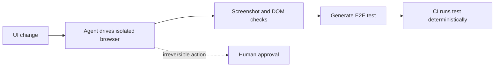

# Computer-Use and Browser Agents

> **Handbook:** Let agents operate UIs without handing them your session  
> **Repo anchors:** [Native agent hooks](./native-agent-hooks.md) · [MCP in 2026](./mcp-remote-servers-and-auth.md) · [Human in the loop](./human-in-the-loop.md)  
> **Version:** 1.0 | **Updated:** 2026-11-06

---

## Purpose

Define when to use agents that drive a browser or desktop (screenshots, clicks, keystrokes) and the isolation, credential, and verification rules that make them safe for engineering work such as UI verification, reproduction of bugs, and E2E test authoring.

## Why

Coding agents increasingly verify their own UI changes: open the page, click through the flow, take a screenshot, compare. Browser MCP servers (Playwright, Chrome DevTools) and built-in browser/computer-use tools make this one prompt away. The risk profile is different from file and shell tools:

| Property | File/shell tools | Computer/browser use |
|----------|------------------|----------------------|
| Input channel | Repo files you control | Arbitrary web content — prime prompt-injection vector |
| Credentials | Environment variables | Whatever session the browser holds (SSO cookies, admin consoles) |
| Determinism | High | Low: timing, layout, A/B tests |
| Audit | Diffs and command logs | Screenshots and action logs |

## How

### 1. Prefer the most structured interface

DOM/accessibility-tree automation (Playwright, CDP) over pixel-level computer use; APIs over either. Use screenshots for verification, not as the primary control channel, when a structured channel exists.

### 2. Isolate the browser

- Dedicated browser profile or container per agent session; **never** the developer's daily profile.
- Test accounts only, with the minimum role; no SSO session to production consoles.
- Local or preview environments by default; production read-only at most, with human approval.

### 3. Allowlist destinations

Restrict navigation to the app under test and its dependencies. Pages outside the allowlist are injection risk without task value.

### 4. Gate irreversible UI actions

Purchases, deletes, sends, permission changes, and form submissions against shared environments require human approval, implemented as a hook or a tool-level confirmation — not a prompt instruction.

### 5. Turn exploration into tests

When a browser agent verifies a flow, the durable output is a Playwright (or equivalent) test committed to the repo, not the transcript. The next run uses the test, not the agent.

## Tradeoffs

| Choice | Gain | Cost |
|--------|------|------|
| Agent verifies UI itself | Catches visual and flow bugs before review | Slower, token-heavy screenshots |
| Isolated profile/container | Session theft and injection contained | Setup per environment; test accounts to maintain |
| Destination allowlist | Shrinks injection surface | Blocks legitimate third-party steps until added |
| Convert to E2E tests | Deterministic regression coverage | Test authoring and maintenance time |

## Anti-patterns

- **Pointing the agent at your logged-in daily browser.** Every cookie becomes the agent's credential.
- **Computer use for things an API does.** Slower, flakier, and harder to audit.
- **Letting the agent read arbitrary web pages while holding write tools.** A hidden instruction on a page becomes an action.
- **Treating a successful agent click-through as a test.** It is a one-off observation; commit a real test.

## Enterprise considerations

- Screenshots can capture PII and secrets; apply retention and redaction to agent artifacts.
- Run browser agents in managed sandboxes with egress controls for any environment holding customer data.
- Separate test identities per agent runtime for attribution in application audit logs.

## Checklist

- [ ] Structured automation preferred over pixel control
- [ ] Dedicated browser profile/container and test accounts only
- [ ] Destination allowlist configured
- [ ] Irreversible UI actions gated by mechanism, not prompt
- [ ] Verified flows committed as E2E tests
- [ ] Screenshot retention policy applied

## Changelog

- 2026-11-06: Initial chapter — isolation, allowlists, irreversible-action gating, exploration-to-test.
