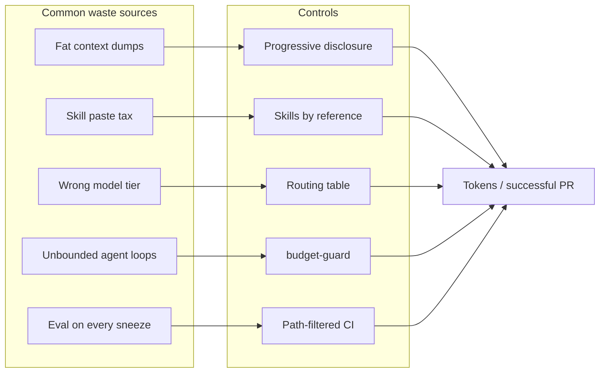
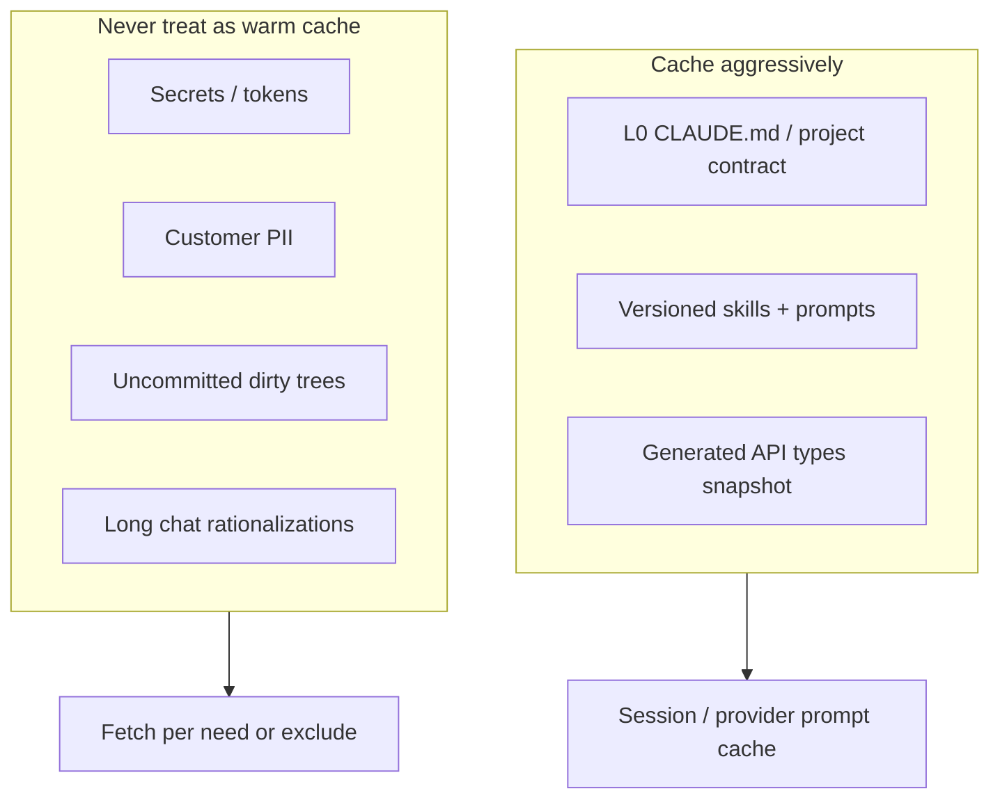

# Containing Token Waste

> **Handbook:** Cut cost and noise without starving quality  
> **Repo anchors:** [`budget-guard.hook.sh`](../04-agent-engineering/hooks/budget-guard.hook.sh) · [`progressive-disclosure.md`](../02-context-engineering/principles/progressive-disclosure.md) · [`eval-gate.yml`](../../.github/workflows/eval-gate.yml) · [`context.skill.md`](../03-skill-engineering/skills/context.skill.md)  
> **Version:** 1.0 | **Updated:** 2026-07-16

---

## Purpose

Give teams a practitioner system for **measuring and reducing wasted tokens** — caching, context curation, skill-vs-paste, model routing, and eval cost — without degrading plan quality or review rigor.

## Why

Token spend is not a badge of thoroughness. Waste shows up as:

- Repeating the same 8KB skill body in every turn.  
- Dumping monorepos into planning prompts.  
- Using the strongest (most expensive) model for import sorting.  
- Re-running full eval suites on unrelated markdown typos.  
- Agent loops that retry after a clear human “no.”

Cost and quality share a cause: **low context fidelity**. Fixing waste usually *improves* outputs (see [`context-fidelity.md`](../02-context-engineering/principles/context-fidelity.md)).



---

## What counts as waste (definition)

**Waste** = tokens that do not change the probability of a correct, mergeable outcome.

| Not waste | Waste |
|-----------|-------|
| Plan generation for a 6-file UI feature | Pasting `node_modules` summaries |
| Independent PR review pass | Third “are you sure?” loop after approval |
| Eval on changed prompt/skill | Full DeepEval run for README typo outside `paths:` |
| Retrieving one sibling component | Prefetching entire design system |
| Caching stable L0 contract | Re-embedding unchanged docs every call |

If you cannot tie a token batch to a decision or verification step, cut it.

---

## How — containment playbook

### 1. Curate context (biggest lever)

Follow [How to give context](./how-to-give-context.md) and [`progressive-disclosure.md`](../02-context-engineering/principles/progressive-disclosure.md):

- Lean [`CLAUDE.md`](../../CLAUDE.md) / template — pointers, not encyclopedias.  
- Strict file allowlists.  
- Place AC at edges ([`lost-in-the-middle.md`](../02-context-engineering/principles/lost-in-the-middle.md)).  
- Cap retrieval loops; allow `insufficient_evidence`.

Apply [`context.skill.md`](../03-skill-engineering/skills/context.skill.md) when assembling packages.

### 2. Prefer skills by reference over paste

| Approach | Tokens over 20 tickets | Drift risk |
|----------|------------------------|------------|
| Paste React a11y essay each time | High | High (edits diverge) |
| Reference [`react.skill.md`](../cookbook/react/skills/react.skill.md) / [`accessibility.skill.md`](../03-skill-engineering/skills/accessibility.skill.md) | Low | Low if versioned |

Harness should load skill bodies **once per activation**, not echo them into every user message. See vocabulary in [Skills vs prompts vs agents](./skills-vs-prompts-vs-agents.md).

### 3. Cache what is stable



Practical rules:

- Enable provider **prompt caching** for static prefixes (system + L0 + skill headers) when the vendor supports it.  
- Invalidate cache on skill/prompt version bump — correct, not wasteful.  
- Do not cache secrets “for speed.”  
- Compress conversation history; offload state per [`structured-state-offloading.md`](../02-context-engineering/principles/structured-state-offloading.md).

### 4. Route models by task class

| Task class | Model tier | Examples |
|------------|------------|----------|
| Mechanical | Small / cheap | Rename, import sort, generate boilerplate test stubs |
| Structured generation | Mid | Implementation plan fill, review draft, story kickoff |
| Hard reasoning | Strong | Authz design, incident RCA, ambiguous architecture |
| Embeddings / retrieval | Embedding models | Doc chunk search — **not** chat models |

Anti-pattern: frontier model for every keystroke. Put the routing table in project contract so agents do not “upgrade themselves.”

### 5. Bound loops with `budget-guard`

[`budget-guard.hook.sh`](../04-agent-engineering/hooks/budget-guard.hook.sh) requires `OAIES_BUDGET_PROFILE` and positive `OAIES_BUDGET_REMAINING`.

```sh
export OAIES_BUDGET_PROFILE=ui-feature-standard
export OAIES_BUDGET_REMAINING=8
sh content/04-agent-engineering/hooks/budget-guard.hook.sh
```

Profiles (example — define for your org):

| Profile | Remaining units (turns or $) | Intended use |
|---------|------------------------------|--------------|
| `typo-r0` | 2 | Single-file fix |
| `ui-feature-standard` | 8 | Plan + code + one review |
| `incident-rca` | 15 | Deep debug with retrieval |
| `eval-batch` | Job-level cap | CI only |

When remaining hits 0, stop. Do not spawn a new session to evade the guard — that is fraud against your own budget.

Also use [`pre-delegation.hook.sh`](../04-agent-engineering/hooks/pre-delegation.hook.sh) so subagent trees cannot fan out forever.

### 6. Contain eval cost

[`.github/workflows/eval-gate.yml`](../../.github/workflows/eval-gate.yml) already path-filters to prompts, agents, skills, and `eval/**`. Keep it that way.

| Practice | Effect |
|----------|--------|
| Path filters | Skip eval on unrelated UI-only PRs |
| Golden sets sized to risk | Fewer cases, higher signal |
| Cache embeddings / pinned fixtures | Stable, cheaper reruns |
| Fail closed without API key | No fake green ([workflow requires `OPENAI_API_KEY`](../../.github/workflows/eval-gate.yml)) |
| Separate nightly wide suites | Don’t block every PR on the ocean |

Use [`evaluation.skill.md`](../03-skill-engineering/skills/evaluation.skill.md) for how to design cases — not for running 500 near-duplicates.

### 7. Measure waste (or you are guessing)

Track weekly:

| Metric | How to compute | Target direction |
|--------|----------------|------------------|
| Tokens / merged PR | Provider export ÷ merged PRs with AI assist | Down without defect uptick |
| Context bytes at plan start | Size of package attached to planner | Down; allowlist compliance up |
| % PRs with plan amendment | Plan extra-files / total R1 PRs | Investigate if high (bad plans or bad discipline) |
| Eval $ / prompt-changing PR | CI cost attribution | Stable; spike means suite bloat |
| Review nits / Critical | From review artifacts | Nits down, Critical catch rate stable |
| Budget exhaustions | Hook exit 70 count | Non-zero is OK; evasion is not |

Publish a simple dashboard; shame vanity “we used 2B tokens this month” narratives.

---

## Worked example — portal filter feature token budget

**Scenario:** R1 portal status filter (same running example).

### Budget envelope

| Stage | Model tier | Context package | Budget units | Notes |
|-------|------------|-----------------|--------------|-------|
| Context assembly | none | L1 brief + 4 files | 0 | Human/harness |
| Plan | Mid | Brief + excerpts + constraints | 2 | [`implementation-plan.prompt.md`](../08-ai-sdlc/prompts/implementation-plan.prompt.md) |
| Code | Mid/Strong | Plan + allowlisted files + `react.skill` ref | 3 | No monorepo |
| Unit test fix loop | Small | Failing test + component | 2 | Cheap model |
| PR review | Mid | Diff + AC + plan | 2 | Independent |
| Eval | — | N/A | 0 | No prompt/skill change → gate skipped |

**Total:** 9 units planned; profile `ui-feature-standard` capped at 8 → force compact review or accept one human-only review pass. That tension is intentional.

### Waste traps on this ticket

| Trap | Token impact | Containment |
|------|--------------|-------------|
| Attach entire `content/cookbook/` | Huge | Only [`react.skill.md`](../cookbook/react/skills/react.skill.md) |
| Paste prior 40-message chat into review | High noise | Fresh review package |
| Re-plan after every nit | Doubles plan cost | Amend plan only on blast-radius change |
| Run eval-gate locally “for luck” | $$ | Trust path filters; run eval when prompts change |

### Before / after (illustrative measurement)

| Metric | Before curation | After |
|--------|-----------------|-------|
| Plan prompt input size | ~120KB (app tree) | ~18KB allowlist |
| Coding turns | 14 (exploration thrash) | 5 |
| Review comments that were nits | 22 | 4 |
| Merged with escaped High defect | 1 (invalid status) | 0 (test in plan) |

---

## Tradeoffs

| Choice | Gain | Cost |
|--------|------|------|
| Aggressive allowlists | Lower spend, higher fidelity | Upfront curation time |
| Small models for mechanical work | Cost down | Occasional weaker refactors — keep humans for R2+ |
| Tight budgets | Stops runaway loops | May need explicit budget raise for hard bugs |
| Tiny eval suites | Cheap CI | Miss rare regressions — compensate with nightly |
| Prompt caching | Large savings on stable prefixes | Invalidation complexity |

Do not “save” tokens by skipping plan or review on R1+. That trades API cost for incident cost.

---

## Anti-patterns

| Anti-pattern | Why | Instead |
|--------------|-----|---------|
| Monorepo paste | Classic waste | Progressive disclosure |
| Skill paste tax | Duplicates + drift | Reference + load once |
| Frontier-for-everything | Burns cash | Routing table |
| Session hopping to reset budget | Hides spend | Raise profile with owner approval |
| Eval without path filters | CI bankruptcy | Keep `eval-gate.yml` filters tight |
| Deleting review to save tokens | Ships defects | Use severity caps, not zero review |
| Caching secrets | Security incident | Never |

---

## Enterprise considerations

- **FinOps:** Allocate token budgets per team/profile; chargeback beats surprise invoices.  
- **Vendor lock / retention:** Cached prompts and logs may leave the boundary — align with DLP.  
- **Procurement:** Prompt caching and batch APIs are contract line items; enable them deliberately.  
- **Compliance:** Reducing PII in context is both cheaper and safer.  
- **Capacity:** Unbounded agents can starve interactive human sessions on shared keys — rate limit per profile.

---

## Repo anchors

| Need | Path |
|------|------|
| Context fidelity / disclosure | [`content/02-context-engineering/README.md`](../02-context-engineering/README.md), [`progressive-disclosure.md`](../02-context-engineering/principles/progressive-disclosure.md), [`fidelity-threshold.md`](../02-context-engineering/principles/fidelity-threshold.md) |
| Context skill / pattern | [`context.skill.md`](../03-skill-engineering/skills/context.skill.md), [`context-pattern`](../patterns/context-pattern/README.md) |
| Budget / delegation hooks | [`budget-guard.hook.sh`](../04-agent-engineering/hooks/budget-guard.hook.sh), [`pre-delegation.hook.sh`](../04-agent-engineering/hooks/pre-delegation.hook.sh) |
| Hooks contract | [`hooks/README.md`](../04-agent-engineering/hooks/README.md) |
| Evaluation skill | [`evaluation.skill.md`](../03-skill-engineering/skills/evaluation.skill.md) |
| Eval CI | [`.github/workflows/eval-gate.yml`](../../.github/workflows/eval-gate.yml) |
| Planning / coding prompts | [`implementation-plan.prompt.md`](../08-ai-sdlc/prompts/implementation-plan.prompt.md), [`coding.prompt.md`](../08-ai-sdlc/prompts/coding.prompt.md) |
| React cookbook (UI) | [`content/cookbook/react/README.md`](../cookbook/react/README.md) |
| Behavioral contract | [`CLAUDE.md`](../../CLAUDE.md) |

---

## Checklist

- [ ] Context packages use allowlists; no secrets/PII/monorepo dumps  
- [ ] Skills and prompts referenced by path; not pasted each turn  
- [ ] Stable L0/skills eligible for provider prompt cache; secrets excluded  
- [ ] Model routing table exists and is followed for mechanical vs hard tasks  
- [ ] `budget-guard` profiles defined; exhaustion stops work  
- [ ] Subagent depth budgeted via `pre-delegation`  
- [ ] Eval gate path filters preserved; suites sized to risk  
- [ ] Tokens / merged PR and eval $ tracked weekly  
- [ ] Cost cuts never remove plan/review gates for R1+  
- [ ] Budget evasion (new sessions to reset) treated as process violation

## Changelog

- 2026-07-16: Initial practitioner handbook chapter for token waste containment.
