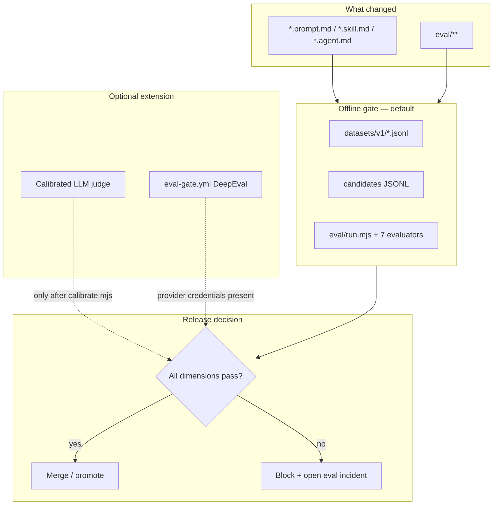
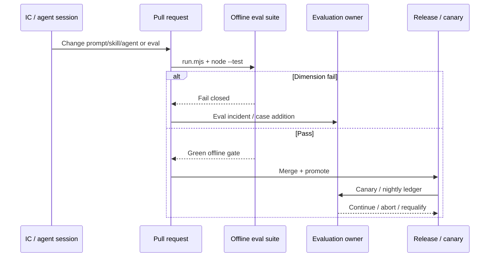

# Evals as Quality Gates

> **Handbook:** Block merges on model regressions, not vibes  
> **Repo anchors:** [`eval/`](../../eval/README.md) · [`.github/workflows/eval-gate.yml`](../../.github/workflows/eval-gate.yml) · [`content/07-llmops/evaluation/`](../07-llmops/evaluation/continuous-eval.md)  
> **Version:** 1.0 | **Updated:** 2026-07-16

---

## Purpose

Turn evaluation from a slide-deck metric into a **release control**: versioned cases, deterministic component checks, calibrated judges only when needed, and CI that fails closed when prompts, skills, agents, or candidate behavior regress.

## Why

Unit tests catch type errors. Evals catch **behavioral** failures: wrong retrieval, unauthorized tools, policy misses, fluent nonsense. Without a gate:

| Failure mode | What ships |
|--------------|------------|
| Prompt tweak “improves” demos | Policy-sensitive false accepts |
| Averaged relevance score | Retrieval leak offset by pretty prose |
| Paid-key-only CI | Green PRs when secrets are missing |
| Mutable golden set | Yesterday’s release evidence evaporates |

This repo’s contract is explicit in [`eval/README.md`](../../eval/README.md): separate dimensions, fail closed on missing intermediates, never require paid keys for the offline suite, and never mutate a released dataset version.

## Mental model



A single “accuracy” number is not a gate. Seven independent fails are.

## How

### 1. Own the dimensions, not a composite score

The runner in [`eval/run.mjs`](../../eval/run.mjs) evaluates each candidate across:

| Dimension | Evaluator | Gate intent |
|-----------|-----------|-------------|
| Retrieval | [`eval/evaluators/retrieval.mjs`](../../eval/evaluators/retrieval.mjs) | Required IDs in; forbidden IDs out |
| Routing | [`eval/evaluators/routing.mjs`](../../eval/evaluators/routing.mjs) | Selected route ∈ allowlist |
| Tools | [`eval/evaluators/tools.mjs`](../../eval/evaluators/tools.mjs) | Required calls present; no shadow tools |
| Memory | [`eval/evaluators/memory.mjs`](../../eval/evaluators/memory.mjs) | Write policy; no forbidden values |
| Policy | [`eval/evaluators/policy.mjs`](../../eval/evaluators/policy.mjs) | Allow/deny equals expected |
| Trace | [`eval/evaluators/trace.mjs`](../../eval/evaluators/trace.mjs) | Spans, IDs, auth-before-retrieval order |
| Final output | [`eval/evaluators/final-output.mjs`](../../eval/evaluators/final-output.mjs) | Schema + required/forbidden content |

Do **not** average these. A policy fail with a beautiful answer is still a fail.

### 2. Freeze datasets by version

Cases live under [`eval/datasets/v1/`](../../eval/datasets/v1/normal.jsonl):

| Partition | File | Use |
|-----------|------|-----|
| Normal | `normal.jsonl` | Happy-path contract |
| Edge | `edge.jsonl` | Boundary / sparse context |
| Adversarial | `adversarial.jsonl` | Injection / abuse attempts |
| Policy-sensitive | `policy-sensitive.jsonl` | Authorization and refusal |

Correct a bad case by publishing `datasets/v2`. Do not silently reinterpret `v1`. See [`content/07-llmops/evaluation/golden-set-management.md`](../07-llmops/evaluation/golden-set-management.md).

### 3. Run the offline suite on every relevant PR

Local / CI without network:

```bash
node --test eval/test/*.test.mjs
node eval/run.mjs \
  --dataset eval/datasets/v1 \
  --candidates eval/fixtures/candidates.pass.jsonl
```

Negative control (must fail):

```bash
node eval/run.mjs \
  --dataset eval/datasets/v1 \
  --candidates eval/fixtures/candidates.fail.jsonl
```

Wire this as the **default** merge gate. The GitHub workflow [`.github/workflows/eval-gate.yml`](../../.github/workflows/eval-gate.yml) triggers on `content/**/*.prompt.md`, `*.agent.md`, `*.skill.md`, and `eval/**`. Treat DeepEval there as an **extension** that requires credentials — never as the only gate. If `OPENAI_API_KEY` is absent, that job correctly fails closed rather than inventing a pass.

### 4. Add LLM-as-judge only after calibration

When lexical checks cannot express a quality property:

1. Freeze provider, model, prompt, decoding, rubric, schema ([`llm-as-judge.md`](../07-llmops/evaluation/llm-as-judge.md)).
2. Double-label a stratified sample; adjudicate disagreements.
3. Split by case ID into calibration vs holdout **before** threshold selection.
4. Run [`eval/calibrate.mjs`](../../eval/calibrate.mjs); lock threshold; measure holdout once.
5. Store digest of dataset, split, labels, judge config, and reports together.

Uncalibrated judges do not block merges.

### 5. Continuously evaluate after merge

PR gates catch regressions in the repo. Production still drifts. Follow [`continuous-eval.md`](../07-llmops/evaluation/continuous-eval.md):

| Trigger | Dataset | Failure action |
|---------|---------|----------------|
| Pull request | Deterministic + compact sentinel | Block merge |
| Staging promotion | Full regression + adversarial | Block promotion |
| Canary | Risk-enriched live sample | Auto-abort to prior release |
| Nightly | Full qualified suite | Open eval incident by severity |
| Provider notice | Contract + safety requalification | Freeze affected route |

### 6. Candidate adapter contract

The offline runner does not call your product. Your harness must emit candidate JSONL that mirrors each case `id` and supplies `actual` for every dimension. Missing IDs and missing dimensions **fail closed** — that is deliberate. Teams that “skip” a dimension to green CI are breaking the gate, not optimizing it.

Practical adapter rules:

1. Capture intermediates at the control boundary (retrieved IDs, tool calls, policy decision, span order), not only the final string.
2. Map production trace fields → evaluator expectations once; version that mapping with the dataset.
3. Keep [`eval/fixtures/candidates.pass.jsonl`](../../eval/fixtures/candidates.pass.jsonl) and [`candidates.fail.jsonl`](../../eval/fixtures/candidates.fail.jsonl) as smoke fixtures in CI so the runner and evaluators themselves cannot regress silently.
4. Prefer deterministic offline green before spending on DeepEval / hosted judges in [`.github/workflows/eval-gate.yml`](../../.github/workflows/eval-gate.yml).

Framework choice (DeepEval vs others) is secondary to this contract. See [`framework-selection.md`](../07-llmops/evaluation/framework-selection.md) only after dimensions and datasets are owned.

### Gate placement in the delivery loop



## Worked example — policy regression caught before merge

**Situation.** A team softens a refusal prompt for “friendliness.” Offline final-output looks fine on demos. Policy-sensitive cases should still deny unauthorized account actions.

**Steps.**

1. Export candidate traces into JSONL shaped as `{ "id": "...", "actual": { "<dimension>": ... } }` (see [`eval/README.md`](../../eval/README.md)).
2. Run against `eval/datasets/v1` with the new candidate file.
3. Observe `policy` and/or `tools` fail on `policy-sensitive` IDs while `finalOutput` may still pass lexical checks.
4. Block the PR. Do **not** ship and “monitor.”
5. Fix the prompt/skill; re-run; if the failure is novel, add a case via a new dataset version after adjudication ([`golden-set-management.md`](../07-llmops/evaluation/golden-set-management.md)).
6. Evaluation owner signs the run ledger fields from [`continuous-eval.md`](../07-llmops/evaluation/continuous-eval.md): dataset digest, decision rule version, severe failure count.

**Exit.** Merge only when every dimension for every required case passes, and the evaluation owner accepts residual risk for any waived exploratory slice (never for severe policy fails).

## Tradeoffs

| Choice | You gain | You give up |
|--------|----------|-------------|
| Seven independent gates | Diagnosable failures | Adapter cost to capture intermediates |
| Lexical final-output checks | Cheap, reproducible CI | No semantic quality claim |
| Immutable dataset versions | Replayable release evidence | Slower “quick fix” of labels |
| Offline-first CI | No secret dependency for green builds | Must still fund continuous / judge evals |
| Calibrated judge on holdout | Semantic coverage | Labeling cost; requalify on model change |
| Averaged score (rejected here) | Pretty dashboard | Hidden authorization disasters |

## Anti-patterns

| Anti-pattern | Why it fails |
|--------------|--------------|
| One relevance score as the merge gate | Offsets policy/tool failures with fluency |
| Mutating `datasets/v1` in place | Invalidates prior release evidence |
| Tuning thresholds on the holdout | Inflates claimed performance |
| Making `OPENAI_API_KEY` mandatory for PR tests | CI lies or blocks for the wrong reason |
| “We’ll add evals after launch” | No baseline; incidents become the golden set |
| Shipping uncalibrated LLM judges | Position/verbosity/self-preference bias becomes policy |
| Averaging across risk tiers | Concentrated harm in one tenant/locale disappears |
| Treating DeepEval green as sufficient without offline dimensions | Provider path ≠ control order proof |

## Enterprise considerations

- **Classification.** Test prompts, retrieved docs, tool state, and judge rationales inherit source data class. Do not send policy-sensitive payloads to a hosted judge without an approved DPA boundary ([`eval/README.md`](../../eval/README.md) enterprise section).
- **Provenance.** Retain SHA-256 digests for datasets, candidates, judge configs, and reports with the release.
- **Ownership.** Name an **evaluation owner** (metric definitions, golden-set governance, gate configuration, calibration). They do **not** alone accept residual business harm — that stays with the product/use-case owner ([`roles-and-accountability.md`](../10-ai-org-playbook/governance/roles-and-accountability.md)).
- **Slices.** Track results by risk tier, language, tenant class, and policy domain.
- **Fallback.** Keep a deterministic gate when the judge provider is down; do not auto-pass.
- **Frameworks.** Continuous evaluation evidence supports NIST AI RMF MEASURE/MANAGE and ISO/IEC 42001 monitoring clauses — it does not transfer fitness decisions to a vendor framework ([`continuous-eval.md`](../07-llmops/evaluation/continuous-eval.md)).

## Checklist

- [ ] PR path runs `node --test eval/test/*.test.mjs` and `eval/run.mjs` offline
- [ ] Normal, edge, adversarial, and policy-sensitive partitions are represented
- [ ] Retrieval, routing, tools, memory, policy, trace, and final output are separate fails
- [ ] Missing candidate or missing dimension fails closed
- [ ] Dataset changes create a new version with digest retained
- [ ] Judge (if any) is calibrated; holdout measured once; config frozen
- [ ] Policy-sensitive false-accept limit is predeclared and met
- [ ] [`.github/workflows/eval-gate.yml`](../../.github/workflows/eval-gate.yml) does not invent a pass without credentials
- [ ] Production evaluation owner and canary abort runbook are named
- [ ] Confirmed production failures become regression cases before incident close

## Repo map

| Concern | Path |
|---------|------|
| Offline foundation | [`eval/README.md`](../../eval/README.md) |
| Runner | [`eval/run.mjs`](../../eval/run.mjs) |
| Calibration | [`eval/calibrate.mjs`](../../eval/calibrate.mjs) |
| CI workflow | [`.github/workflows/eval-gate.yml`](../../.github/workflows/eval-gate.yml) |
| Continuous eval | [`content/07-llmops/evaluation/continuous-eval.md`](../07-llmops/evaluation/continuous-eval.md) |
| Golden sets | [`content/07-llmops/evaluation/golden-set-management.md`](../07-llmops/evaluation/golden-set-management.md) |
| LLM-as-judge | [`content/07-llmops/evaluation/llm-as-judge.md`](../07-llmops/evaluation/llm-as-judge.md) |
| Framework selection | [`content/07-llmops/evaluation/framework-selection.md`](../07-llmops/evaluation/framework-selection.md) |
| Definition of Done | [`content/08-ai-sdlc/quality-standards/definition-of-done.md`](../08-ai-sdlc/quality-standards/definition-of-done.md) |

## Changelog

- 2026-07-16: Initial handbook chapter — evals as merge/release gates grounded in `eval/` and LLMOps evaluation profiles.
