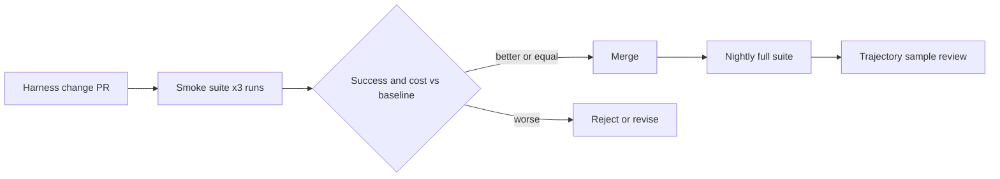

# Evaluating Coding Agents

> **Handbook:** Decide which agent setup to trust with evidence, not anecdotes  
> **Repo anchors:** [Evals as quality gates](./evals-as-quality-gates.md) · [`eval/`](../../eval/README.md)  
> **Version:** 1.0 | **Updated:** 2026-11-06

---

## Purpose

Measure coding-agent configurations — model, runtime, instructions, skills, subagents, hooks — on your own repositories with task-level outcomes and trajectory review, so changes to the harness are accepted or rejected on evidence.

## Why

Public leaderboards measure a model on someone else's tasks. Your outcome depends on the whole harness: `AGENTS.md`, skills, tool permissions, test speed, and repo structure. Teams that do not measure end up changing three variables at once after a bad week and learning nothing. The unit of evaluation is the **task**, scored on whether the merged result is correct and what it cost.

## How

### 1. Build a task suite from your history

Take 30–100 closed issues with merged fixes. For each, record: the issue text (as the agent would see it), the base commit, and the hidden acceptance check (the tests added in the real fix, or a reviewer-written check). Exclude tasks whose fix is in the agent's training data verbatim if your repo is public.

### 2. Score outcomes, not vibes

| Metric | Definition | Why it matters |
|--------|------------|----------------|
| Task success | Hidden acceptance check passes, no existing test regresses | Primary quality signal |
| Review-adjusted success | Success **and** a reviewer would merge without major changes | Catches passing-but-wrong code |
| Contract adherence | No edits outside allowed paths; no guard denials bypassed | Safety under autonomy |
| Cost per success | Tokens/$ divided by successful tasks | Real efficiency, not per-call price |
| Wall clock per success | Time to a mergeable result | Developer waiting time |
| Intervention rate | Human messages needed per task | Autonomy level actually achieved |

### 3. Review trajectories, not just diffs

Sample 10–20% of runs and read the transcript: wrong files explored, repeated failing commands, ignored skills, tool misuse. Trajectory review explains *why* a configuration wins and finds harness bugs (a skill that never triggers, a hook that blocks a legitimate command).

### 4. Change one variable at a time

Run the suite for the baseline, then for exactly one change (new model, new skill, stricter tool list). Run each configuration at least 3 times — agent runs are stochastic. Accept the change only if success improves or cost drops with success flat, beyond run-to-run variance.

### 5. Gate harness changes in CI

Changes to `AGENTS.md`, `.agents/skills/`, agent definitions, or hooks trigger a smaller smoke suite (10–20 tasks) before merge; the full suite runs nightly or weekly.

## Tradeoffs

| Choice | Gain | Cost |
|--------|------|------|
| Repo-specific suite | Measures what you actually ship | Curation time; must be refreshed as the codebase changes |
| Multiple runs per config | Separates signal from noise | 3× compute |
| Trajectory review | Explains outcomes, finds harness bugs | Human time; sample, do not read everything |
| Hidden acceptance checks | Prevents teaching to the test | Requires writing checks the agent cannot see |

## Anti-patterns

- **Choosing a model from a leaderboard alone.** Your harness and repo dominate the outcome.
- **One run per configuration.** Variance between runs routinely exceeds the difference between configurations.
- **Counting "tests pass" as success.** Agents delete or weaken tests; check that existing tests are unchanged and hidden checks pass.
- **Changing model, prompt, and tools together.** No attribution, no learning.
- **Evaluating on tasks the agent can see the answer to** (e.g., fix already on a public branch).

## Enterprise considerations

- Keep the suite and transcripts inside your data boundary; transcripts contain source code.
- Report success and cost per runtime to inform procurement and seat allocation.
- Re-baseline after every major model release; vendors change default behavior silently.

## Checklist

- [ ] ≥ 30 historical tasks with base commits and hidden checks
- [ ] Outcome, adherence, cost, and intervention metrics recorded
- [ ] ≥ 3 runs per configuration; one variable changed at a time
- [ ] Trajectory sample reviewed each cycle
- [ ] Harness changes gated by a smoke suite in CI

## Changelog

- 2026-11-06: Initial chapter — task suites, outcome metrics, trajectory review, harness-change gating.
