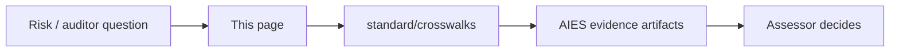

# External Standards Map

> **Handbook:** Practitioner front door to assurance frameworks  
> **Canonical crosswalks:** [`content/standard/crosswalks/`](../standard/crosswalks/README.md)  
> **Version:** 1.2 | **Updated:** 2026-11-06

---

## Purpose

Point engineering teams at the **right external standard** for the risk they are managing — without claiming certification or inventing a parallel dialect. AIES already holds machine-readable crosswalks; this page is the daily navigation layer.

## Why

Teams either ignore external frameworks (“we have prompts”) or paste ISO/NIST logos on decks with no evidence. The correct posture: **AIES artifacts as candidate evidence**, assessors decide sufficiency.

## Quick map (start here)

| If you need… | Open this | Then this AIES surface |
|--------------|-----------|-------------------------|
| LLM app threats (injection, agency, DoS) | [OWASP LLM 2026 + Agentic + MCP crosswalk](../standard/crosswalks/owasp-ai-security.md) | Security skill · [Agent security controls](../09-enterprise-ai/security/agent-security-controls.md) · MCP handbook |
| Org AI risk program | [NIST AI RMF crosswalk](../standard/crosswalks/nist-ai-risk.md) | Portal / SoA · Migration bible · Evals gates |
| AI management system (cert path) | [ISO 42001 / 23894 / 42005](../standard/crosswalks/iso-ai-management-risk-impact.md) | Enterprise pattern · Org playbook · Exceptions |
| Supply chain / SBOM / provenance | [SSDF / SLSA / OpenSSF](../standard/crosswalks/secure-software-supply-chain.md) | DevOps skill · Release pattern · Hooks |
| MCP auth, A2A, GenAI telemetry | [Protocols & observability](../standard/crosswalks/protocols-and-observability.md) | MCP when-and-how · LLMOps tracing |
| Legal high-risk classification (EU AI Act) | Counsel + [EU AI Act engineering map](../standard/crosswalks/eu-ai-act.md) · [Responsible AI](../09-enterprise-ai/governance/responsible-ai.md) | Do **not** treat AIES as conformity |
| Model churn, deprecations, API breaking changes | [Model lifecycle](../07-llmops/model-lifecycle.md) | Model Record · eval gates · tier routing |

## How to use this map

1. Start from a concrete risk or auditor question, not from a framework.
2. Find the row in the quick map; open the crosswalk it names.
3. In the crosswalk, list the AIES artifacts (by ID and version) that provide evidence for that row, and its relationship label (`evidence-supports`, `partial`, `no-mapping`).
4. Record gaps in the exception register with an owner and an expiry date.
5. Hand the evidence list to the assessor or counsel; they decide sufficiency.

## Evolving AI footprints (2025–2026) — how AIES absorbs them

| Footprint | What changed | Where AIES covers it |
|-----------|--------------|----------------------|
| **Agentic OWASP Top 10** | Goal hijack, tool misuse, memory poison, inter-agent trust | OWASP agentic table in crosswalk · multi-agent threat-controls · agent definitions |
| **MCP as default tool bus** | AuthZ, allowlists, confused deputy; spec `2026-07-28` (stateless HTTP, CIMD) | [MCP: remote servers & OAuth](./mcp-remote-servers-and-auth.md) · Tool Contract · empty MCP config by default in kit |
| **Open agent standards (AAIF: `AGENTS.md`, Agent Skills, MCP)** | Instructions, skills, and tools portable across runtimes | [Open standards & file matrix](./open-agent-standards.md) · kit writes `AGENTS.md` + `.agents/skills/*/SKILL.md` + native subagents |
| **Native agent hooks** | Runtimes can deny tool calls before execution | [Native agent hooks](./native-agent-hooks.md) · kit `hooks/aies-guard.mjs` wired per runtime |
| **Parallel & cloud agents** | Many concurrent agents, branch-per-task, cloud execution | [Parallel agents & worktrees](./parallel-agents-and-worktrees.md) · [Cloud & background agents](./cloud-and-background-agents.md) |
| **Structured outputs / schemas** | Probabilistic text inside deterministic contracts | Prompt templates · Tool contracts · Improper output handling (LLM10:2026) |
| **Eval-as-gate (not dashboards)** | Release blocking goldens / judges | `evals-as-quality-gates` · EVAL family controls · continuous-eval |
| **Prompt injection as data, not auth** | Untrusted retrieval cannot grant tools | `09-enterprise-ai/security/prompt-injection-defense` · Context pattern trust labels |
| **Cost / unbounded consumption** | Token & tool budgets | Containing token waste · LLM06:2026 mapping · agent termination criteria |
| **OWASP LLM Top 10 2026 renumbering** | IDs moved (e.g., LLM03 is now Excessive Agency; System Prompt Leakage became Hidden Context Exposure) | OWASP crosswalk lists 2026 and 2025 IDs side by side |
| **Agent self-configuration and CI-agent attacks** | CVE-2025-53773, MCPoison, Clinejection, malicious skills | [Agent security controls](../09-enterprise-ai/security/agent-security-controls.md) AC-01–AC-06 · kit guard write policy |
| **EU AI Act Digital Omnibus (Reg. 2026/1744)** | High-risk dates moved to 2027-12-02 / 2028-08-02; Art. 50 applies since 2026-08-02 | [EU AI Act control map](../09-enterprise-ai/governance/eu-ai-act.md) |
| **Model turnover every 6–12 months** | Breaking parameter changes (prefill, sampling, forced tool choice) | [Model lifecycle](../07-llmops/model-lifecycle.md) |

## What is still thin (honest gaps)

| Gap | Mitigation today | Do not |
|-----|------------------|--------|
| Full cookbook parity beyond kit stacks | React/Next/Node/Python/Java/.NET/RN are kit-ready; domain cookbooks vary — see cookbook README status | Pretend every cookbook is production-depth |
| EU AI Act conformity | [Informative engineering map](../standard/crosswalks/eu-ai-act.md) — evidence only | Claim CE / conformity via AIES |
| Live inter-org pilots (roadmap S1) | Publish evidence notes when earned | Market as “the industry standard” prematurely |

## Ease-of-use path (practitioners)

1. `/start` → kit install → `enhance` → `enhance-repo.prompt.md`  
2. Pick a [pattern](../patterns/README.md) (Planner / Context / Reviewer first)  
3. Run one [lifecycle workflow](/workflows)  
4. Only then open portal/crosswalks for assurance  

## Tradeoffs

| Choice | Benefit | Cost |
|---|---|---|
| Evidence-oriented mapping (assessor decides) | Honest; survives audit | Teams cannot self-declare "compliant" from AIES alone |
| One crosswalk per framework family | Each stays accurate to its source | A question spanning frameworks needs two or three pages |
| Tracking framework editions explicitly | Evidence stays valid when IDs move | Re-keying work at each new edition |

## Anti-patterns

- Citing “NIST compliant” because you read a blog  
- Enabling write MCP tools to “move faster” before OWASP LLM01/ASI02 review  
- Forking private prompt dialects instead of enhancing the kit against repo conventions  
- Citing OWASP IDs without the edition year — `LLM06` meant Excessive Agency in 2025 and Unbounded Consumption in 2026

## Enterprise considerations

- Keep one evidence index across frameworks, keyed by AIES artifact ID; each crosswalk row points into it. Duplicate evidence per framework drifts.
- Assign a framework owner who watches for new editions (OWASP, NIST, ISO, EU implementing acts) and triggers re-keying.
- Freeze framework editions per assessment cycle and record them in the Statement of Applicability.

## Checklist

- [ ] Risk question mapped to one crosswalk row  
- [ ] Evidence artifact IDs listed (not just doc titles)  
- [ ] MCP still empty or allowlisted with data class  
- [ ] Eval gate exists for user-visible model behavior  
- [ ] Human gate named for irreversible effects  
- [ ] Framework edition (e.g., OWASP LLM 2026) stated in every cited ID  

## Related

- Normative portal: `/portal`  
- Migration bible: [ai-migration-bible-path](./ai-migration-bible-path.md)  
- Crosswalk index: [standard/crosswalks](../standard/crosswalks/README.md)

## Changelog

- **1.2 (2026-11-06):** How-to-use steps; OWASP 2026, agent security controls, EU Omnibus, model lifecycle rows; Tradeoffs and Enterprise considerations.
- **2026-11-06:** Added AAIF open standards, native hooks, and parallel/cloud agent footprints; MCP row points at the remote-servers chapter and spec `2026-07-28`.
- **2026-07-29:** Initial practitioner map — OWASP/NIST/ISO/SLSA/MCP footprints + honest gaps.
