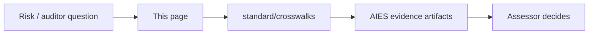

# External Standards Map

> **Handbook:** Practitioner front door to assurance frameworks  
> **Canonical crosswalks:** [`content/standard/crosswalks/`](../standard/crosswalks/README.md)  
> **Version:** 1.0 | **Updated:** 2026-07-29

---

## Purpose

Point engineering teams at the **right external standard** for the risk they are managing — without claiming certification or inventing a parallel dialect. AIES already holds machine-readable crosswalks; this page is the daily navigation layer.

## Why

Teams either ignore external frameworks (“we have prompts”) or paste ISO/NIST logos on decks with no evidence. The correct posture: **AIES artifacts as candidate evidence**, assessors decide sufficiency.

## Quick map (start here)

| If you need… | Open this | Then this AIES surface |
|--------------|-----------|-------------------------|
| LLM app threats (injection, agency, DoS) | [OWASP LLM + Agentic crosswalk](../standard/crosswalks/owasp-ai-security.md) | Security skill · Context pattern · MCP handbook |
| Org AI risk program | [NIST AI RMF crosswalk](../standard/crosswalks/nist-ai-risk.md) | Portal / SoA · Migration bible · Evals gates |
| AI management system (cert path) | [ISO 42001 / 23894 / 42005](../standard/crosswalks/iso-ai-management-risk-impact.md) | Enterprise pattern · Org playbook · Exceptions |
| Supply chain / SBOM / provenance | [SSDF / SLSA / OpenSSF](../standard/crosswalks/secure-software-supply-chain.md) | DevOps skill · Release pattern · Hooks |
| MCP auth, A2A, GenAI telemetry | [Protocols & observability](../standard/crosswalks/protocols-and-observability.md) | MCP when-and-how · LLMOps tracing |
| Legal high-risk classification (EU AI Act) | Counsel + [EU AI Act engineering map](../standard/crosswalks/eu-ai-act.md) · [Responsible AI](../09-enterprise-ai/governance/responsible-ai.md) | Do **not** treat AIES as conformity |

## Evolving AI footprints (2025–2026) — how AIES absorbs them

| Footprint | What changed | Where AIES covers it |
|-----------|--------------|----------------------|
| **Agentic OWASP Top 10** | Goal hijack, tool misuse, memory poison, inter-agent trust | OWASP agentic table in crosswalk · multi-agent threat-controls · agent definitions |
| **MCP as default tool bus** | AuthZ, allowlists, confused deputy | `handbook/mcp-when-and-how` · Tool Contract · empty `mcpServers` by default in kit |
| **IDE agent skills (`SKILL.md`, `AGENTS.md`)** | Project skills are first-class | Kit writes Cursor `SKILL.md` + root `CLAUDE.md` / `AGENTS.md` / Copilot instructions |
| **Structured outputs / schemas** | Probabilistic text inside deterministic contracts | Prompt templates · Tool contracts · Improper output handling (LLM05) |
| **Eval-as-gate (not dashboards)** | Release blocking goldens / judges | `evals-as-quality-gates` · EVAL family controls · continuous-eval |
| **Prompt injection as data, not auth** | Untrusted retrieval cannot grant tools | `09-enterprise-ai/security/prompt-injection-defense` · Context pattern trust labels |
| **Cost / unbounded consumption** | Token & tool budgets | Containing token waste · LLM10 mapping · agent termination criteria |

## What is still thin (honest gaps)

| Gap | Mitigation today | Do not |
|-----|------------------|--------|
| Full cookbook parity beyond kit stacks | React/Next/Node/Python/Java/.NET/RN are kit-ready; domain cookbooks vary — see cookbook README status | Pretend every cookbook is production-depth |
| EU AI Act conformity | [Informative engineering map](../standard/crosswalks/eu-ai-act.md) — evidence only | Claim CE / conformity via AIES |
| Live inter-org pilots (roadmap S1) | Publish evidence notes when earned | Market as “the industry standard” prematurely |

## Ease-of-use path (practitioners)

1. `/start` → kit install → `enhance` → `enhance-repo.prompt.md`  
2. Pick a [pattern](../patterns/README.md) (Planner / Context / Reviewer first)  
3. Run one [lifecycle workflow](/workflows)  
4. Only then open portal/crosswalks for assurance  

## Anti-patterns

- Citing “NIST compliant” because you read a blog  
- Enabling write MCP tools to “move faster” before OWASP LLM01/ASI02 review  
- Forking private prompt dialects instead of enhancing the kit against repo conventions  

## Checklist

- [ ] Risk question mapped to one crosswalk row  
- [ ] Evidence artifact IDs listed (not just doc titles)  
- [ ] MCP still empty or allowlisted with data class  
- [ ] Eval gate exists for user-visible model behavior  
- [ ] Human gate named for irreversible effects  

## Related

- Normative portal: `/portal`  
- Migration bible: [ai-migration-bible-path](./ai-migration-bible-path.md)  
- Crosswalk index: [standard/crosswalks](../standard/crosswalks/README.md)

## Changelog

- **2026-07-29:** Initial practitioner map — OWASP/NIST/ISO/SLSA/MCP footprints + honest gaps.
