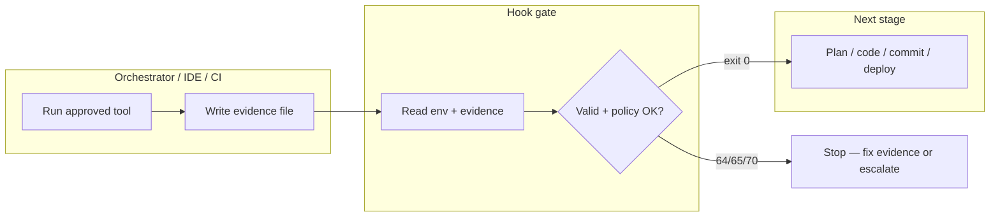
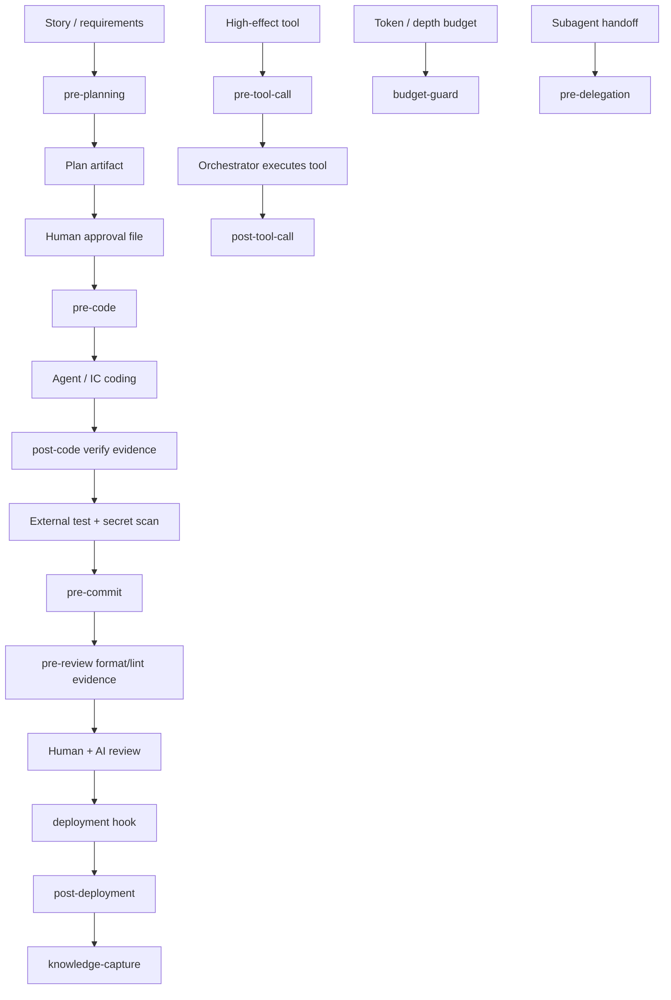

# Hooks in Practice

> **Handbook:** Fail closed before bad artifacts leave the laptop  
> **Repo anchors:** [`content/04-agent-engineering/hooks/`](../04-agent-engineering/hooks/README.md) · [`content/patterns/*/hooks.md`](../patterns/planner-pattern/hooks.md) · [`tests/hooks.test.sh`](../04-agent-engineering/hooks/tests/hooks.test.sh)  
> **Version:** 1.0 | **Updated:** 2026-07-16

---

## Purpose

Use hooks as **deterministic evidence gates** on the AI delivery lifecycle — not as task runners, secret scanners, or soft reminders. A hook either accepts declared evidence/approvals or exits non-zero. Orchestrators supply evidence; hooks validate it.

## Why

Agents invent procedure. Humans forget steps under deadline pressure. Soft “please run tests” instructions get skipped. Hooks encode the **minimum machine-checkable contract** between stages:

| Without hooks | With hooks (OAIES v2) |
|---------------|------------------------|
| Code before approved plan | `pre-code` requires plan + `effect=workspace-write` approval |
| Commit without test/scan evidence | `pre-commit` requires both evidence files; blocks staged private-key headers |
| Tool call with vague “permission” | `pre-tool-call` matches effect + target on approval |
| Budget exhaustion ignored | `budget-guard` requires positive remaining budget |

Version 2.0 of the library ([`hooks/README.md`](../04-agent-engineering/hooks/README.md)) **removed** `sh -c` command execution from env vars. That injection surface is gone. Hooks read files and declarations only.

## Mental model



Hooks prove **narrow checks**, not cryptographic attestation. Provenance binding lives upstream.

## How

### Exit contract (memorize this)

| Exit | Meaning | Response |
|------|---------|----------|
| `0` | Narrow gate passed | Proceed |
| `64` | Usage / missing required declaration | Fix wiring |
| `65` | Malformed, empty, unreadable, unknown classification | Fix evidence shape |
| `70` | Evidence valid; **policy** failed | Get correct approval or change approach |

`--dry-run` validates declared inputs. Only `pre-commit` changes behavior on dry-run (skips staged-diff inspection). All other hooks run the same read-only checks.

### The twelve library hooks

Canonical scripts: [`content/04-agent-engineering/hooks/`](../04-agent-engineering/hooks/README.md).

| Hook | Required declarations | Checks |
|------|----------------------|--------|
| [`pre-planning.hook.sh`](../04-agent-engineering/hooks/pre-planning.hook.sh) | `OAIES_REQUIREMENTS_FILE` | Non-empty requirements |
| [`pre-code.hook.sh`](../04-agent-engineering/hooks/pre-code.hook.sh) | `OAIES_PLAN_FILE`, `OAIES_APPROVAL_FILE` | Plan exists; approval has `effect=workspace-write` + `target=` |
| [`post-code.hook.sh`](../04-agent-engineering/hooks/post-code.hook.sh) | `OAIES_VERIFY_EVIDENCE` | `status=passed` + artifact |
| [`pre-commit.hook.sh`](../04-agent-engineering/hooks/pre-commit.hook.sh) | `OAIES_TEST_EVIDENCE`, `OAIES_SECRET_SCAN_EVIDENCE` | Both passed; non-dry-run blocks staged private-key header |
| [`pre-review.hook.sh`](../04-agent-engineering/hooks/pre-review.hook.sh) | `OAIES_FORMAT_EVIDENCE`, `OAIES_LINT_EVIDENCE` | Both passed |
| [`deployment.hook.sh`](../04-agent-engineering/hooks/deployment.hook.sh) | Manifest, approval, release evidence | Digest/env, deployment approval, passed release |
| [`knowledge-capture.hook.sh`](../04-agent-engineering/hooks/knowledge-capture.hook.sh) | `OAIES_KNOWLEDGE_FILE` | Owner, source, retention |
| [`pre-tool-call.hook.sh`](../04-agent-engineering/hooks/pre-tool-call.hook.sh) | `OAIES_TOOL_EFFECT` (+ approval for high effects) | Known effect; high-effect approval matches |
| [`post-tool-call.hook.sh`](../04-agent-engineering/hooks/post-tool-call.hook.sh) | `OAIES_TOOL_RESULT_FILE` | Status, effect, target |
| [`pre-delegation.hook.sh`](../04-agent-engineering/hooks/pre-delegation.hook.sh) | `OAIES_DELEGATION_FILE` | Principal, scope, budget profile, remaining depth > 0 |
| [`post-deployment.hook.sh`](../04-agent-engineering/hooks/post-deployment.hook.sh) | `OAIES_HEALTH_EVIDENCE` | Digest, environment, healthy |
| [`budget-guard.hook.sh`](../04-agent-engineering/hooks/budget-guard.hook.sh) | `OAIES_BUDGET_PROFILE`, `OAIES_BUDGET_REMAINING` | Named profile; positive remaining |

### Pattern hooks vs library hooks

Pattern docs under [`content/patterns/*/hooks.md`](../patterns/planner-pattern/hooks.md) show **workflow-shaped** examples (e.g. planner prerequisite checks). Library hooks are the **portable, tested contract**. Prefer library hooks in production harnesses; use pattern hooks as teaching overlays when adapting a specific pattern (planner, reviewer, release, hotfix, enterprise, etc.).

Examples of pattern hook docs:

- [`content/patterns/planner-pattern/hooks.md`](../patterns/planner-pattern/hooks.md)
- [`content/patterns/reviewer-pattern/hooks.md`](../patterns/reviewer-pattern/hooks.md)
- [`content/patterns/release-pattern/hooks.md`](../patterns/release-pattern/hooks.md)
- [`content/patterns/hotfix-pattern/hooks.md`](../patterns/hotfix-pattern/hooks.md)
- [`content/patterns/enterprise-pattern/hooks.md`](../patterns/enterprise-pattern/hooks.md)

### Lifecycle wiring



### Minimal invocation recipes

Verify after coding:

```sh
printf '%s\n' 'status=passed' 'artifact=sha256:abc' > verify.evidence
OAIES_VERIFY_EVIDENCE=verify.evidence \
  sh content/04-agent-engineering/hooks/post-code.hook.sh
```

Gate a high-effect tool (dry-run):

```sh
printf '%s\n' 'effect=deployment' 'target=staging' > approval.evidence
OAIES_TOOL_EFFECT=deployment OAIES_APPROVAL_FILE=approval.evidence \
  sh content/04-agent-engineering/hooks/pre-tool-call.hook.sh --dry-run
```

Gate coding start ([`pre-code.hook.sh`](../04-agent-engineering/hooks/pre-code.hook.sh)):

```sh
printf '%s\n' 'effect=workspace-write' 'target=repo:feature/auth' > approval.evidence
OAIES_PLAN_FILE=./plan.md OAIES_APPROVAL_FILE=approval.evidence \
  sh content/04-agent-engineering/hooks/pre-code.hook.sh
```

### Verification

Always run the isolated harness before claiming hooks work in your org:

```sh
sh content/04-agent-engineering/hooks/tests/hooks.test.sh
```

The harness covers all 12 hooks, success/failure paths, dry-run, effect matching, budget exhaustion, and a staged private-key fixture.

## Worked example — stop unapproved workspace writes

**Situation.** An agent session jumps from chat to editing `app/` without a plan approval. Team policy: no multi-file writes without HITL on the plan ([`implementation-plan.prompt.md`](../08-ai-sdlc/prompts/implementation-plan.prompt.md), planner pattern).

**Steps.**

1. Orchestrator writes plan to `artifacts/plan.md` (sections per planner pattern: sequence, rollback, tests).
2. Human approves; orchestrator writes `artifacts/approval.evidence`:

```text
effect=workspace-write
target=repo:open-ai-engineering-standard
```

3. Before any write tool batch:

```sh
OAIES_PLAN_FILE=artifacts/plan.md \
OAIES_APPROVAL_FILE=artifacts/approval.evidence \
  sh content/04-agent-engineering/hooks/pre-code.hook.sh
```

4. If approval says `effect=read` or omits `target=`, exit `70` / `65` — coding does not start.
5. After coding, external verifier produces `verify.evidence`; `post-code` must pass before commit hooks run.
6. On commit, test runner and approved secret scanner each write evidence; `pre-commit` fails if either is missing. Do **not** treat the private-key header check as a full secret scanner — that is an anti-pattern called out in the README.

**Exit.** Diff lands only with plan-bound approval and verification evidence. Bypass is an incident, not a convenience flag.

## Tradeoffs

| Choice | Benefit | Cost |
|--------|---------|------|
| Evidence gates vs command runners | No injection via `sh -c`; portable POSIX | Orchestrator must produce evidence |
| Narrow private-key check | High-confidence, low false positive | Does not replace approved scanners |
| Fail closed | Stops silent skips | Friction until evidence pipeline exists |
| Pattern-local hook scripts | Teaching clarity | Drift risk vs library contract |
| Treating `status=passed` as attestation | Fast local loop | Forgable without upstream provenance |

## Anti-patterns

| Anti-pattern | Why it fails |
|--------------|--------------|
| Re-adding `eval` / `sh -c` of env command text | Reopens OS command injection |
| Reusing one approval file across targets/effects/time | Confused deputy; stale authority |
| Calling `pre-commit` a comprehensive secret scanner | False confidence; tokens/passwords miss |
| `--no-verify` / skipping hooks under deadline | Converts gates into theater |
| Soft chatbot “reminder hooks” without exit codes | Non-enforcement |
| Writing evidence after the fact to green CI | Fraudulent control evidence |
| Duplicating library logic only in pattern `hooks.md` without tests | Silent divergence |

## Enterprise considerations

- **Attestation.** Issue signed, immutable evidence with task ID, producer identity, artifact digest, target, timestamps, and policy version. Enforce freshness and replay prevention in the orchestrator ([`hooks/README.md`](../04-agent-engineering/hooks/README.md)).
- **Separation.** Secret scanning, SAST, and policy engines run **outside** hooks; hooks consume their evidence.
- **SLSA / provenance.** Align evidence binding with [SLSA Provenance](https://slsa.dev/spec/v1.0/provenance) concepts — hooks alone are not SLSA level claims.
- **Audit.** Log hook name, exit code, evidence digests, and actor for every gate in the delivery trail.
- **Delegation.** `pre-delegation` + `budget-guard` are how you stop runaway subagent trees from burning budget or escalating scope.

## Checklist

- [ ] All 12 library hooks pass `tests/hooks.test.sh`
- [ ] No command-text execution in hook scripts
- [ ] Evidence producer and storage are access-controlled
- [ ] Approval binds effect + target (+ time window upstream)
- [ ] Secret scan / lint / test tools run separately and emit evidence files
- [ ] `pre-code` wired before multi-file agent writes
- [ ] `pre-tool-call` wired for high-effect MCP/tool actions
- [ ] Pattern `hooks.md` files used as overlays, library as source of truth
- [ ] Bypass path requires incident + named approver, not a local alias
- [ ] Engineers know exit codes 64 / 65 / 70 and how to recover

## Repo map

| Concern | Path |
|---------|------|
| Hook library README | [`content/04-agent-engineering/hooks/README.md`](../04-agent-engineering/hooks/README.md) |
| Hook tests | [`content/04-agent-engineering/hooks/tests/hooks.test.sh`](../04-agent-engineering/hooks/tests/hooks.test.sh) |
| Planner pattern hooks | [`content/patterns/planner-pattern/hooks.md`](../patterns/planner-pattern/hooks.md) |
| Reviewer pattern hooks | [`content/patterns/reviewer-pattern/hooks.md`](../patterns/reviewer-pattern/hooks.md) |
| Release pattern hooks | [`content/patterns/release-pattern/hooks.md`](../patterns/release-pattern/hooks.md) |
| Implementation plan prompt | [`content/08-ai-sdlc/prompts/implementation-plan.prompt.md`](../08-ai-sdlc/prompts/implementation-plan.prompt.md) |
| Definition of Ready | [`content/08-ai-sdlc/quality-standards/definition-of-ready.md`](../08-ai-sdlc/quality-standards/definition-of-ready.md) |

## Changelog

- 2026-07-16: Initial handbook chapter — hooks as evidence gates in AI-assisted delivery.
