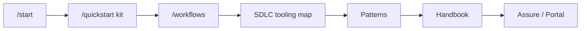

# How to browse AIES

> **Handbook:** Reading order for the working standard  
> **Version:** 1.1 | **Updated:** 2026-11-06

---

## Purpose

Give newcomers a **single logical path** through the site so they do not bounce between Patterns, Foundations, and Portal without knowing what to install first.

## Why

A corpus this size fails when every page looks equally important. Order is a quality gate: kit before dialect, workflow before crosswalk, pattern envelope before assurance theater.

## The path (do this in order)

| Step | Where | Exit criterion |
|------|-------|----------------|
| 1 | [`/start`](/start) | You know your stack, IDE, role, data class |
| 2 | [`/quickstart`](/quickstart) (“Your kit”) | Kit installed into IDE-native paths — not a hollow `.aies/` folder |
| 3 | [`/workflows`](/workflows) | You ran one lifecycle stage end-to-end |
| 4 | [AI SDLC stage tooling map](../08-ai-sdlc/stage-tooling-map.md) | You can name the prompt/skill/pattern for your current stage |
| 5 | [Pattern library](../patterns/README.md) — Planner → Context → Reviewer first | You opened prompt + skills + checklist for one pattern |
| 6 | [Practitioner handbook](./README.md) | You applied one practice doc (HITL, evals, MCP, or PR review) |
| 7 | [External standards map](./external-standards-map.md) / [`/portal`](/portal) | Only when you need assurance evidence — not day-one reading |

## What each nav section is for

| Sidebar section | Job | Not for |
|-----------------|-----|---------|
| Get started | Operate the product | Deep theory |
| AI SDLC | Stage → tools (prompts, skills, patterns) | Normative ISO claims |
| Patterns | Consequential envelopes with HITL gates | Casual autocomplete tips |
| Practitioner handbook | Day-to-day how-to | Certification |
| Foundations | Why harness / failure modes / XML | First-hour browsing |
| Cookbook | Stack adapters after kit install | Replacing the kit |
| Ops & assurance | Evals, hooks, portal, crosswalks | Skipping kit install |

## Tradeoffs

| Choice | Benefit | Cost |
|---|---|---|
| Kit-first, theory-later order | Value in the first hour; learning anchored to real work | Foundations reasoning arrives after habits form — revisit it after the first workflow |
| One workflow before reading patterns | Patterns make sense against a concrete task | Teams may miss a better-fitting pattern on the first run |
| Assurance pages only with a risk question | No compliance theater | Governance teams must wait for engineering evidence to exist |

## Anti-patterns

- Opening Portal or ISO crosswalks before installing a kit  
- Reading all 12 patterns before running one workflow  
- Treating Foundations as onboarding  
- Claiming “we follow AIES” with no kit files in the product repo  

## Enterprise considerations

- Make kit install plus one completed workflow the onboarding exit criterion for every team, tracked per repository with `create-aies-kit audit --min-score`.
- Route governance, risk, and audit staff straight to the [External standards map](./external-standards-map.md); route engineers through this path.
- Run the browse order as a 90-minute internal workshop: install, enhance, one story through plan → code → review.

## Checklist

- [ ] Kit present in IDE paths (`AIES.md`, prompts, skills)  
- [ ] One workflow completed  
- [ ] Current SDLC stage mapped to a prompt + pattern  
- [ ] Assurance pages opened only with a risk question in hand  

## Related

- [AI migration bible path](./ai-migration-bible-path.md)  
- [Skills vs prompts vs agents](./skills-vs-prompts-vs-agents.md)  
- [AI SDLC overview](../08-ai-sdlc/README.md)

## Changelog

- **1.1 (2026-11-06):** Added Tradeoffs and Enterprise considerations.
- **1.0 (2026-07-29):** Initial browse-order handbook page.
