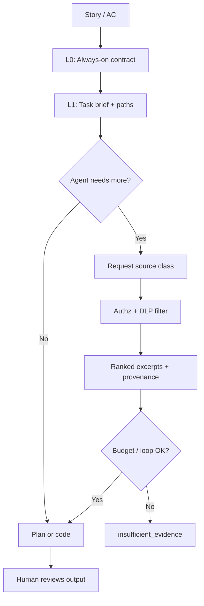

# How to Give Context

> **Handbook:** Build packages agents can actually use  
> **Repo anchors:** [`content/02-context-engineering/`](../02-context-engineering/README.md) · [`templates/CLAUDE.md.template`](../02-context-engineering/templates/CLAUDE.md.template) · [`CLAUDE.md`](../../CLAUDE.md) · [`content/cookbook/react/`](../cookbook/react/README.md)  
> **Version:** 1.0 | **Updated:** 2026-07-16

---

## Purpose

Teach teams to assemble a **context package** — the minimum high-fidelity inputs an agent needs for a UI or platform task — using progressive disclosure instead of dumping the monorepo into the prompt.

## Why

Model quality is gated by **signal / noise**, not by how many files you paste. The fidelity threshold (see [`principles/fidelity-threshold.md`](../02-context-engineering/principles/fidelity-threshold.md)) is usually far below the advertised context window. Pasting `src/**` plus secrets “just in case” does three things:

1. Dilutes the instruction that actually matters (acceptance criteria, constraints).
2. Burns tokens on every turn, including retries.
3. Creates a compliance incident when `.env`, tokens, or customer PII hitch a ride.

Progressive disclosure ([`principles/progressive-disclosure.md`](../02-context-engineering/principles/progressive-disclosure.md)) is the default: start with a task contract, then retrieve only what the next step needs, under authorization and budget.



---

## Context package shape

A package is a **versioned folder or PR comment artifact**, not a Slack paste. Use these layers:

| Layer | What goes in | Source in this repo | Loaded when |
|-------|--------------|---------------------|-------------|
| **L0 — Always-on** | Project identity, stack, non-negotiable constraints | Root [`CLAUDE.md`](../../CLAUDE.md) or fork of [`CLAUDE.md.template`](../02-context-engineering/templates/CLAUDE.md.template) | Every session |
| **L1 — Task** | Goal, AC, out-of-scope, risk, file allowlist | [`task-brief.template.md`](../02-context-engineering/templates/task-brief.template.md) | Every ticket |
| **L2 — Project snapshot** | Architecture sketch, conventions, known pitfalls | [`project-context.template.md`](../02-context-engineering/templates/project-context.template.md) | Multi-file / cross-team work |
| **L3 — Code excerpts** | Only files on the allowlist, truncated to relevant symbols | Agent retrieval / `@file` | After L1 approval |
| **L4 — Domain / cookbook** | Specialist procedure (React a11y, Next routing) | e.g. [`cookbook/react/skills/react.skill.md`](../cookbook/react/skills/react.skill.md) | When the skill trigger fires |
| **L5 — Historical** | Prior incident, failed attempt, ADR snippet | Knowledge capture / ticket | Debug or migration only |

Map layers to the 13 context types in [`content/02-context-engineering/README.md`](../02-context-engineering/README.md). Do not invent a fourteenth “misc dump” bucket.

### What to put in L0 (`CLAUDE.md`)

Fork [`templates/CLAUDE.md.template`](../02-context-engineering/templates/CLAUDE.md.template). Keep it lean:

- One-sentence product identity and stack.
- Critical constraints (security, tenancy, “never write secrets”).
- Pointers to skills/hooks — **paths**, not pasted skill bodies.
- Test and commit conventions.

Do **not** paste entire ESLint configs, full API OpenAPI specs, or the design system token dump into L0. Those belong in L3/L4 on demand.

### What to exclude (hard rules)

| Exclude | Why | Safer alternative |
|---------|-----|-------------------|
| `.env`, `*.pem`, API keys, session cookies | Credential leakage into logs, vendors, eval fixtures | Redacted stubs; harness injects secrets at runtime only |
| Whole monorepo / `node_modules` / `.next` | Noise + cost; lost-in-the-middle | Path allowlist + targeted excerpts |
| Unrelated packages in a monorepo | Cross-contamination of conventions | Package-scoped `CLAUDE.md` + allowlist |
| Customer PII, production DB dumps | Compliance and retention risk | Synthetic fixtures under `fixtures/` |
| Untrusted retrieved HTML/docs as instructions | Prompt injection | Provenance labels; treat as data not policy |
| “All of Slack / Confluence for this epic” | Unbounded retrieval | Curated excerpts with owners |

---

## How — step-by-step

### 1. Start from the behavioral contract

Confirm the repo has a root contract ([`CLAUDE.md`](../../CLAUDE.md) in this standard, or a project fork of the template). If an engineer opens a session with no L0, stop and add it before planning.

### 2. Write the task brief (L1)

Fill [`task-brief.template.md`](../02-context-engineering/templates/task-brief.template.md):

1. Goal in one sentence.
2. Acceptance criteria as falsifiable checks.
3. Out of scope (explicit).
4. Risk tags: `auth` | `pii` | `payments` | `public-ui` | `none`.
5. **File allowlist** — concrete paths, not globs like `src/**`.
6. Success and failure definitions for the agent.

### 3. Assemble code context (L3) only after allowlist

For a UI change, prefer:

- The target component and its test.
- The nearest layout/route parent.
- The design-system primitive it already uses.
- One golden example of the same pattern in-repo.

Use placement rules from [`principles/lost-in-the-middle.md`](../02-context-engineering/principles/lost-in-the-middle.md): put AC and constraints at the **edges** (start and end); put large code in the middle only if necessary.

### 4. Disclose progressively during the run

```mermaid
sequenceDiagram
  participant Eng as Engineer
  participant Harness as Harness / IDE agent
  participant Policy as Authz + budget
  participant Store as Repo / docs store
  Eng->>Harness: L0 + L1 package
  Harness->>Harness: Plan or first edit attempt
  Harness->>Policy: Request class=code path=Button.tsx
  Policy->>Store: Authorized read
  Store-->>Harness: Excerpt + provenance
  Harness->>Eng: Blocking question OR draft
  Note over Harness,Policy: Loop capped; insufficient_evidence allowed
```

Wire budgets with [`budget-guard.hook.sh`](../04-agent-engineering/hooks/budget-guard.hook.sh) (`OAIES_BUDGET_PROFILE`, `OAIES_BUDGET_REMAINING`). Retrieval without a remaining budget is a gate failure, not a suggestion.

### 5. Prefer skills over pasted essays

If the team keeps pasting “how we do React forms” into every ticket, promote it to a skill (see [`content/03-skill-engineering/skills/`](../03-skill-engineering/skills/) and cookbook [`react.skill.md`](../cookbook/react/skills/react.skill.md)). The context package **references** the skill path; it does not inline 2KB of procedure every time.

### 6. Gate planning inputs

Before planner activation, require a non-empty requirements file via [`pre-planning.hook.sh`](../04-agent-engineering/hooks/pre-planning.hook.sh) (`OAIES_REQUIREMENTS_FILE`). Empty “please fix UI” briefs do not enter the planning stage.

### 7. Verify with the context checklist

Run through [`checklists/context-checklist.md`](../02-context-engineering/checklists/context-checklist.md) and avoid the failures in [`anti-patterns/context-anti-patterns.md`](../02-context-engineering/anti-patterns/context-anti-patterns.md).

---

## Worked example — portal filter bar (UI)

**Story:** Add a status filter to the engineering portal list without breaking keyboard focus order.

### Context package (what you actually attach)

| Artifact | Path / content |
|----------|----------------|
| L0 | Repo [`CLAUDE.md`](../../CLAUDE.md) (already loaded) |
| L1 brief | `docs/briefs/portal-status-filter.md` (local) — AC: filter by `draft\|active\|archived`; URL sync `?status=`; no new card chrome |
| Allowlist | `app/portal/page.tsx`, `components/portal/PortalList.tsx`, `components/portal/PortalFilters.tsx` (create), existing `components/ui/Select.tsx`, test `PortalList.test.tsx` |
| L4 skill | [`content/cookbook/react/skills/react.skill.md`](../cookbook/react/skills/react.skill.md) + a11y skill if focus traps involved |
| Exclude | `.env.local`, `.next/**`, unrelated `content/cookbook/microfrontends/**`, full `package-lock.json` |

### Bad vs good package

| Bad (noise) | Good (signal) |
|-------------|----------------|
| “Here’s the whole `app/` tree” | Three files + parent Select primitive |
| Paste OpenAPI for unrelated billing API | Link to list API type already imported in `PortalList.tsx` |
| Screenshot only, no AC | AC table + URL contract + out-of-scope |
| Embed AWS keys “for deploy context” | No secrets; deploy is a later stage with [`deployment.hook.sh`](../04-agent-engineering/hooks/deployment.hook.sh) |

### Progressive steps the agent should take

1. Read L1 + allowlisted files only.
2. If URL sync pattern is unclear, request **one** sibling route that already syncs query params — not all routes.
3. Produce plan via [`implementation-plan.prompt.md`](../08-ai-sdlc/prompts/implementation-plan.prompt.md) (see [How to set up planning](./how-to-set-up-planning.md)).
4. Implement only after human plan approval (`pre-code` + approval evidence).

---

## Tradeoffs

| Choice | You gain | You give up |
|--------|----------|-------------|
| Strict allowlists | Higher fidelity, lower cost | More human curation up front |
| Progressive retrieval | Focus + audit trail | Extra round trips; risk of retrieval miss |
| Fat L0 `CLAUDE.md` | Fewer “what stack is this?” questions | Permanent noise on every turn |
| Skills by reference | Reuse without paste tax | Requires skill hygiene and versioning |
| Synthetic fixtures only | Safer evals and demos | Slightly less “production realism” |

Opinionated default: **lean L0, strict L1, progressive L3, skills by path**. Fat context is a smell, not a virtue.

---

## Anti-patterns

| Anti-pattern | Why it fails | Do this instead |
|--------------|--------------|-----------------|
| Monorepo dump | Lost-in-the-middle; token burn | Allowlist + progressive disclosure |
| Secrets “for realism” | Leakage into vendors and CI logs | Redaction; runtime secret injection |
| Screenshot-only briefs | Ambiguous AC; untestable | Task brief with falsifiable checks |
| Pasting entire skill bodies | Drift; duplicated procedure | Reference skill path; load on trigger |
| Treating Confluence as trusted instructions | Injection / stale policy | Provenance + human-owned constraints in L0/L1 |
| “Context completeness = 100% of files” | Optimizes volume, not fidelity | Optimize signal / noise |

---

## Enterprise considerations

- **DLP / egress:** Every retrieval path must be authorization-filtered; log source IDs requested vs returned (see progressive-disclosure enterprise notes).
- **Tenancy:** Context packages for customer workspaces must not cross tenants — even in “internal” agent sandboxes.
- **Retention:** Prompt logs are records. Exclude PII at package assembly time; do not rely on post-hoc scrubbing.
- **Vendor boundaries:** If a third-party coding agent leaves your VPC, the package is an export. Classify it.
- **Audit:** Plan and code stages should cite which package version (commit SHA + brief path) was used.
- **Eval cost:** Bloated fixtures in eval suites multiply spend on every PR that touches prompts/skills — see [Containing token waste](./containing-token-waste.md) and [`.github/workflows/eval-gate.yml`](../../.github/workflows/eval-gate.yml).

---

## Repo anchors

| Need | Path |
|------|------|
| Context engineering overview | [`content/02-context-engineering/README.md`](../02-context-engineering/README.md) |
| Progressive disclosure | [`principles/progressive-disclosure.md`](../02-context-engineering/principles/progressive-disclosure.md) |
| Fidelity / placement | [`context-fidelity.md`](../02-context-engineering/principles/context-fidelity.md), [`lost-in-the-middle.md`](../02-context-engineering/principles/lost-in-the-middle.md) |
| Templates | [`CLAUDE.md.template`](../02-context-engineering/templates/CLAUDE.md.template), [`task-brief.template.md`](../02-context-engineering/templates/task-brief.template.md), [`project-context.template.md`](../02-context-engineering/templates/project-context.template.md) |
| Checklist / anti-patterns | [`context-checklist.md`](../02-context-engineering/checklists/context-checklist.md), [`context-anti-patterns.md`](../02-context-engineering/anti-patterns/context-anti-patterns.md) |
| Context skill | [`content/03-skill-engineering/skills/context.skill.md`](../03-skill-engineering/skills/context.skill.md) |
| Context pattern | [`content/patterns/context-pattern/README.md`](../patterns/context-pattern/README.md) |
| React UI depth | [`content/cookbook/react/README.md`](../cookbook/react/README.md) |
| Planning gate | [`pre-planning.hook.sh`](../04-agent-engineering/hooks/pre-planning.hook.sh) |
| Budget gate | [`budget-guard.hook.sh`](../04-agent-engineering/hooks/budget-guard.hook.sh) |

---

## Checklist

- [ ] L0 contract exists and is lean (template-based, not a novel)
- [ ] L1 task brief has AC, out-of-scope, risk tags, and a **concrete file allowlist**
- [ ] No secrets, PII, lockfiles, build caches, or whole-package dumps in the package
- [ ] Large code is retrieved on demand with provenance, not pre-pasted “just in case”
- [ ] Specialist procedure is a **skill reference**, not a Slack essay
- [ ] `pre-planning` can see a non-empty requirements file
- [ ] Budget profile declared before multi-loop retrieval
- [ ] Context checklist reviewed; known anti-patterns avoided
- [ ] Package version (brief path + commit) recorded on the plan/PR

## Changelog

- 2026-07-16: Initial practitioner handbook chapter for context packages and progressive disclosure.
