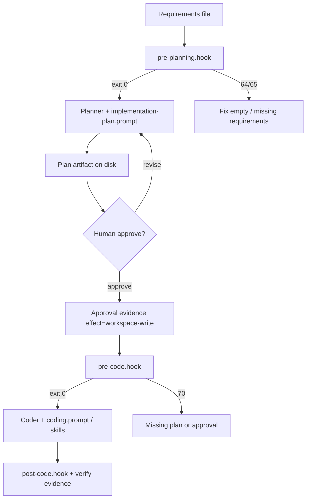
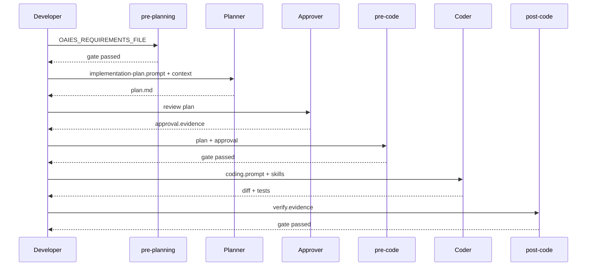

# How to Set Up Planning

> **Handbook:** Enforce plan-before-code without ceremony theater  
> **Repo anchors:** [`planner-pattern`](../patterns/planner-pattern/README.md) · [`implementation-plan.prompt.md`](../08-ai-sdlc/prompts/implementation-plan.prompt.md) · [`pre-planning.hook.sh`](../04-agent-engineering/hooks/pre-planning.hook.sh) · [`pre-code.hook.sh`](../04-agent-engineering/hooks/pre-code.hook.sh)  
> **Version:** 1.0 | **Updated:** 2026-07-16

---

## Purpose

Wire the Planner Pattern, the implementation-plan prompt, evidence hooks, and human approval into a **real repo workflow** so multi-file UI/platform work cannot jump straight to coding.

## Why

Agents optimize local token correctness. Without an externalized plan, they:

- Pick an architecture silently (wrong layout boundary, wrong state library, wrong API shape).
- Touch files outside the blast radius.
- Skip tests, migrations, and rollback until review — when rework is expensive.

The Planner Pattern ([`content/patterns/planner-pattern/README.md`](../patterns/planner-pattern/README.md)) treats plan-before-execute as a **constraint**. Hooks make it mechanical: no `workspace-write` without an approved plan file.



Skip planning only for the pattern’s explicit exclusions: single-file typos, pure docs, config with no logic. Everything else that crosses three files or a trust boundary plans first.

---

## How — wire it into the repo

### 1. Decide when planning is mandatory

| Trigger | Planning required? |
|---------|-------------------|
| ≥3 files or new module | Yes |
| Public API / schema / auth / tenancy | Yes |
| UI route + component + test | Yes |
| One-line copy fix | No |
| Docs-only in `content/` with no runtime | No (still use story clarity) |

Document the rule in project `CLAUDE.md` critical constraints: “No multi-file implementation without an approved plan artifact.”

### 2. Require a requirements input (`pre-planning`)

Hook: [`pre-planning.hook.sh`](../04-agent-engineering/hooks/pre-planning.hook.sh).

```sh
# requirements.md is your L1 brief or story-kickoff output
export OAIES_REQUIREMENTS_FILE=docs/briefs/portal-status-filter.md
sh content/04-agent-engineering/hooks/pre-planning.hook.sh
```

Exit `0` only if the file is readable and non-whitespace. This is the gate that kills “vibes-based” planning sessions.

Produce requirements via [`story-kickoff.prompt.md`](../08-ai-sdlc/prompts/story-kickoff.prompt.md) when the ticket is fuzzy; do not invent AC inside the planner.

### 3. Run the planner with the canonical prompt

Use [`implementation-plan.prompt.md`](../08-ai-sdlc/prompts/implementation-plan.prompt.md) (also referenced from [`planner-pattern/prompt.md`](../patterns/planner-pattern/prompt.md)).

Fill variables from the context package ([How to give context](./how-to-give-context.md)):

| Prompt slot | Fill with |
|-------------|-----------|
| `{{STORY_SPECIFICATION}}` | Story-kickoff output or task brief |
| `{{RELEVANT_CODE_CONTEXT}}` | Allowlisted excerpts only |
| `{{EXISTING_ARCHITECTURE}}` | Short architecture sketch / ADR pointer |
| `{{TECHNICAL_CONSTRAINTS}}` | Perf, a11y, security, release train |

The prompt **forbids writing code**. If the model emits patches, discard and re-run — do not “just apply them.”

Optional skill: [`planning.skill.md`](../03-skill-engineering/skills/planning.skill.md) for procedural consistency across agents.

### 4. Persist the plan as an artifact

Write the plan to a stable path the hooks can see, for example:

```text
docs/plans/YYYY-MM-DD-portal-status-filter.md
```

Minimum sections (align with prompt output + planner checklist [`planner-pattern/checklist.md`](../patterns/planner-pattern/checklist.md)):

1. Goal and non-goals  
2. Files to touch (create / modify / delete)  
3. Data / API / UI impact  
4. Test plan  
5. Risks and rollback  
6. Open questions (blocking vs non-blocking)

### 5. Human approval — real, not ceremonial

See [Human in the loop](./human-in-the-loop.md). For planning, approval means a named engineer:

- Accepts file blast radius and approach.
- Resolves **blocking** questions (or parks the work).
- Records approval evidence for `pre-code`.

Example approval evidence file:

```text
effect=workspace-write
target=docs/plans/2026-07-16-portal-status-filter.md
approver=jdoe
ticket=PORTAL-214
```

Rubber-stamp “LGTM” without reading risks is an anti-pattern. Risk-based depth: auth/PII plans get a second reader; low-risk UI polish can be single approver.

### 6. Gate coding on plan + approval (`pre-code`)

Hook: [`pre-code.hook.sh`](../04-agent-engineering/hooks/pre-code.hook.sh).

```sh
export OAIES_PLAN_FILE=docs/plans/2026-07-16-portal-status-filter.md
export OAIES_APPROVAL_FILE=docs/plans/2026-07-16-portal-status-filter.approval
sh content/04-agent-engineering/hooks/pre-code.hook.sh
```

The hook requires the plan file and an approval that declares `effect=workspace-write` and a target. No silent coding agent with “the plan is in chat history.”

### 7. Implement against the plan

- Coder agent: [`content/04-agent-engineering/agents/coder.agent.md`](../04-agent-engineering/agents/coder.agent.md)  
- Coding prompt: [`coding.prompt.md`](../08-ai-sdlc/prompts/coding.prompt.md)  
- UI skills as needed: [`cookbook/react/skills/react.skill.md`](../cookbook/react/skills/react.skill.md)

After implementation, attach verify evidence and run [`post-code.hook.sh`](../04-agent-engineering/hooks/post-code.hook.sh). Drift from the plan (new files not listed, skipped tests) is a **plan amendment + re-approval**, not a drive-by.

### 8. Close the loop in CI / local harness



Optional: [`pre-delegation.hook.sh`](../04-agent-engineering/hooks/pre-delegation.hook.sh) when a planner delegates to specialist subagents — require principal, scope, budget profile, remaining depth ([`planner-pattern/subagents.md`](../patterns/planner-pattern/subagents.md)).

---

## Worked example — portal status filter

**Goal:** URL-synced status filter on the portal list (same story as the context chapter).

### Artifacts on disk

| Step | Path |
|------|------|
| Requirements | `docs/briefs/portal-status-filter.md` |
| Plan | `docs/plans/2026-07-16-portal-status-filter.md` |
| Approval | `docs/plans/2026-07-16-portal-status-filter.approval` |
| Verify | `docs/plans/2026-07-16-portal-status-filter.verify` |

### Plan excerpt (concrete, not slogans)

| Area | Decision |
|------|----------|
| Files | Modify `app/portal/page.tsx`, `components/portal/PortalList.tsx`; create `components/portal/PortalFilters.tsx`; extend `PortalList.test.tsx` |
| State | Read/write `status` via `useSearchParams` — no new global store |
| UI | Reuse `components/ui/Select.tsx`; no card wrappers |
| A11y | Preserve focus on filter control after selection; announce result count via existing live region if present |
| Tests | Unit: query param round-trip; empty list; invalid `status` falls back to `all` |
| Rollback | Revert PR; no schema migration |
| Out of scope | Server-side persistence of filter preference; microfrontend shell changes |

### Commands (local harness)

```sh
export OAIES_REQUIREMENTS_FILE=docs/briefs/portal-status-filter.md
sh content/04-agent-engineering/hooks/pre-planning.hook.sh --dry-run

# ... generate plan with implementation-plan.prompt.md ...

export OAIES_PLAN_FILE=docs/plans/2026-07-16-portal-status-filter.md
export OAIES_APPROVAL_FILE=docs/plans/2026-07-16-portal-status-filter.approval
sh content/04-agent-engineering/hooks/pre-code.hook.sh

# ... implement ...

printf '%s\n' 'status=passed' 'artifact=sha256:deadbeef' > docs/plans/2026-07-16-portal-status-filter.verify
export OAIES_VERIFY_EVIDENCE=docs/plans/2026-07-16-portal-status-filter.verify
sh content/04-agent-engineering/hooks/post-code.hook.sh
```

### Failure modes to expect

| Symptom | Likely cause | Fix |
|---------|--------------|-----|
| `pre-planning` exit 65 | Empty brief | Complete task brief |
| Plan lists 20 files | Context dump / gold-plating | Tighten allowlist; re-plan |
| Coder adds Redux | Plan silent on state | Amend plan; re-approve |
| Tests missing in PR | Plan test section ignored | Block in review; see [PR review](./pr-review-with-ai.md) |

---

## Tradeoffs

| Choice | Gain | Cost |
|--------|------|------|
| Hook-enforced plan | Cannot “forget” planning | Slight process friction on small tasks — mitigate with clear skip rules |
| Plans as files | Auditable, reviewable in PRs | Path discipline; stale plans if not amended |
| Chat-only plans | Fast | No `pre-code` gate; no audit |
| Deep plans for every chore | Consistency theater | Token waste; engineer revolt |
| Planner subagents | Parallel research | Delegation depth + budget controls required |

Default: **hooks on for multi-file**; document skip list; amend plans instead of ghost-writing architecture in the coder prompt.

---

## Anti-patterns

| Anti-pattern | Why | Instead |
|--------------|-----|---------|
| Plan in chat only | Hooks cannot validate; approval evaporates | File + approval evidence |
| “Decision completeness = 100%” checklists | Fake rigor; ignores risk | Risk-based section depth |
| Coding during planning | Contaminates the plan with accidental commits | Separate stages; discard early patches |
| Approving without reading blast radius | Ceremony | Require file table + risks sign-off |
| Skipping plan for “just UI” | UI still has a11y, routing, and state contracts | Plan for route+component+test triplets |
| One mega-plan for a quarter | Unimplementable | Story-sized plans; link epics |

---

## Enterprise considerations

- **Audit:** Store plan SHA and approver identity with the PR (SOC2 change management narrative).
- **Segregation of duties:** For high-risk changes, planner approver ≠ sole merge approver (see HITL).
- **Regulated UI:** Accessibility and data-residency constraints belong in `{{TECHNICAL_CONSTRAINTS}}`, not as afterthoughts in review.
- **Vendor agents:** If planning runs in a third-party IDE agent, export still includes code context — apply the same package rules as [How to give context](./how-to-give-context.md).
- **Knowledge capture:** After non-obvious plans, run [`knowledge-capture.hook.sh`](../04-agent-engineering/hooks/knowledge-capture.hook.sh) / [`knowledge-capture.prompt.md`](../08-ai-sdlc/prompts/knowledge-capture.prompt.md) so the next team does not re-litigate the same architecture.

---

## Repo anchors

| Need | Path |
|------|------|
| Planner pattern | [`content/patterns/planner-pattern/README.md`](../patterns/planner-pattern/README.md) |
| Checklist / skills / examples | [`checklist.md`](../patterns/planner-pattern/checklist.md), [`skills.md`](../patterns/planner-pattern/skills.md), [`examples/example.md`](../patterns/planner-pattern/examples/example.md) |
| Implementation plan prompt | [`content/08-ai-sdlc/prompts/implementation-plan.prompt.md`](../08-ai-sdlc/prompts/implementation-plan.prompt.md) |
| Story kickoff | [`story-kickoff.prompt.md`](../08-ai-sdlc/prompts/story-kickoff.prompt.md) |
| Coding prompt | [`coding.prompt.md`](../08-ai-sdlc/prompts/coding.prompt.md) |
| Planning skill | [`content/03-skill-engineering/skills/planning.skill.md`](../03-skill-engineering/skills/planning.skill.md) |
| Hooks README | [`content/04-agent-engineering/hooks/README.md`](../04-agent-engineering/hooks/README.md) |
| Gates | `pre-planning`, `pre-code`, `post-code`, `pre-delegation`, `budget-guard` under [`hooks/`](../04-agent-engineering/hooks/) |
| DoR / DoD | [`definition-of-ready.md`](../08-ai-sdlc/quality-standards/definition-of-ready.md), [`definition-of-done.md`](../08-ai-sdlc/quality-standards/definition-of-done.md) |

---

## Checklist

- [ ] Planning triggers documented in project contract (and skip list is short)
- [ ] `OAIES_REQUIREMENTS_FILE` points at a real brief; `pre-planning` passes
- [ ] Plan generated with [`implementation-plan.prompt.md`](../08-ai-sdlc/prompts/implementation-plan.prompt.md) — **no code**
- [ ] Plan file lists files, tests, risks, rollback, open questions
- [ ] Named human recorded approval with `effect=workspace-write` + target
- [ ] `pre-code` passes before any agent writes the workspace
- [ ] Implementation diffs checked against plan; amendments re-approved
- [ ] `post-code` verify evidence attached
- [ ] High-risk plans have appropriate second reader (HITL policy)

## Changelog

- 2026-07-16: Initial practitioner handbook chapter for planning workflow wiring.
