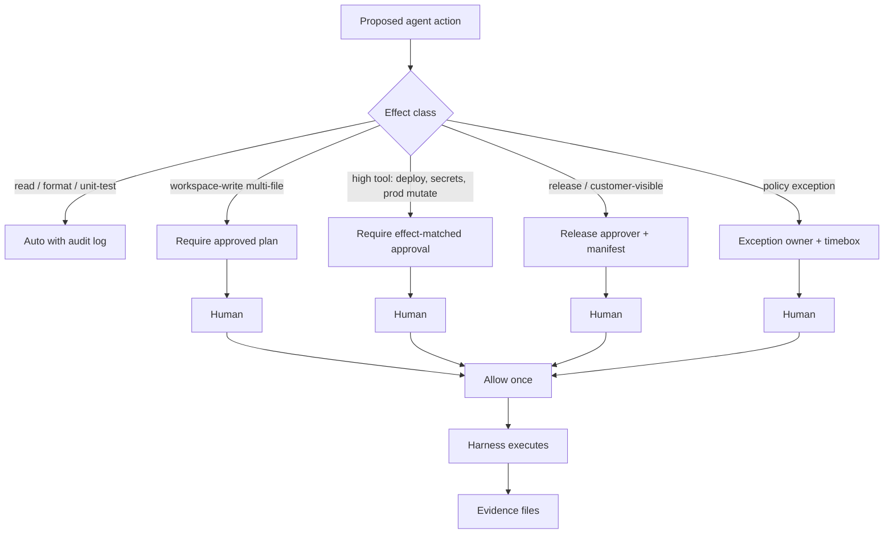
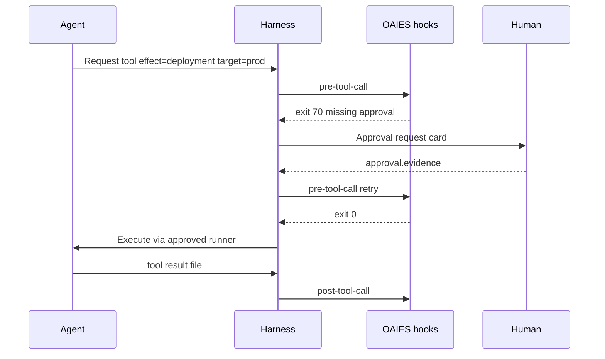

# Human in the Loop

> **Handbook:** Place approvals where risk is real  
> **Repo anchors:** [`hooks/README.md`](../04-agent-engineering/hooks/README.md) · [`pre-code.hook.sh`](../04-agent-engineering/hooks/pre-code.hook.sh) · [`pre-tool-call.hook.sh`](../04-agent-engineering/hooks/pre-tool-call.hook.sh) · [`deployment.hook.sh`](../04-agent-engineering/hooks/deployment.hook.sh) · [`planner-pattern`](../patterns/planner-pattern/README.md)  
> **Version:** 1.0 | **Updated:** 2026-07-16

---

## Purpose

Define **where humans must approve** in AI-assisted UI and platform delivery — plan, high-impact tools, release, and exceptions — using risk, not ceremony.

## Why

Full autonomy sounds efficient until an agent:

- Writes production config from a guessed plan.
- Calls a destructive tool (`deploy`, `drop`, `revoke`) because the prompt said “finish the job.”
- Merges a PR the bot “reviewed” itself.

Humans are not there to click “Approve” on every lint fix. They are there to own **irreversible or high-blast-radius effects**. Hooks in this repo encode that: high effects need matching approval evidence; low effects proceed with logging.



---

## Risk model (use this, not vibes)

| Risk tier | Examples | Human gate | Default latency budget |
|-----------|----------|------------|------------------------|
| **R0 — Reversible local** | Format, single-file typo, generate unit test draft | None (post-hoc review optional) | Seconds |
| **R1 — Workspace write** | Multi-file feature, new route, schema draft in repo | Plan approval (`pre-code`) | Hours |
| **R2 — High-impact tool** | Deploy staging/prod, rotate keys, prod DB migrate, broad `rm` | `pre-tool-call` effect approval | Minutes–hours |
| **R3 — Release / customer** | Prod traffic, public UI copy with legal meaning, model prompt change behind eval gate | Release approver + evidence | Scheduled |
| **R4 — Exception** | Bypass hook, skip eval, emergency hotfix without full plan | Named exception owner, time-boxed, post-incident review | Immediate + follow-up |

Map tiers in project `CLAUDE.md`. Do not invent a fifth tier called “AI said it was fine.”

---

## Where approvals must sit

### 1. Plan approval (before code)

- **When:** Planner Pattern triggers ([How to set up planning](./how-to-set-up-planning.md)).
- **Who:** Engineer accountable for the blast radius (usually the assignee). R2+ plans: second reader.
- **Evidence:** Approval file with `effect=workspace-write` and `target=<plan path>` for [`pre-code.hook.sh`](../04-agent-engineering/hooks/pre-code.hook.sh).
- **What they check:** File list, non-goals, security/a11y constraints, test plan, rollback — not comma placement.

### 2. High-impact tool approval (before side effects)

Hook: [`pre-tool-call.hook.sh`](../04-agent-engineering/hooks/pre-tool-call.hook.sh).

Declare `OAIES_TOOL_EFFECT`. For high effects, supply an approval file whose `effect` **matches** and that names a `target`.

| Effect (illustrative) | Needs approval? | Approver |
|-----------------------|-----------------|----------|
| `read` / search | No | — |
| `workspace-write` | Via plan gate | Plan approver |
| `deployment` | Yes | On-call / release engineer |
| `secret-read` / credential mint | Yes | Security-capable owner |
| `prod-mutate` | Yes | Service owner |

After the call, [`post-tool-call.hook.sh`](../04-agent-engineering/hooks/post-tool-call.hook.sh) requires a result file with status, effect, and target — so “we think it deployed” is not enough.

### 3. Release approval

Hook: [`deployment.hook.sh`](../04-agent-engineering/hooks/deployment.hook.sh) — needs release manifest, approval (`effect=deployment`), and passed release evidence. Follow with [`post-deployment.hook.sh`](../04-agent-engineering/hooks/post-deployment.hook.sh) health evidence.

For model/prompt changes that affect user-visible behavior, also respect [`.github/workflows/eval-gate.yml`](../../.github/workflows/eval-gate.yml) — green eval is not a substitute for a human release decision, but a red eval is a hard stop.

### 4. Exceptions (bypass with a name and an end date)

Exceptions are for SEV1 containment and broken gates with a known false positive — not for “the agent is impatient.”

Minimum exception record:

```text
exception_id=EXC-2026-07-16-01
owner=jdoe
bypass=pre-code
reason=SEV1 empty portal list; hotfix single file
expires=2026-07-16T18:00:00Z
follow_up=PORTAL-220 durable fix with plan
```

No anonymous bypasses. No permanent exceptions in chat lore.

### 5. PR merge (always human)

AI review assists; **humans own merge**. See [PR review with AI](./pr-review-with-ai.md). Self-merge of agent-authored + agent-reviewed code is forbidden for R1+.

---

## How — operating procedure

### Step 1: Classify the ticket at kickoff

Add `risk_tier: R0|R1|R2|R3` to the task brief. Wrong classification is cheaper to fix at kickoff than after a prod tool call.

### Step 2: Bind gates to the harness



Harness rule: **agents never execute high effects directly**. They request; harness checks hooks; humans approve; harness runs the tool.

### Step 3: Keep R0 fast

Do not force plan theater on typo PRs. If everything is R1+, engineers route around the system. Protect the gates that matter by exempting the ones that do not.

### Step 4: Separate duties on R3

| Role | Owns |
|------|------|
| Author / coder operator | Diff quality |
| Plan approver | Approach + blast radius |
| Reviewer | Defect finding (Reviewer Pattern) |
| Merger | Final accept |
| Release approver | Prod exposure |
| Eval owner | Model behavior gates |

One person may wear two hats on a small team; they must not wear **author + sole merger + release approver** on R3.

### Step 5: Budget the autonomy

Use [`budget-guard.hook.sh`](../04-agent-engineering/hooks/budget-guard.hook.sh) so agent loops cannot spend forever waiting for a human who already said no. Exhausted budget → stop, escalate, do not retry silently.

---

## Worked example — portal filter vs prod config

### Case A — R1 UI feature (portal status filter)

| Gate | Required? | Actor |
|------|-----------|-------|
| `pre-planning` | Yes | Assignee |
| Plan approve | Yes | Assignee (peer optional) |
| `pre-code` | Yes | Evidence on disk |
| High tool | No | — |
| AI PR review | Yes | Reviewer Pattern + human |
| Merge | Yes | Human ≠ only the agent |
| Deploy prod | Separate R3 change | Release train |

Paths: brief `docs/briefs/portal-status-filter.md`, plan `docs/plans/2026-07-16-portal-status-filter.md`, approval sibling `.approval` file.

### Case B — R2 agent proposes `kubectl apply` to prod

| Gate | Required? | Actor |
|------|-----------|-------|
| Plan for manifest change | Yes | Service owner |
| `pre-tool-call` effect=`deployment` | Yes | On-call |
| Matching `target=prod` | Yes | Must match approval |
| Eval gate | If prompts/agents changed | CI |
| Post-deploy health | Yes | `post-deployment` |

If the agent “helpfully” retries deploy after denial, harness must refuse — approval is single-use per target/digest, not a vibe.

### Case C — R4 exception

SEV1: portal returns empty list due to bad query param parsing in one file.

1. Exception owner files `EXC-*` bypassing full planner for a one-file hotfix.
2. Human still reviews the hotfix PR.
3. Follow-up ticket requires durable fix **with** plan within 48h.
4. Exception expires; hooks return to normal.

---

## Tradeoffs

| Choice | Gain | Cost |
|--------|------|------|
| Risk-tiered HITL | Speed on R0; safety on R3 | Requires discipline classifying tickets |
| Universal human approve | Simple policy | Ceremony; shadow IT agents |
| Fully autonomous deploy | Apparent velocity | Incidents and audit failure |
| Chat approvals only | Convenient | No hook evidence; weak audit |
| Dual control on R3 | Strong governance | Scheduling overhead |

Opinion: **risk-tiered gates with evidence files**. Ceremony without risk mapping trains people to ignore approvals.

---

## Anti-patterns

| Anti-pattern | Why it fails | Fix |
|--------------|--------------|-----|
| Approve-all bot | Removes the human | Disable; require named approver |
| Plan theater on typos | Causes bypass culture | Explicit R0 skip list |
| Agent self-merge | No independent challenge | Branch protection + human merger |
| Blanket “AI may deploy staging” | Staging often shares secrets/data | Still approve deploy effects |
| Eternal exceptions | Policy decay | Expiry + follow-up ticket required |
| Approval without target | Ambiguous blast radius | `target=` mandatory on high effects |

---

## Enterprise considerations

- **Change management:** Plan and release approvals are audit artifacts — retain with the change record.
- **Privileged access:** Tool approvals for prod must integrate with existing PAM / break-glass, not a parallel soft system.
- **Privacy:** HITL UIs must not display raw secrets in approval cards; show redacted targets.
- **Cross-border:** Who may approve customer-data-affecting UI copy may be jurisdiction-specific — encode in risk tags.
- **Insurance / customer contracts:** Autonomous production changes without dual control may violate commitments — legal owns the R3 definition with eng.

---

## Repo anchors

| Need | Path |
|------|------|
| Hooks contract | [`content/04-agent-engineering/hooks/README.md`](../04-agent-engineering/hooks/README.md) |
| Plan → code gate | [`pre-code.hook.sh`](../04-agent-engineering/hooks/pre-code.hook.sh) |
| Tool effect gate | [`pre-tool-call.hook.sh`](../04-agent-engineering/hooks/pre-tool-call.hook.sh), [`post-tool-call.hook.sh`](../04-agent-engineering/hooks/post-tool-call.hook.sh) |
| Release | [`deployment.hook.sh`](../04-agent-engineering/hooks/deployment.hook.sh), [`post-deployment.hook.sh`](../04-agent-engineering/hooks/post-deployment.hook.sh) |
| Budget | [`budget-guard.hook.sh`](../04-agent-engineering/hooks/budget-guard.hook.sh) |
| Planner / reviewer patterns | [`planner-pattern`](../patterns/planner-pattern/README.md), [`reviewer-pattern`](../patterns/reviewer-pattern/README.md) |
| Release pattern | [`content/patterns/release-pattern/README.md`](../patterns/release-pattern/README.md) |
| Eval gate | [`.github/workflows/eval-gate.yml`](../../.github/workflows/eval-gate.yml) |
| Hotfix pattern | [`content/patterns/hotfix-pattern/README.md`](../patterns/hotfix-pattern/README.md) |

---

## Checklist

- [ ] Risk tiers defined in project contract; tickets tagged at kickoff
- [ ] R1+ requires plan approval evidence before workspace write
- [ ] High tool effects cannot run without matching approval `effect` + `target`
- [ ] R3 has distinct release approver and eval awareness
- [ ] Exceptions are named, owned, expiry-bound, with follow-up
- [ ] Humans own merge; agents do not self-approve merges
- [ ] Approval UIs redact secrets
- [ ] Budget guard prevents infinite retry around denials
- [ ] Post-tool and post-deploy evidence required for side effects

## Changelog

- 2026-07-16: Initial practitioner handbook chapter for risk-based human approvals.
