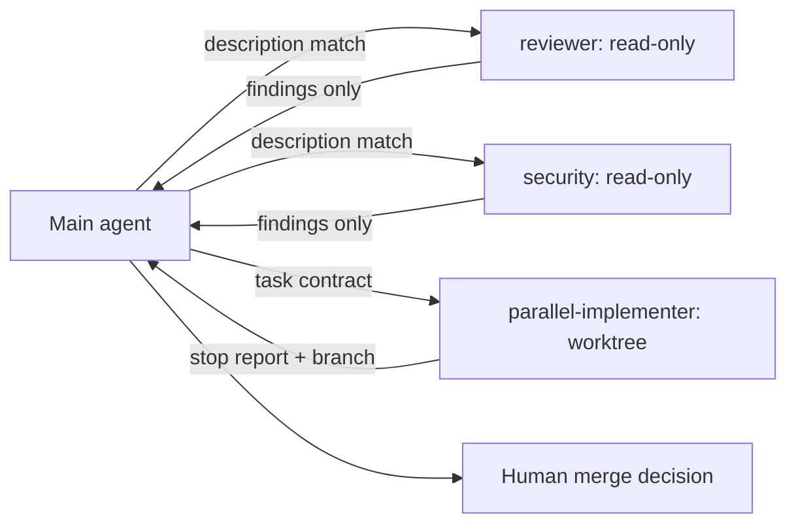

# IDE-Native Subagents

> **Handbook:** Design subagents that the runtime loads, isolates, and constrains — not personas in a prompt  
> **Repo anchors:** [`04-agent-engineering/agents/`](../04-agent-engineering/README.md) · kit renderers in `packages/kit-core/lib/generate.js`  
> **Version:** 1.0 | **Updated:** 2026-11-06

---

## Purpose

Define how AIES agent definitions become native subagents in Claude Code, Cursor, GitHub Copilot, Codex, Gemini CLI, and opencode, and the design rules that make delegation reliable: narrow descriptions, least-privilege tools, isolated context, and explicit termination.

## Why

In 2024–2025 "agents" were mostly framework code (AutoGen, CrewAI, LangGraph). By late 2026 every coding runtime ships a **delegation primitive**: the main agent spawns a subagent with its own context window, tool set, and model, and receives only the result. That changes what an agent definition is:

| Framework-era agent | IDE-native subagent |
|---------------------|---------------------|
| Python/TS class wired by you | Markdown/TOML file the runtime discovers |
| Shares the caller's context unless engineered otherwise | Fresh, isolated context by default |
| Tools granted in code | Tools declared in frontmatter, enforced by the runtime |
| Invoked by your orchestrator | Chosen by the main agent from the `description` |

Two consequences matter most: **the description is the router** (a vague description means the subagent is never used, or used for everything), and **tool lists are the security boundary** (a "read-only reviewer" with `Edit` is not read-only).

## How

### File locations and formats

| Runtime | Project path | Format | Required |
|---------|--------------|--------|----------|
| Claude Code | `.claude/agents/<name>.md` | YAML frontmatter + Markdown body | `name`, `description` |
| Cursor | `.cursor/agents/<name>.md` (also reads `.claude/agents`, `.codex/agents`) | YAML + Markdown | `name`, `description` |
| GitHub Copilot | `.github/agents/<name>.agent.md` | YAML + Markdown | `description` |
| Codex | `.codex/agents/<name>.toml` | TOML | `name`, `description`, `developer_instructions` |
| Gemini CLI | `.gemini/agents/<name>.md` | YAML + Markdown | `name`, `description` |
| opencode | `.opencode/agents/<name>.md` | YAML + Markdown (`mode: subagent`) | `description` |

AIES keeps **one canonical source** per agent (`content/04-agent-engineering/agents/*.agent.md` with `name`, `description`, `tools`, `model`, `privilege`, optional `isolation`) and the kit renders each target's dialect. Never hand-maintain six copies.

### Privilege → native tool mapping

| AIES privilege | Claude Code `tools` | Cursor | Copilot `tools` | Codex (inherits parent) | opencode `permission` |
|----------------|--------------------|--------|-----------------|----------------------|------------------------|
| read-only | `Read, Grep, Glob, Bash` | `readonly: true` | `[read, search]` | read-only instruction; parent `sandbox_mode` enforces | `edit: deny` |
| workspace-write | `+ Edit, Write` | `readonly: false` | `+ edit, execute` | project `sandbox_mode = "workspace-write"` | `edit: allow` |
| external-effect | as workspace-write; effects gated by hooks + human | same | same | same | `bash: ask` |

### Design rules

1. **Description = trigger.** Lead with the outcome, then "Use when …" with concrete conditions. Include what it will *not* do ("never edits files").
2. **One responsibility.** If the description needs "and", split the agent.
3. **Least-privilege tools.** Reviewers, planners, researchers, and security auditors are read-only. Write access is for implementers only.
4. **Preload skills, do not inline procedures.** Claude Code's `skills` field (and skill auto-discovery elsewhere) keeps the agent body short and the procedure reusable.
5. **Return contract.** The body states exactly what the subagent returns (findings with file:line, a plan file path, a stop report). The parent sees only that.
6. **Termination is explicit.** Success, blocked, failed — with the evidence required for each.
7. **`model: inherit` by default.** Override only with an eval or cost measurement; route small read-heavy subagents to fast models deliberately.
8. **Isolation for writers in parallel.** `isolation: worktree` (Claude Code) or one branch per cloud agent — see [Parallel agents and worktrees](./parallel-agents-and-worktrees.md).

## Tradeoffs

| Choice | Gain | Cost |
|--------|------|------|
| Isolated subagent context | Main context stays small; focused reasoning | Subagent re-reads files; parent cannot see its reasoning |
| Many narrow subagents | Precise routing, small tool sets | Description collisions; more files to maintain (generate them) |
| Read-only reviewers | Review cannot mutate what it reviews | Reviewer cannot apply trivial fixes; the coder does |
| Inherit model | Consistent behavior, one knob | Misses cost savings on read-heavy subagents until measured |

## Anti-patterns

- **Persona prompts as agents.** "You are a senior architect" with full tools and no return contract is a costume, not a subagent.
- **Copy-pasting definitions per IDE.** Drift is guaranteed within a month. Generate from one source.
- **Subagents that spawn subagents.** Gemini CLI forbids recursion outright; elsewhere it multiplies cost and hides decisions. Fan-out belongs to the main agent or the human.
- **"Use for anything related to code."** An over-broad description makes the main agent delegate everything, doubling latency and cost.
- **Granting `Bash` to read-only agents without a guard hook.** Shell is a write path; pair it with the AIES guard (see [Native agent hooks](./native-agent-hooks.md)).

## Enterprise considerations

- Treat agent definitions as code: CODEOWNERS on `.claude/agents/`, `.github/agents/`, etc.; review tool-list changes like IAM changes.
- Workspace trust: several runtimes load project agents only in trusted workspaces — document the trust decision for cloned repos.
- Audit which subagent produced which change (subagent start/stop hooks where available) for regulated codebases.

## Checklist

- [ ] Every agent has one canonical source with `name`, `description`, `tools`, `model`, `privilege`
- [ ] Descriptions state outcome + "Use when" + what it never does
- [ ] Read-only roles have no write tools in any rendered target
- [ ] Return contract and termination states defined in the body
- [ ] Parallel writers run isolated (worktree / own branch)
- [ ] Rendered files validated by `npm run kit:check`

## Changelog

- **2026-11-06:** Codex agents inherit `sandbox_mode` from the project config; agent TOML cannot override it.
- 2026-11-06: Initial chapter — native formats, privilege mapping, design rules.
