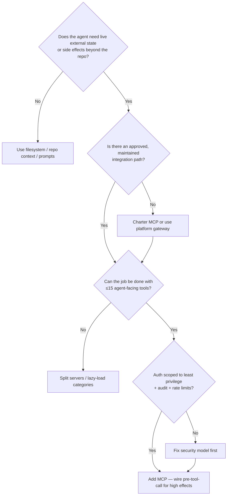
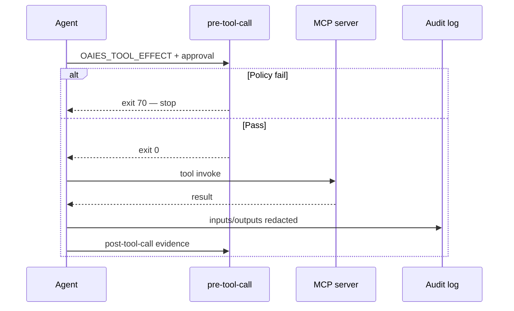

# MCP When and How

> **Handbook:** Add tools without turning agents into confused deputies  
> **Repo anchors:** [`content/mcps/README.md`](../mcps/README.md) · [`content/mcps/version-control/github.mcp.md`](../mcps/version-control/github.mcp.md) · [`pre-tool-call.hook.sh`](../04-agent-engineering/hooks/pre-tool-call.hook.sh)  
> **Version:** 1.0 | **Updated:** 2026-07-16

---

## Purpose

Decide **when** an MCP server belongs in an agent’s tool belt, how to scope auth and effects, and how to keep tool definitions agent-optimized. This chapter is a decision playbook — not a dump of every integration under [`content/mcps/`](../mcps/README.md).

## Why

MCP solves the M×N integration problem (models × tools → models + servers). Teams then recreate the failure mode MCP was meant to avoid:

| Mistake | Consequence |
|---------|-------------|
| Register every API as a tool | Context bloat; worse routing |
| Broad PAT “for convenience” | Prompt injection → exfiltration / write abuse |
| Thin REST wrappers | Human API docs, not agent affordances |
| No audit of tool I/O | Irreproducible incidents |
| MCP before workflow clarity | Agents thrash tools instead of reading the plan |

OAIES principles ([`content/mcps/README.md`](../mcps/README.md)): design for the agent, least privilege, avoid context bloat, validate untrusted inputs, audit every call.

## Decision model — when to add MCP

**Add MCP when** the agent repeatedly needs structured, live access (issues, PRs, incidents, metrics) and copy-paste context is slower or wronger than a tool call.

**Do not add MCP when** the data is already in the context package, the effect is one-off for humans (click the UI), or you cannot fund auth, audit, and rate limits.

## How

### 1. Start with one high-value, read-mostly server

Canonical deep example: [`github.mcp.md`](../mcps/version-control/github.mcp.md).

**Minimum scopes (read path):** `repo:read`, `issues:read`.  
**Write scopes only when the workflow requires them:** `issues:write`, `pull_requests:write`, `contents:write`.

Prefer GitHub App installation tokens (short-lived, repo-scoped) over long-lived PATs. Threat model from the spec:

| Threat | Mitigation |
|--------|------------|
| Token exfiltration via prompt injection | Short-lived App tokens; minimal scopes |
| Unauthorized repo access | Restrict installation to named repos |
| SSRF via URLs | Allowlist destinations before fetch |

### 2. Design tools for agent reasoning, not API docs

From the MCP README:

| Bad (API-shaped) | Good (agent-shaped) |
|------------------|---------------------|
| `POST /api/v2/issues` | `create_issue` — when to use, required fields |
| Dump 40 endpoints | Cap ~10–15 tools per server |

GitHub tools that earn their seat: `search_issues`, `get_issue`, `get_pull_request`, `search_code`, and only then `create_issue` if write is approved.

### 3. Bind high effects to hooks

MCP expands the blast radius of every prompt-injection success. Pair tool execution with [`pre-tool-call.hook.sh`](../04-agent-engineering/hooks/pre-tool-call.hook.sh) and [`post-tool-call.hook.sh`](../04-agent-engineering/hooks/post-tool-call.hook.sh):

- Low effect (read issue): may proceed under session policy.
- High effect (`deployment`, `workspace-write`, `contents:write`): require approval evidence matching **effect** and **target**.

### 4. Progressive disclosure of the catalog

The library lists many integrations (GitHub, GitLab, Azure DevOps, Playwright, Jira, Linear, Slack, Datadog, Postgres, …). **Do not load them all.** Org adoption order that usually works:

| Phase | MCP class | Why first |
|-------|-----------|-----------|
| 1 | Version control (GitHub) | Story/PR context is the daily loop |
| 2 | Browser testing (Playwright) when UI-heavy | Replaces flaky “describe the bug” |
| 3 | Observability (Sentry/Datadog) for on-call agents | Needs stricter auth |
| 4 | Project management / chat | High noise; easy to spam |
| 5 | Infrastructure data (Postgres/K8s) | Highest blast radius — read-only default |

Full inventory and security checklist: [`content/mcps/README.md`](../mcps/README.md). Spec format for any new server lives there — copy it; do not invent a parallel template.

### 5. Auth and operational controls (every production MCP)

Before production:

- [ ] OAuth 2.1 or rotating API key / App tokens
- [ ] Tool execution restricted by user/session permissions
- [ ] Input validation (type, length, patterns)
- [ ] Output filtering for secrets/PII
- [ ] Rate limits per user/session
- [ ] Audit log of tool calls
- [ ] Least privilege on the server identity
- [ ] SSRF protection on outbound fetches

### 6. Auth risk register (teach these, not “use OAuth”)

| Risk | How it shows up | Control |
|------|-----------------|---------|
| Long-lived PAT in agent env | Issue comment injection → `create_issue` / `contents:write` | GitHub App install tokens; revoke on suspicion |
| Over-scoped token | Agent can push to repos the user cannot | Mirror human ACL; repo allowlist |
| Tool result poisoning | Malicious issue body becomes “instructions” | Treat tool output as **data**; never concatenate into system policy |
| Confused deputy | MCP server acts with server identity, not user | Per-user OAuth; deny server-wide write for multi-tenant agents |
| Shadow MCP | Engineer installs unlisted community server | Catalog admission ([`operating-model.md`](../10-ai-org-playbook/governance/operating-model.md)) |
| Rate-limit thrash | Agent loops `search_code` | Cap tools; backoff; prefer filesystem read for known paths ([`github.mcp.md`](../mcps/version-control/github.mcp.md) anti-pattern) |

### 7. Profile matrix — same MCP, different blast radius

| Agent profile | GitHub tools enabled | Auth | Hook gate |
|---------------|----------------------|------|-----------|
| Planner | `get_issue`, `search_issues`, `search_code` (sparingly) | Read-only App token | Optional for reads |
| Coding assist | + filesystem; **no** `contents:write` via MCP | Read-only | Workspace writes via local tools + `pre-code` |
| Release bot | `get_pull_request` + approved write set | Write scopes + short TTL | `pre-tool-call` mandatory |
| On-call | Usually **not** GitHub write; observability MCP instead | Separate identity | High-effect only with approval |

One server binary can power all four profiles; **tool allowlists differ**. That is how you avoid “we installed GitHub MCP” becoming “every agent can push main.”

### 8. When MCP is the wrong tool

| Need | Prefer instead |
|------|----------------|
| Known file contents | Context package / filesystem read |
| Stable architecture rules | Versioned skill ([`content/03-skill-engineering/`](../03-skill-engineering/README.md)) |
| One-time human click | Human does it; agent drafts the checklist |
| Bulk analytics over tickets | Offline export + eval dataset, not live tool spam |
| Secrets or prod DB mutation | Break-glass human runbook — not agent MCP |

## Worked example — GitHub MCP for issue → plan (no write)

**Situation.** Engineer: “Look at issue #456 and draft an implementation plan.” Agent should **not** create branches or commits yet.

**Config.**

- Enable GitHub MCP with **read-only** scopes.
- Disable `create_issue` / write tools in this profile, or gate them behind approval.
- Context package still includes repo paths and DoR ([`definition-of-ready.md`](../08-ai-sdlc/quality-standards/definition-of-ready.md)).

**Agent sequence** (from [`github.mcp.md`](../mcps/version-control/github.mcp.md)):

1. `get_issue(repository, 456)` — full body + comments.
2. `search_code(...)` — only if pattern location unknown; respect code-search rate limits.
3. `search_issues(...)` — related/duplicate check.
4. Produce plan via [`implementation-plan.prompt.md`](../08-ai-sdlc/prompts/implementation-plan.prompt.md) — **no further MCP writes**.
5. Human approves plan; coding proceeds under hooks, not under `contents:write` MCP.

**Failure you avoid.** Agent with `contents:write` “helpfully” opens a PR from a half-baked plan after a poisoned issue comment. Read-only profile + plan HITL stops that.

### Worked example B — enabling write the hard way

Only after plan approval:

1. Switch session profile to “release” or open a **new** session with write tools — do not silently escalate mid-chat.
2. Create approval evidence: `effect` matching the MCP write class, `target=owner/repo#pr-or-path`.
3. Run [`pre-tool-call.hook.sh`](../04-agent-engineering/hooks/pre-tool-call.hook.sh); on exit `70`, stop.
4. Invoke the write tool; log I/O; run post-tool evidence.
5. Add an adversarial eval case if the write path is novel ([`eval/datasets/v1/adversarial.jsonl`](../../eval/datasets/v1/adversarial.jsonl)).

If the team cannot do steps 2–4, they are not ready for write MCP.

## Tradeoffs

| Choice | Gain | Cost |
|--------|------|------|
| MCP vs bespoke plugins | Portable tool surface | Another auth + audit surface |
| Few tools vs full API mirror | Better agent routing | Less one-shot coverage |
| App tokens vs PAT | Shorter blast radius | Setup overhead |
| Read-only default | Safer under injection | Extra step to enable writes |
| Loading all catalog servers | “Complete” IDE | Context collapse; confused tool choice |

## Anti-patterns

| Anti-pattern | Why it fails |
|--------------|--------------|
| Dumping all ~24 MCP specs into every agent | Tool-selection failure; token waste |
| Using `search_code` as a file browser | Hits strict rate limits; wrong abstraction |
| Putting secrets/PII in `create_issue` bodies | Permanent leak in GitHub |
| Broad `repo` PAT in developer laptops for agents | Prompt injection becomes breach |
| MCP write tools without `pre-tool-call` | Side effects without evidence |
| Treating MCP as a substitute for a context package | Tools ≠ curated requirements/architecture |
| Thin wrappers with human-oriented descriptions | Model misroutes or over-calls |

## Enterprise considerations

- **Confused deputy.** The MCP server identity must not exceed the human user’s authorization. Map session user → downstream scopes.
- **Data residency.** Tool responses may leave region; route through approved processors.
- **Provider catalog.** Admit MCP servers like models: qualification, owner, expiry ([`operating-model.md`](../10-ai-org-playbook/governance/operating-model.md)).
- **Incident response.** On suspected injection, revoke App installation / rotate tokens, preserve audit logs, add adversarial eval cases ([`eval/datasets/v1/adversarial.jsonl`](../../eval/datasets/v1/adversarial.jsonl)).
- **Procurement.** Prefer servers with clear threat models (as in `github.mcp.md`) over anonymous community binaries for production.

## Checklist

- [ ] Workflow is clear **before** MCP is added
- [ ] Decision tree answered: need live state/effects → approved path → ≤15 tools → auth ready
- [ ] Production server has agent-optimized descriptions
- [ ] Least privilege documented (read vs write scopes)
- [ ] High-effect tools gated by hooks + human approval
- [ ] Audit logging and rate limits enabled
- [ ] Adversarial input tests (injection, path traversal, SSRF)
- [ ] Catalog admission owner and review date named
- [ ] Engineers know when **not** to call MCP (local file already known)
- [ ] GitHub (or VCS) profile starts read-only for planning agents

## Repo map

| Concern | Path |
|---------|------|
| MCP library + principles | [`content/mcps/README.md`](../mcps/README.md) |
| GitHub reference spec | [`content/mcps/version-control/github.mcp.md`](../mcps/version-control/github.mcp.md) |
| Tool call gates | [`content/04-agent-engineering/hooks/pre-tool-call.hook.sh`](../04-agent-engineering/hooks/pre-tool-call.hook.sh) |
| Post tool evidence | [`content/04-agent-engineering/hooks/post-tool-call.hook.sh`](../04-agent-engineering/hooks/post-tool-call.hook.sh) |
| Org operating model | [`content/10-ai-org-playbook/governance/operating-model.md`](../10-ai-org-playbook/governance/operating-model.md) |
| Adversarial eval partition | [`eval/datasets/v1/adversarial.jsonl`](../../eval/datasets/v1/adversarial.jsonl) |

## Changelog

- 2026-07-16: Initial handbook chapter — when/how to add MCP, auth risks, GitHub worked example.
