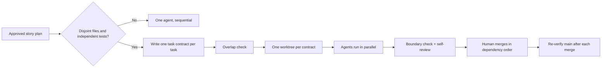

# Parallel Agents and Git Worktrees

> **Handbook:** Run several coding agents at once without merge chaos  
> **Repo anchors:** [`parallel-implementer.agent.md`](../04-agent-engineering/agents/parallel-implementer.agent.md) · kit `scripts/aies-worktree.mjs` · kit `plans/_TASK_CONTRACT.md`  
> **Version:** 1.0 | **Updated:** 2026-11-06

---

## Purpose

Define the one correct way to run multiple AI coding agents concurrently on one repository: **one task, one branch, one worktree, one base commit**, bounded by a written task contract and merged serially by a human.

## Why

Every major agent runtime now runs agents in parallel — Claude Code subagents with `isolation: worktree`, Cursor Cloud Agents, Copilot cloud agent, Codex cloud tasks, and local multi-session setups. Throughput goes up; so does a new class of failure that sequential AI coding never had:

| Failure | Cause | What prevents it |
|---------|-------|------------------|
| Agents overwrite each other's edits | Shared working directory | One worktree per agent |
| Clean git merge, broken build | Semantic conflict across tasks | Dependency-ordered serial merge + re-verify after each merge |
| Flaky tests, "port already in use" | Shared ports, DB, caches | Per-worktree port range + DB schema |
| Agent "fixes" files outside its task | No boundary | Task contract with Allowed paths, checked mechanically |
| Rework after review | Tasks were not independent | Split only along file/ownership seams; overlap check before starting |
| Review queue collapse | 10 agents, 1 reviewer | Cap at 2–4 concurrent agents per human reviewer |

The bottleneck in parallel agent work is **human review and integration**, not generation. The process below is designed around that bottleneck.

## How

### 1. Decide whether to parallelize at all

Parallelize only when the approved plan splits into tasks that (a) touch disjoint files, (b) have independently verifiable acceptance criteria, and (c) are each larger than ~30 minutes of agent work. Otherwise run one agent sequentially — coordination overhead exceeds the gain.



### 2. Write a task contract per task

The contract (kit: `plans/_TASK_CONTRACT.md`) is the agent's entire mandate. Required sections:

| Section | Rule |
|---------|------|
| Objective | One observable outcome; link the parent plan |
| Allowed paths | Globs; anything else is a violation |
| Prohibited paths | Lockfiles, CI config, migrations unless the task *is* that |
| Acceptance criteria | Each verifiable by a command |
| Isolation | Ports, DB schema, credentials for this worktree |
| Dependencies | Tasks that must merge first |
| Stop conditions | Out-of-bounds need, plan conflict, repeated failure, budget |
| Budget | Wall clock, turns/tool calls, spend |

### 3. Create isolated worktrees

```bash
node scripts/aies-worktree.mjs new JIRA-42-api --base main
node scripts/aies-worktree.mjs new JIRA-42-ui  --base main
node scripts/aies-worktree.mjs overlap          # before starting: expect no shared files
```

The helper creates `agent/<task>` from a recorded base SHA in `../<repo>.worktrees/<task>`, writes `.env.worktree` (`PORT`, `AIES_PORT_RANGE`, `DATABASE_SCHEMA`), and copies the contract template. Worktrees sit **outside** the main checkout so IDE indexers and file watchers in the main window do not pick them up.

Runtime-native equivalents follow the same rule:

| Runtime | Native isolation | Note |
|---------|------------------|------|
| Claude Code | Subagent frontmatter `isolation: worktree` | Kit's `parallel-implementer` sets it |
| Cursor | Cloud Agents (each on its own branch) or a local worktree per window | One agent per branch |
| GitHub Copilot | Cloud agent works on its own branch, opens a draft PR | Environment from `copilot-setup-steps.yml` |
| Codex | Cloud tasks in isolated containers; local CLI per worktree | `[agents] max_concurrent_threads_per_session` caps fan-out |

### 4. Run agents with the contract attached

Start one agent session per worktree (or delegate to `parallel-implementer`). Attach the contract and the parent plan. The agent stops — it does not push, open PRs, or merge.

### 5. Gate and merge serially

1. `node scripts/aies-worktree.mjs check <task>` — every changed file inside Allowed paths.
2. Human reviews the self-review (`reviews/<task>-code-review.md`) and the diff.
3. Merge the task that others depend on first.
4. Rebase remaining branches onto the new main; re-run their verify commands. A clean rebase is not proof — semantic conflicts surface only in tests.
5. Repeat. `remove` each worktree after its PR merges.

## Tradeoffs

| Choice | Gain | Cost |
|--------|------|------|
| Worktree per agent | No working-copy collisions; parallel builds | Disk + install time per worktree (mitigate with package-manager caches) |
| Strict contracts | Mechanical scope enforcement | Up-front planning time; legitimate cross-cutting fixes need a plan amendment |
| Serial merge | Semantic conflicts caught one at a time | Wall-clock integration is sequential |
| 2–4 agent cap | Review keeps up | Leaves theoretical throughput unused |

## Anti-patterns

- **Parallelizing an unsplit plan.** "Agent A does backend, agent B does frontend" without an agreed API contract produces two incompatible halves. Freeze the interface first, as its own task.
- **Shared branch, multiple agents.** Commits interleave and each agent's context goes stale. One agent per branch, always.
- **Merging because git said "no conflicts".** Clean textual merges routinely break builds. Re-verify after every merge.
- **Letting agents decide fan-out.** An agent spawning agents spawning agents explodes cost and review load. Fan-out is a human (or orchestrator) decision made from the dependency graph.
- **Shared dev database.** Two agents' integration tests mutate the same rows; failures look random. Per-worktree schema or container.

## Enterprise considerations

- **Audit:** record base SHA, contract hash, agent runtime, and model in each PR description; regulators ask "what instructions produced this change?"
- **Credentials:** worktrees get sandbox or read-only credentials only; production secrets never enter an agent environment.
- **Capacity:** set an org cap on concurrent cloud agents per repository; cost and review load scale linearly.
- **Policy as code:** run the path-boundary check in CI against the contract committed on the branch, so the gate holds even for cloud agents you do not control locally.

## Checklist

- [ ] Plan approved and split along disjoint file seams
- [ ] One filled contract per task; overlap check shows no shared files
- [ ] One worktree + branch per agent from a recorded base SHA
- [ ] Ports and DB schema isolated per worktree
- [ ] ≤ 4 concurrent agents per reviewing human
- [ ] Boundary check + self-review before human review
- [ ] Serial merge in dependency order; verify after each merge

## Changelog

- 2026-11-06: Initial chapter — task contracts, worktree isolation, runtime-native isolation map, serial merge protocol.
