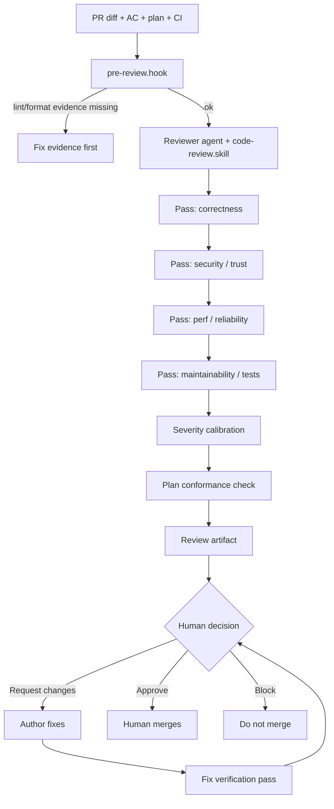
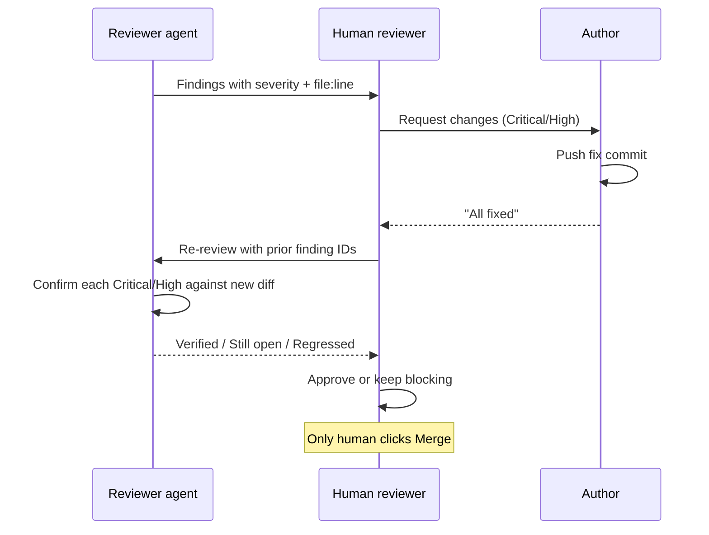

# PR Review with AI

> **Handbook:** Severity-calibrated reviews that humans still own  
> **Repo anchors:** [`reviewer-pattern`](../patterns/reviewer-pattern/README.md) · [`code-review.skill.md`](../03-skill-engineering/skills/code-review.skill.md) · [`pre-review.hook.sh`](../04-agent-engineering/hooks/pre-review.hook.sh) · [`cookbook/react` review](../cookbook/react/prompts/review.prompt.md)  
> **Version:** 1.0 | **Updated:** 2026-07-16

---

## Purpose

Run AI-assisted pull request review that finds **consequential defects**, checks **plan conformance**, and **verifies claimed fixes** — while keeping merge authority with a human.

## Why

AI-authored PRs fail in predictable ways:

- Look polished; miss edge cases and trust boundaries.
- Drift from the approved plan (extra abstractions, skipped tests).
- Authors (human or agent) mark review threads “fixed” without fixing them.
- Style nits drown Critical findings until reviewers rubber-stamp.

The Reviewer Pattern ([`content/patterns/reviewer-pattern/README.md`](../patterns/reviewer-pattern/README.md)) exists to **falsify** the change against acceptance criteria, not to maximize comment count.

---

## Severity model (non-negotiable)

| Severity | Meaning | Merge rule |
|----------|---------|------------|
| **Critical** | Exploitable, data loss, wrong authz, broken tenancy, silent corruption | **Block** until fixed and verified |
| **High** | Likely production defect, missing tests for new behavior, plan-critical gap | **Block** |
| **Medium** | Real issue, workaround exists, or maintainability that will cost soon | Fix before merge **or** tracked ticket with owner — human chooses explicitly |
| **Low** | Style, naming, optional cleanup | Never blocks alone |
| **Nit** | Preference | Do not inflate; batch or drop |

If the bot cannot calibrate, default **up** for security/auth and **down** for style. Never label a missing authz check as “nit.”

---

## How — step-by-step

### 1. Prepare evidence before review

Hook: [`pre-review.hook.sh`](../04-agent-engineering/hooks/pre-review.hook.sh) requires format and lint evidence (`OAIES_FORMAT_EVIDENCE`, `OAIES_LINT_EVIDENCE`). Do not spend model tokens reviewing unformatted dumps.

Also attach:

- Acceptance criteria / ticket link  
- Approved plan path (if R1+)  
- Test results relevant to the diff  
- Risk tags (`auth`, `pii`, `public-ui`, …)

### 2. Run an **independent** reviewer

Use:

- Pattern workflow: [`reviewer-pattern/workflow.md`](../patterns/reviewer-pattern/workflow.md)  
- Skill: [`code-review.skill.md`](../03-skill-engineering/skills/code-review.skill.md)  
- Pattern prompt: [`reviewer-pattern/prompt.md`](../patterns/reviewer-pattern/prompt.md)  
- UI-specific: [`cookbook/react/prompts/review.prompt.md`](../cookbook/react/prompts/review.prompt.md) + [`checklists/code-review.md`](../cookbook/react/checklists/code-review.md)

**Independence rule:** The same agent session that wrote the code does not get to issue the merge recommendation. New context package: diff + AC + plan, not the coder’s rationalizations.

### 3. Enforce plan conformance

For every R1+ PR, the review artifact includes a table:

| Plan item | Diff evidence | Status |
|-----------|---------------|--------|
| Files listed | Paths touched | Match / Extra / Missing |
| Test plan | Test files / CI jobs | Done / Partial / Absent |
| Non-goals | Forbidden work present? | Clean / Violated |
| Rollback | Documented / N/A | OK / Gap |

Extra files are not automatically bad — but they require **plan amendment note** or High finding. Missing tests from the plan are High.

### 4. Walk trust boundaries for UI/platform

Minimum boundary questions:

- Can this change leak data across tenants or roles?  
- Are secrets, tokens, or PII logged or sent to the model vendor?  
- Do new query params / headers get validated?  
- Does focus order / keyboard path break (public UI)?  
- Did CI skip paths that hide prompt/skill regressions? (see eval gate)

Security depth: invoke [`security.skill.md`](../03-skill-engineering/skills/security.skill.md) or [`security-review.prompt.md`](../08-ai-sdlc/prompts/security-review.prompt.md) when risk tags say so — not on every docs PR.

### 5. Verify claimed fixes

“Fixed” without a verification pass is a **High process failure**. Re-run the reviewer on the delta with the prior finding list; do not trust checkbox theater.

### 6. Human owns merge

Branch protection:

- Require human approval from CODEOWNERS / designated reviewers.  
- AI comments are advisory input to that human.  
- Critical/High open → no merge.  
- Author cannot be the only approver on R2+ (see [HITL](./human-in-the-loop.md)).

### 7. Store the review artifact

Keep the severity table and plan conformance table in the PR (comment or `docs/reviews/<pr>.md`). Pattern failures and examples: [`reviewer-pattern/failures.md`](../patterns/reviewer-pattern/failures.md), [`examples/example.md`](../patterns/reviewer-pattern/examples/example.md).

Optional hooks: [`reviewer-pattern/hooks.md`](../patterns/reviewer-pattern/hooks.md), [`pre-commit.hook.sh`](../04-agent-engineering/hooks/pre-commit.hook.sh) for test + secret-scan evidence before the PR even opens.

---

## Worked example — portal status filter PR

**PR title:** `feat(portal): URL-synced status filter`  
**Plan:** `docs/plans/2026-07-16-portal-status-filter.md`  
**Diff paths:**

| Path | Change |
|------|--------|
| `app/portal/page.tsx` | Pass `status` from searchParams |
| `components/portal/PortalFilters.tsx` | **New** Select wired to router |
| `components/portal/PortalList.tsx` | Filter client list |
| `components/portal/PortalList.test.tsx` | Round-trip + invalid fallback |

### Sample AI review output (calibrated)

| ID | Sev | Finding | Location |
|----|-----|---------|----------|
| F1 | High | Invalid `?status=foo` not normalized to `all` — plan required fallback | `PortalList.tsx` |
| F2 | Medium | No aria association between filter label and Select | `PortalFilters.tsx` |
| F3 | Low | Prefer `status` union type export shared with test | types |
| F4 | Nit | Import order | `page.tsx` |

Plan conformance:

| Plan item | Status |
|-----------|--------|
| No new card chrome | Match |
| Reuse `components/ui/Select.tsx` | Match |
| Tests for invalid status | **Absent** → drives F1 |
| Out of scope: preference persistence | Clean |

### Fix verification

Author pushes commit claiming F1/F2 fixed.

Re-review checklist:

- [ ] F1: test asserts invalid → `all`; implementation matches  
- [ ] F2: label `htmlFor` / `aria-labelledby` present  
- [ ] No new Critical introduced (e.g., filter applied after sensitive fields render incorrectly)

Human approves; human merges. Bot never presses the button.

### If eval-related files change

When the PR also touches `content/**/*.prompt.md`, `*.skill.md`, `*.agent.md`, or `eval/**`, [`.github/workflows/eval-gate.yml`](../../.github/workflows/eval-gate.yml) must be green. A UI-only reviewer saying LGTM does not override a failed eval gate.

---

## Tradeoffs

| Choice | Gain | Cost |
|--------|------|------|
| Severity-first review | Signal; faster human decisions | Needs calibration discipline |
| Volume-maximizing nits | Looks thorough | Review fatigue; missed Criticals |
| Author-agent self-review | Cheap | Correlated blind spots |
| Independent reviewer agent | Better defect discovery | Extra tokens / latency |
| Block on Medium always | Strict quality | Slow trains; gaming severity down |
| Verify fixes | Closes the loop | Second review pass cost |

Default: **independent AI pass + human merge + verify Critical/High**.

---

## Anti-patterns

| Anti-pattern | Why | Instead |
|--------------|-----|---------|
| “LGTM from the bot” merge | No accountability | Human merger required |
| Nit flooding | Hides Critical | Cap Low/Nit; lead with Sev table |
| Skipping plan check | Silent scope creep | Mandatory conformance table for R1+ |
| Trusting “fixed” checkboxes | Regressions ship | Finding-ID verification pass |
| Reviewing without AC | Aesthetic review | Require AC + risk tags |
| Same session code+approve | Conflicted | Fresh reviewer context |
| Ignoring eval gate on prompt PRs | Model regressions ship | Eval gate is merge-blocking |

---

## Enterprise considerations

- **Audit:** Retain review artifacts with severities for regulated changes.  
- **CODEOWNERS:** Map UI shells, auth, and billing paths to human owners; AI does not replace ownership.  
- **Supply chain:** Agent-suggested dependency bumps need human review of lockfile and advisories — not auto-merge.  
- **Customer data in diffs:** Redact fixtures; never paste prod dumps into the reviewer context ([context rules](./how-to-give-context.md)).  
- **Metrics:** Track escaped defects that were visible in diff; if >20%, the pattern’s symptom threshold says the process is failing ([reviewer-pattern problem statement](../patterns/reviewer-pattern/README.md)).

---

## Repo anchors

| Need | Path |
|------|------|
| Reviewer pattern | [`content/patterns/reviewer-pattern/README.md`](../patterns/reviewer-pattern/README.md) |
| Workflow / prompt / hooks | [`workflow.md`](../patterns/reviewer-pattern/workflow.md), [`prompt.md`](../patterns/reviewer-pattern/prompt.md), [`hooks.md`](../patterns/reviewer-pattern/hooks.md) |
| Code review skill | [`content/03-skill-engineering/skills/code-review.skill.md`](../03-skill-engineering/skills/code-review.skill.md) |
| Security / performance prompts | [`security-review.prompt.md`](../08-ai-sdlc/prompts/security-review.prompt.md), [`performance-review.prompt.md`](../08-ai-sdlc/prompts/performance-review.prompt.md) |
| React review | [`cookbook/react/prompts/review.prompt.md`](../cookbook/react/prompts/review.prompt.md), [`checklists/code-review.md`](../cookbook/react/checklists/code-review.md) |
| Pre-review / pre-commit hooks | [`pre-review.hook.sh`](../04-agent-engineering/hooks/pre-review.hook.sh), [`pre-commit.hook.sh`](../04-agent-engineering/hooks/pre-commit.hook.sh) |
| Quality standards | [`code-quality-standard.md`](../08-ai-sdlc/quality-standards/code-quality-standard.md), [`definition-of-done.md`](../08-ai-sdlc/quality-standards/definition-of-done.md) |
| Eval gate | [`.github/workflows/eval-gate.yml`](../../.github/workflows/eval-gate.yml) |

---

## Checklist

- [ ] Format/lint evidence present; `pre-review` would pass  
- [ ] AC, plan (if R1+), tests, and risk tags attached to the review package  
- [ ] Reviewer is independent of the authoring session  
- [ ] Findings use Critical/High/Medium/Low/Nit with merge rules applied  
- [ ] Plan conformance table completed; extras/missing tests explained  
- [ ] Security/a11y boundaries walked when risk tags require  
- [ ] Critical/High fixes re-verified by finding ID before approve  
- [ ] Human (not the bot) performs merge  
- [ ] Eval gate green when prompts/skills/agents/eval paths change  
- [ ] Review artifact stored on the PR

## Changelog

- 2026-07-16: Initial practitioner handbook chapter for AI-assisted PR review.
