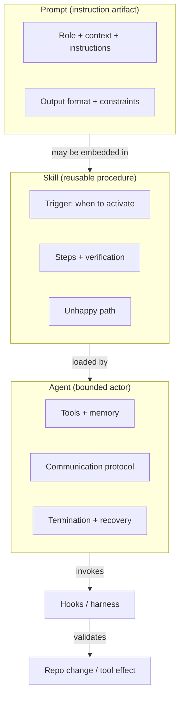
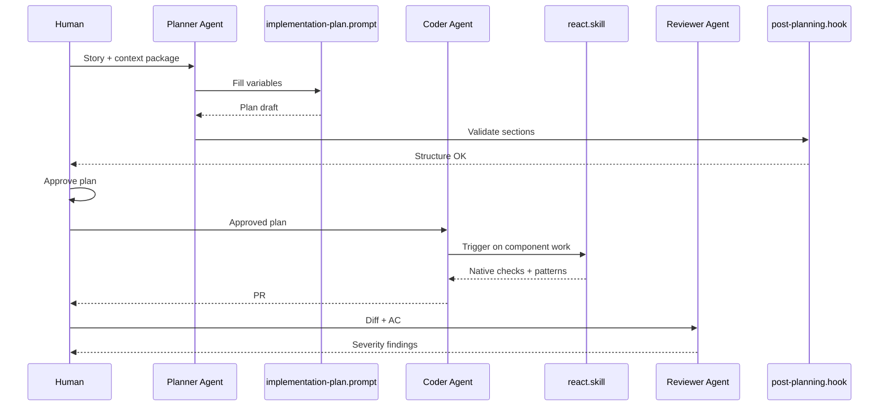

# Skills vs Prompts vs Agents

> **Handbook:** Practitioner daily vocabulary  
> **Repo anchors:** [`content/03-skill-engineering/`](../03-skill-engineering/README.md) · [`content/01-prompt-engineering/`](../01-prompt-engineering/README.md) · [`content/04-agent-engineering/`](../04-agent-engineering/README.md)  
> **Version:** 1.0 | **Updated:** 2026-07-16

---

## Purpose

Stop the most expensive confusion in AI-assisted teams: calling every pasted XML blob a “skill,” every chat session an “agent,” and every checklist a “prompt.” This chapter defines the three layers, when to use each, and how they compose in a UI/platform delivery loop.

## Why this distinction matters

| If you confuse… | You get… |
|-----------------|----------|
| Prompt ≈ Skill | One-off text that never becomes reusable procedure |
| Skill ≈ Agent | Procedures without tools, memory, or termination — or agents that reinvent procedure every run |
| Agent ≈ Hook | Soft suggestions where you needed a hard gate |

In a React/Next UI org, the failure mode looks like: “We have 40 prompts in Notion, no versioned skills, and agents that rewrite button accessibility rules differently every PR.”

## Mental model



## Definitions (use these in standups)

### Prompt

A **versioned instruction artifact**. It tells a model what to produce for a specific stage. It does not own tools or loops.

**Canonical examples in this repo:**

- [`content/08-ai-sdlc/prompts/implementation-plan.prompt.md`](../08-ai-sdlc/prompts/implementation-plan.prompt.md)
- [`content/08-ai-sdlc/prompts/coding.prompt.md`](../08-ai-sdlc/prompts/coding.prompt.md)
- [`content/01-prompt-engineering/templates/system-prompt.template.md`](../01-prompt-engineering/templates/system-prompt.template.md)

**Authoring convention (AIES):** XML sections `<role>`, `<context>`, `<instructions>`, `<output_format>`, `<constraints>`. That is repository authoring discipline — your runtime may compile to another format if the semantics survive.

### Skill

A **reusable procedure** with a trigger, steps, verification, and failure path. Skills are how you productize “how we debug React hooks” so every agent/session does not invent a new method.

**Canonical examples:**

- [`content/03-skill-engineering/skills/debug.skill.md`](../03-skill-engineering/skills/debug.skill.md)
- [`content/03-skill-engineering/skills/security.skill.md`](../03-skill-engineering/skills/security.skill.md)
- [`content/03-skill-engineering/skills/code-review.skill.md`](../03-skill-engineering/skills/code-review.skill.md)
- Cookbook skills such as [`content/cookbook/react/skills/react.skill.md`](../cookbook/react/skills/react.skill.md)

**Skill must answer:**

1. **When** does this activate?  
2. **How** do you execute (ordered steps)?  
3. **How do you know it worked?**  
4. **What if it fails?**

If it only has a prompt body, it is still a prompt.

### Agent

A **bounded actor** with tools, memory requirements, communication rules, and termination criteria. Agents *use* prompts and skills; they are not synonyms for either.

**Canonical example:** [`content/04-agent-engineering/agents/coder.agent.md`](../04-agent-engineering/agents/coder.agent.md)

**Agent must answer:**

1. What may it read/write?  
2. When does it stop (success and failure)?  
3. Who does it escalate to?  
4. How does the harness validate tool effects?

## Decision table — what should I create?

| Situation | Create | Do not create |
|-----------|--------|---------------|
| One stage, one output shape (plan, RCA, story) | **Prompt** | Agent |
| Recurring method across tickets (a11y review, React debug) | **Skill** | Copy-paste prompt in Slack |
| Multi-step work with tools, loops, budgets | **Agent** (+ skills) | Giant mega-prompt |
| Must block merge/deploy on missing sections | **Hook** (see [Hooks in practice](./hooks-in-practice.md)) | Hope the agent remembers |
| Needs GitHub/Jira/browser APIs | **MCP** + agent policy (see [MCP](./mcp-when-and-how.md)) | Stuff credentials into the prompt |

## Composition in a UI feature loop



## Worked example — “Add ReportForm”

| Layer | Artifact | What it contains |
|-------|----------|------------------|
| Prompt | `implementation-plan.prompt.md` | Mermaid, file list, sequence, rollback |
| Skill | `react.skill.md` | Hook rules, a11y, test commands |
| Agent | `coder.agent.md` | Tools, stop conditions, no deploy |
| Hook | planner `post-planning.hook.sh` | Grep for required plan sections |
| Pattern | [Planner](../patterns/planner-pattern/README.md) | End-to-end envelope |

Without the skill, the coder invents React patterns. Without the plan prompt, the skill has nothing to constrain. Without the agent, nothing owns the loop budget. Without the hook, incomplete plans still get “approved.”

## How to install and use skills (practical)

```bash
# From this repository root
mkdir -p .claude/skills
cp content/03-skill-engineering/skills/*.skill.md .claude/skills/
cp content/cookbook/react/skills/react.skill.md .claude/skills/

# Agents
mkdir -p .claude/agents
cp content/04-agent-engineering/agents/*.agent.md .claude/agents/
```

**Usage rule:** In the session, name the skill trigger (“use the React skill for this component”) rather than pasting the entire skill into the prompt every time. Pasting once into a system pack is fine; duplicating 6 KB into every user message is token waste (see [Containing token waste](./containing-token-waste.md)).

## Tradeoffs

| Choice | You gain | You pay |
|--------|----------|---------|
| Many thin prompts | Speed to first draft | Drift, no shared method |
| Few deep skills | Consistency across PRs | Upfront authoring + review |
| Agents for everything | Automation theater | Cost, loops, confused authority |
| Skills without hooks | Nice docs | Soft process, no gates |

## Anti-patterns

1. **“Skill” that is only a prompt** — Rename it or add trigger/verify/fail paths.  
2. **Agent with no termination** — Infinite spend.  
3. **Prompt that requests production deploy** — That is an effect; put it behind hooks + human approval.  
4. **One mega system prompt for the whole company** — Context rot; use progressive disclosure ([How to give context](./how-to-give-context.md)).  
5. **Skills that contradict the cookbook** — For React, the cookbook skill wins on stack specifics.

## Enterprise considerations

- Version skills and prompts with the PR that changes them (treat like code).  
- Security skills are mandatory for auth/PII surfaces — see [`security.skill.md`](../03-skill-engineering/skills/security.skill.md).  
- Agents that can call MCP tools inherit identity risk — map to [identity standards](../05-multi-agent-systems/standards/identity-and-delegation.md).

## Checklist

- [ ] Team glossary matches this chapter (prompt / skill / agent / hook / MCP)
- [ ] Recurring UI methods live as skills, not Slack snippets
- [ ] Stage outputs (plan, RCA, story) live as versioned prompts under `08-ai-sdlc/prompts/`
- [ ] Agents reference skills by name and declare tools + termination
- [ ] Hooks exist for any “must not ship incomplete” artifact

## Related

- [How to set up planning](./how-to-set-up-planning.md)
- [PR review with AI](./pr-review-with-ai.md)
- [XML structured prompts](../01-prompt-engineering/patterns/xml-structured.md)
- [Skill engineering README](../03-skill-engineering/README.md)
