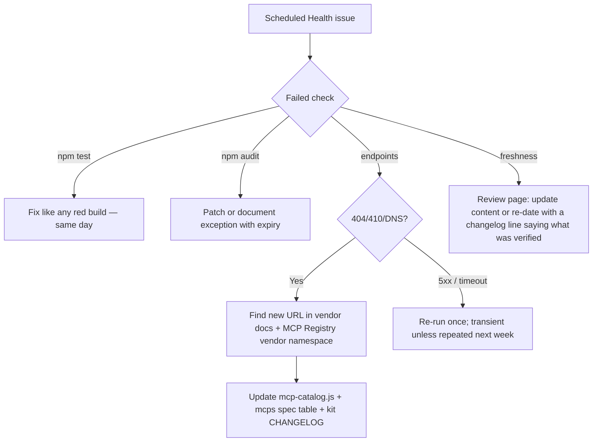

# Vendor Watchlist

> **Handbook:** Keep the standard and the kit correct while agent runtimes change monthly  
> **Owner:** AIES maintainers · **Cadence:** weekly automated check, monthly human review  
> **Version:** 1.0 | **Updated:** 2026-11-06

---

## Purpose

Name every external surface AIES depends on, how drift is detected, and who changes what when a vendor moves. This page is the triage runbook for the weekly *Scheduled Health* issue.

## Why

Between July and November 2026 alone: Windsurf became Devin Desktop with new paths, MCP shipped spec `2026-07-28`, four reference MCP servers were archived, Cursor and Copilot shipped native hooks and subagents, and Agent Skills became a cross-vendor standard. A standard that encodes file paths and endpoints is wrong within a quarter unless drift detection is automated and triage is owned.

## What is watched

| Surface | What AIES encodes | Detection | Source of truth to update |
|---------|-------------------|-----------|---------------------------|
| Runtime file layouts (9 runtimes) | Paths + frontmatter for rules, skills, subagents, commands, hooks, MCP | `npm run kit:check` (format conformance) · vendor changelog review | `packages/kit-core/lib/install-api.js` · `generate.js` · [Open standards matrix](./open-agent-standards.md) |
| Native hook protocols | stdin/stdout shapes for Claude, Cursor, Copilot, Kiro | `kit:check` guard behavior tests | `packages/kit-core/templates/aies-guard.mjs` · [Native agent hooks](./native-agent-hooks.md) |
| Remote MCP endpoints | 8 vendor-hosted URLs in the kit catalog | `scripts/check-external.mjs` (weekly; 404/410/DNS = moved) | `packages/kit-core/lib/mcp-catalog.js` · `content/mcps/**` deployment-status tables |
| MCP spec version | `2026-07-28` baseline, CIMD, stateless HTTP | Spec site + `check-external` doc probe | [MCP: remote servers & OAuth](./mcp-remote-servers-and-auth.md) · `content/mcps/**` |
| Vendor docs we cite | 12 canonical doc URLs | `scripts/check-external.mjs` | Chapter references |
| Model IDs and routing | Task-class routing in `MODEL_POLICY.md` | Monthly human review | `generate.js` model policy renderer |
| Page freshness | `Updated:` dates | `scripts/freshness-report.mjs` (90 days volatile, 120 default) | The flagged page |

## How — triage the weekly issue

1. **Endpoint moved** — confirm the replacement in vendor documentation *and* under the vendor's own reverse-DNS namespace in the MCP Registry. Never accept an aggregator or look-alike listing.
2. **Layout/format changed** — update the emitter, run `npm run kit:check`; if the layout snapshot changes intentionally, run `npm run kit:snapshot`, review the diff, bump the kit minor version, add a CHANGELOG entry, tag `create-aies-kit-vX.Y.Z`.
3. **Page stale** — re-dating without verification is falsification. The changelog line must state what was checked.

## Tradeoffs

| Choice | You gain | You pay |
|--------|----------|---------|
| Weekly automated probes | Drift found in days, not quarters | Occasional transient false positives |
| Liveness (401 = alive) rather than authenticated probes | No secrets in CI | Cannot detect a live endpoint that changed semantics |
| 90-day window for volatile pages | Vendor-specific guidance stays current | More review load on MCP and runtime pages |

## Anti-patterns

| Anti-pattern | Why it fails |
|--------------|--------------|
| Bumping `Updated:` dates in bulk to clear the report | Converts a drift signal into a false assurance claim |
| Adding a runtime target without a conformance test | Emits files the runtime silently ignores — the 1.x failure mode |
| Trusting MCP Registry search results by name | Registry contains look-alike and aggregator servers; only vendor namespaces are trustworthy |
| Closing the health issue without a linked fix | The next run reopens it; the team learns to ignore it |

## Enterprise considerations

- Forks that pin AIES for compliance should run the same `scheduled-health.yml` against their fork and treat endpoint changes as change-management events.
- Record vendor-surface changes in the SoA evidence log when they alter an enabled control (e.g., an MCP server moving regions).
- The kit release workflow refuses to publish without a matching CHANGELOG entry and a green conformance suite — keep that gate; it is the audit trail.

## Checklist

- [ ] `scheduled-health.yml` enabled and assigned an owner
- [ ] Health issues triaged within one week
- [ ] Every endpoint or layout change lands with a kit CHANGELOG entry
- [ ] Freshness re-dates carry a "what was verified" changelog line
- [ ] Monthly review of model IDs in `MODEL_POLICY.md` routing

## Changelog

- **1.0 — 2026-11-06:** Initial watchlist: surfaces, detection scripts, triage flow, release gate.
