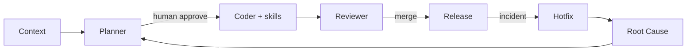

# AI Engineering Patterns

> **Browse from the Patterns menu** — twelve operational envelopes for consequential AI-assisted work.  
> **Version:** 1.2 | **Updated:** 2026-07-16

---

## Purpose

Patterns are **runnable specifications**, not essays and not a sidebar dump of thirteen stub files. Open a pattern README, follow its Mermaid workflow, use its prompt, and keep humans at the approval gates.

## Catalog

| Pattern | Outcome | Start here |
|---------|---------|------------|
| [Planner](./planner-pattern/README.md) | Decision-complete execution contracts | Multi-file / cross-boundary work |
| [Reviewer](./reviewer-pattern/README.md) | Severity-calibrated findings | Before merge |
| [Context](./context-pattern/README.md) | Minimal high-signal packages | Before planning or coding |
| [Debug](./debug-pattern/README.md) | Hypothesis-driven isolation | Defects with repro |
| [Migration](./migration-pattern/README.md) | Safe transitions with return path | Data/service moves |
| [Legacy Modernization](./legacy-modernization-pattern/README.md) | Incremental strangler seams | Behavior-preserving rewrites |
| [Architecture](./architecture-pattern/README.md) | Scenario-governed design | Material topology choices |
| [Optimization](./optimization-pattern/README.md) | Profile-guided improvement | Measured bottlenecks |
| [Enterprise](./enterprise-pattern/README.md) | Governed multi-tenant AI | Policy + jurisdiction |
| [Release](./release-pattern/README.md) | Progressive exposure + abort | Production promote |
| [Hotfix](./hotfix-pattern/README.md) | Smallest reversible containment | Active incident |
| [Root Cause](./root-cause-pattern/README.md) | Evidence-bound learning | After containment |



## How to apply

1. Match the problem to a pattern trigger (read **When / Do not**).  
2. Assemble context ([handbook](../handbook/how-to-give-context.md)).  
3. Follow `workflow.md` — do not skip human gates.  
4. Use `prompt.md` variables; do not rewrite the contract casually.  
5. Run hooks + checklist before calling done.

Component files (`problem.md`, `hooks.md`, …) support the README — they are not meant to flood navigation. Use in-page links from each pattern README.

## Practitioner handbook

For daily practice (skills vs prompts, HITL, PR review, tokens): [`../handbook/README.md`](../handbook/README.md).

## Validate

```bash
node content/patterns/validate-pattern-library.mjs
```

## Changelog

- 2026-07-16: Restored catalog landing for mega-menu browse; pointed to handbook; demphasized stub-file navigation.
