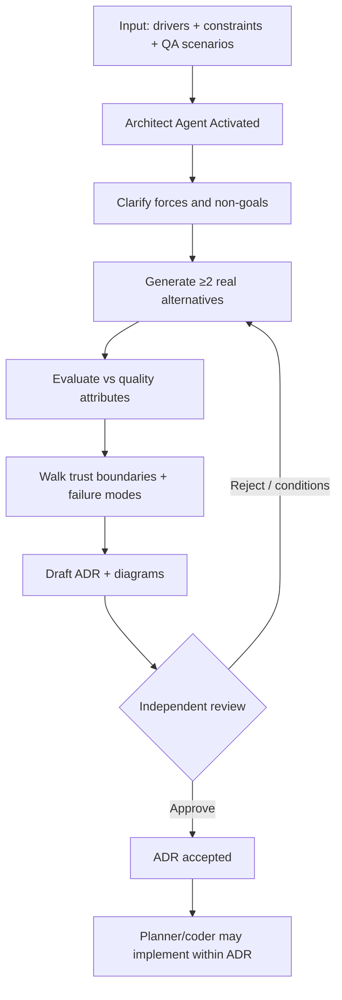

# Architecture Pattern

> **Pattern:** Architecture  
> **Category:** Design Decision & Review  
> **Maturity:** Stable v1.1  
> **Updated:** 2026-07-29

---

## Overview

The Architecture Pattern solves the most common failure before large builds: **diagrams that are never challenged, alternatives never recorded, and irreversible choices made without failure-mode or trust-boundary analysis**. Teams then discover tenancy, blast radius, and operability problems in production.

This pattern enforces ADR-quality decisions with explicit alternatives, quality-attribute scenarios, threat/failure walks, and independent review for High-risk designs.

## When to Apply

Apply this pattern when:
- A new service, store, or trust boundary is introduced
- Quality attributes conflict (latency vs consistency vs cost)
- Cross-team contracts or multi-region topology are in play
- Data classification / tenancy / AI tool boundaries change
- Reversibility is low (hard to undo after six months)

Do NOT apply this pattern to:
- Local refactors with no new boundary or store
- Choosing library X vs Y with identical architecture
- Ticket-sized bugfixes
- UI copy or CSS-only work

---

## Problem

```
architecture-pattern/problem.md
```

**Statement:** Systems ship with unchallenged topology: missing failure modes, unclear tenancy, irreversible coupling, and no recorded rejected alternatives — so “architecture” is a slide, not a decision.

**Measurable symptom:** Major incidents or rewrite programs traceable to unreviewed early topology choices.

**Root cause:** Design review is skipped or rubber-stamped; ADRs omit alternatives and operability; AI agents invent structures without quality-attribute analysis.

---

## Context Requirements

Before applying this pattern:
- [ ] Problem / drivers written (not “use Kubernetes”)
- [ ] Quality-attribute scenarios listed
- [ ] Current-state constraints known
- [ ] Independent reviewer available for High risk
- [ ] Decision will be recorded as ADR

---

## Workflow



---

## Prompt

See [prompt.md](./prompt.md) — grounded in [`architecture-review.prompt.md`](../../08-ai-sdlc/prompts/architecture-review.prompt.md).

---

## Agent Definition

```yaml
name: Architect Agent
role: |
  You produce ADR-quality architecture decisions with alternatives,
  quality-attribute evaluation, and failure/trust-boundary analysis.
  You do not write feature code. You do not self-approve High-risk ADRs.

tools:
  - read_file
  - search_files
  - list_directory
  # Denied: merge, deploy, silent ADR approve for High risk

memory:
  - existing_adrs
  - quality_attribute_scenarios
  - incident_lessons

termination:
  success: ADR drafted; alternatives recorded; review decision issued
  failure: Drivers unclear after 2 clarifications — escalate
```

---

## Subagents

| Subagent | Role | When Invoked |
|----------|------|--------------|
| Alternatives Generator | Forces ≥2 viable options | Early design |
| Failure Walker | Degraded dependency scenarios | Before review |
| Threat Boundary Mapper | Trust/data/identity edges | Before review |

---

## Skills Required

- Architecture / ADR writing
- Architecture review prompt
- Security boundary analysis for external trust edges

---

## Hooks

See [hooks.md](./hooks.md): require drivers + alternatives; block ADR without decision and consequences.

---

## Checklist

- [ ] Drivers and non-goals clear
- [ ] ≥2 real alternatives with reject reasons
- [ ] Quality attributes evaluated
- [ ] Failure + trust walks done
- [ ] Mermaid diagrams match interfaces
- [ ] Independent review for High risk
- [ ] ADR stored and linked

---

## Examples

See [examples/example.md](./examples/example.md) for ADR choosing event-driven order projection vs sync read-from-orders.

| Component | File |
|-----------|------|
| Problem | [problem.md](./problem.md) |
| Context | [context.md](./context.md) |
| Workflow | [workflow.md](./workflow.md) |
| Prompt | [prompt.md](./prompt.md) |
| Agent | [agent.md](./agent.md) |
| Subagents | [subagents.md](./subagents.md) |
| Skills | [skills.md](./skills.md) |
| Hooks | [hooks.md](./hooks.md) |
| Checklist | [checklist.md](./checklist.md) |
| Failures | [failures.md](./failures.md) |
| Enterprise | [enterprise-notes.md](./enterprise-notes.md) |

---

## Common Failures

### Failure 1: Slide-only architecture
**Symptom:** Pretty boxes; no ADR; implementers invent contracts.  
**Cause:** Review never forced a decision record.  
**Recovery:** Write ADR; freeze interfaces before coding.

### Failure 2: Single alternative
**Symptom:** “We will use Kafka” with no comparison.  
**Cause:** Solution shopping.  
**Recovery:** Force two options scored on QA scenarios.

### Failure 3: Self-approved High risk
**Symptom:** Author approved own multi-region data design.  
**Cause:** No SoD.  
**Recovery:** Invalidate; independent review.

---

## Enterprise Notes

- **Audit trail:** ADRs with approver identity linked to change programs.
- **SoD:** Author ≠ sole approver for High-risk topology.
- **Anti-claim:** An approved ADR is not a compliance certification.

## Tradeoffs

Scenario-governed ADRs slow start; undocumented topology choices create irreversible cost later.

## Anti-patterns

Architecture-by-chat; skipping rejected alternatives; no quality-attribute scenarios.

## Artifact index

| Artifact | Path |
|----------|------|
| Prompt | [prompt.md](./prompt.md) |
| Agent | [agent.md](./agent.md) |
| Skills | [skills.md](./skills.md) |
| MCPs | [mcps.md](./mcps.md) |
| Hooks | [hooks.md](./hooks.md) |
| Checklist | [checklist.md](./checklist.md) |
| Example | [examples/example.md](./examples/example.md) |

