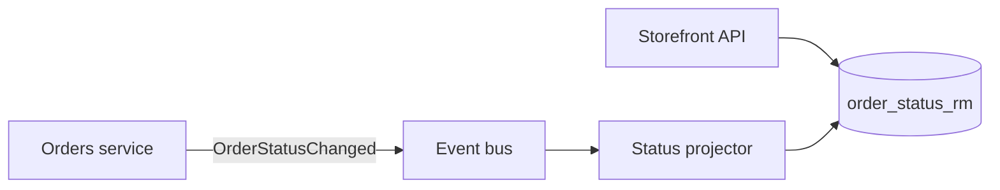

# Architecture Pattern — Example: Order read model

> **Pattern:** Architecture  
> **Component:** examples/example.md  
> **Version:** 1.1 | **Updated:** 2026-07-16  
> **Decision:** How should the Storefront read order status without coupling to Orders DB?

---

## ADR-0142: Storefront order status via projected read model (artifact)

**Status:** Accepted  
**Risk:** Medium

### Context

Storefront needs near-real-time order status. Orders service owns writes. Direct DB reads would couple deploy cycles and break tenancy isolation goals.

### Decision drivers

- p99 status read < 150ms  
- Orders deploy independent of Storefront  
- Tenant isolation enforced in read path  
- Eventual consistency ≤ 5s acceptable for status UI  

### Alternatives

| Option | Summary | Fit to QA | Reject reason |
|--------|---------|-----------|---------------|
| A. Sync REST to Orders | Storefront calls Orders API | Simple; adds Orders load | Couples availability; spikes on flash sales |
| B. Shared Orders DB read | Storefront SQL views | Fast | **Rejected** — breaks service boundary + tenancy ownership |
| C. Event-projected read model | Orders emits events; projector fills `order_status_rm` | Meets latency + decoupling | Chosen |

### Decision

Use option C: Orders publishes `OrderStatusChanged`; projector updates `order_status_rm`; Storefront reads only the read model with `org_id` predicate.

### Architecture diagrams



### Trust & failure analysis

| Scenario | Impact | Mitigation |
|----------|--------|------------|
| Event bus delay > 5s | Stale status | Show “updating…”; alert on lag p99 |
| Projector down | Reads stale | Page on consumer lag; scale projector |
| Poison event | Projector crash loop | DLQ + skip with metric |
| Missing org_id filter | Cross-tenant read | DB policy + integration test |

### Consequences

- Positive: Orders deploy decoupled; Storefront read p99 ~40ms in soak  
- Negative: Temporary inconsistency; ops owns lag alerts  
- Follow-ups: ADR for archive/TTL of read model rows  

### Re-review triggers

- Consistency SLO tightens below 1s  
- Multi-region active-active for Orders  

### Approval

```text
Reviewer: K. Ndlovu (independent)  Date: 2026-07-11
Decision: APPROVE WITH CONDITIONS
Conditions: Lag alert + tenant isolation test must land before Storefront cutover.
Author: A. Chen — not approver (SoD OK)
```

This example **is** the artifact — not a pointer elsewhere.
