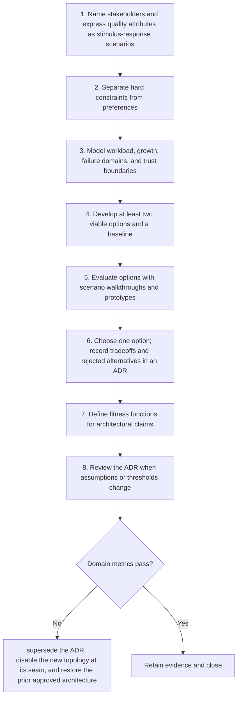

# Architecture: Workflow

> **Version:** 2.0 | **Updated:** 2026-07-16 | **Status:** Stable

## Purpose

Apply the domain workflow to choose and govern a system design against quantified quality-attribute scenarios.

## Procedure

1. **Name stakeholders and.** Name stakeholders and express quality attributes as stimulus-response scenarios.
2. **Separate hard constraints.** Separate hard constraints from preferences.
3. **Model workload, growth,.** Model workload, growth, failure domains, and trust boundaries.
4. **Develop at least.** Develop at least two viable options and a baseline.
5. **Evaluate options with.** Evaluate options with scenario walkthroughs and prototypes.
6. **Choose one option;.** Choose one option; record tradeoffs and rejected alternatives in an ADR.
7. **Define fitness functions.** Define fitness functions for architectural claims.
8. **Review the ADR.** Review the ADR when assumptions or thresholds change.

## Verification

- all priority scenarios have measurable responses
- prototype validates highest-risk assumption
- fitness functions run in CI or operations
- ADR review date and owner are current

## Tradeoffs

Architecture workflow deliberately spends additional review time to protect "all priority scenarios have measurable responses"; evidence weakness triggers "Supersede the ADR, disable the new topology at its seam, and restore the prior approved architecture".

## Anti-patterns

Architecture workflow rejects shortcuts around "Name stakeholders and express quality attributes as stimulus-response scenarios." because they sever the evidence chain required for "all priority scenarios have measurable responses".

## Enterprise considerations

Architecture workflow governance binds owner, policy revision, and retained proof to "all priority scenarios have measurable responses", with "Supersede the ADR, disable the new topology at its seam, and restore the prior approved architecture" as the recorded recovery authority.

## Checklist

- [ ] Name stakeholders and express quality attributes as stimulus-response scenarios
- [ ] Separate hard constraints from preferences
- [ ] Model workload, growth, failure domains, and trust boundaries
- [ ] Develop at least two viable options and a baseline
- [ ] Evaluate options with scenario walkthroughs and prototypes
- [ ] Choose one option; record tradeoffs and rejected alternatives in an ADR
- [ ] Define fitness functions for architectural claims
- [ ] Review the ADR when assumptions or thresholds change

## Changelog

- 2026-07-16: Replaced generic scaffolding with domain-specific production guidance.
