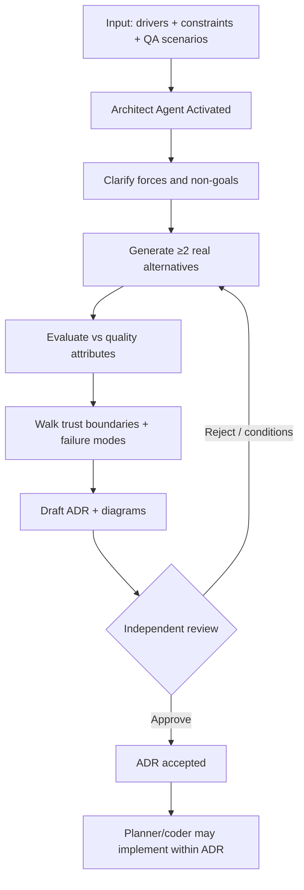

# Architecture Pattern — Workflow

> **Pattern:** Architecture  
> **Component:** workflow.md  
> **Version:** 1.1 | **Updated:** 2026-07-16

---

## End-to-end flow

## Step procedure

| Step | Actor | Action | Exit criteria |
|------|-------|--------|---------------|
| 1 | Human | Freeze drivers, QA scenarios, risk | Inputs reviewable |
| 2 | Architect | Restate forces and non-goals | Shared understanding |
| 3 | Alternatives Generator | Produce ≥2 viable options | Options table |
| 4 | Architect | Score vs QA scenarios | Winner + rejects |
| 5 | Failure Walker + Threat Mapper | Degraded modes + trust edges | Findings listed |
| 6 | Architect | Write ADR + Mermaid | Required sections present |
| 7 | Independent reviewer | Approve / conditions / reject | Named decision |
| 8 | Planner | Implement only within ADR | Plan cites ADR ID |

## Deviation rule

If implementation needs a different topology, **stop coding** and revise the ADR — do not silently diverge.

## Parallelism rule

Threat and failure walks can run in parallel after alternatives exist. Final ADR decision is serial.
