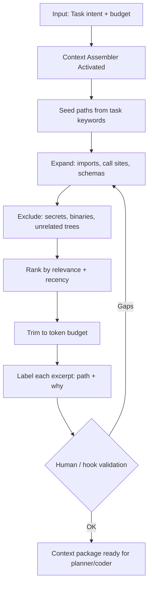

# Context Pattern

> **Pattern:** Context  
> **Category:** Context Engineering  
> **Maturity:** Stable v1.1  
> **Updated:** 2026-07-16

---

## Overview

The Context Pattern solves the most common failure before planning or coding: **stuffing the model with the wrong files, secrets, or an entire monorepo**. Too little context produces hallucinated APIs; too much context drowns the signal and burns tokens.

The Context Pattern enforces curated, labeled, minimal-high-signal packages — not “dump the repo.”

## When to Apply

Apply this pattern when:
- A planner, coder, reviewer, or debug agent needs codebase awareness
- The relevant surface spans multiple modules or services
- Prior agent runs failed due to missing or stale files
- Token budget is constrained relative to repo size
- Secrets, PII, or prod dumps must stay out of the prompt

Do NOT apply this pattern to:
- Single-file edits where the open buffer is already sufficient
- Pure prose questions with no code dependency
- Blind “index everything” RAG projects (use memory/knowledge patterns instead)

---

## Problem

```
context-pattern/problem.md
```

**Statement:** Agents receive either empty context or noisy whole-repo dumps, so they invent APIs, miss call sites, or leak sensitive data into prompts.

**Measurable symptom:** >25% of agent failures cite “I didn’t have file X” or invent symbols not in the package.

**Root cause:** Context is treated as a bag of text instead of an engineered artifact with inclusion rationale, exclusions, and size budgets.

---

## Context Requirements

Before applying this pattern:
- [ ] Task / story intent is known (what decision the context must support)
- [ ] Token or size budget is set
- [ ] Secret/PII exclusion rules exist
- [ ] Output path for the context package is defined

---

## Workflow



---

## Prompt

See [prompt.md](./prompt.md) for the full XML context-assembly prompt with bindable template variables.

---

## Agent Definition

```yaml
name: Context Assembler Agent
role: |
  You assemble minimal high-signal context packages for other agents.
  You do not plan architecture or write product code.
  Every excerpt must include path and inclusion rationale.

tools:
  - read_file
  - list_directory
  - search_files
  # Denied: write product code, exfiltrate secrets, unbounded repo tar

memory:
  - project_layout
  - exclusion_rules
  - prior_packages_for_similar_tasks

termination:
  success: Package within budget; every excerpt labeled; no secrets matched
  failure: Cannot find seed paths after search; escalate to human
```

---

## Subagents

| Subagent | Role | When Invoked |
|----------|------|--------------|
| Path Seeder | Maps task keywords → candidate paths | Start |
| Call-site Expander | Follows imports and references | After seed |
| Secret Scrubber | Greps for keys, tokens, PII patterns | Before emit |

---

## Skills Required

- Context curation skill — ranking and trimming
- Search / codebase navigation — finding call sites
- Security hygiene — secret and PII exclusion

---

## Hooks

See [hooks.md](./hooks.md): `pre-context.hook.sh` and `post-context.hook.sh` (budget + secret greps).

---

## Checklist

- [ ] Task intent recorded
- [ ] Budget set and respected
- [ ] Every excerpt has path + why
- [ ] Secrets/PII patterns absent
- [ ] Unrelated monorepo trees excluded
- [ ] Package handed to consuming agent (planner/coder/reviewer)

---

## Examples

See [examples/example.md](./examples/example.md) for a context package built for “add reports API” (path table, exclusions, size).

| Component | File |
|-----------|------|
| Problem | [problem.md](./problem.md) |
| Context | [context.md](./context.md) |
| Workflow | [workflow.md](./workflow.md) |
| Prompt | [prompt.md](./prompt.md) |
| Agent | [agent.md](./agent.md) |
| Subagents | [subagents.md](./subagents.md) |
| Skills | [skills.md](./skills.md) |
| Hooks | [hooks.md](./hooks.md) |
| Checklist | [checklist.md](./checklist.md) |
| Failures | [failures.md](./failures.md) |
| Enterprise | [enterprise-notes.md](./enterprise-notes.md) |

---

## Common Failures

### Failure 1: Whole-repo dump
**Symptom:** Agent ignores the relevant 3 files inside 200k tokens of noise.  
**Cause:** No ranking or budget.  
**Recovery:** Re-assemble with seed→expand→trim; hard budget.

### Failure 2: Missing call sites
**Symptom:** Planner designs a new helper that already exists.  
**Cause:** Seeded implementation files but not consumers.  
**Recovery:** Expand to importers and route registrations.

### Failure 3: Secrets in context
**Symptom:** `.env` or prod dump appears in the package.  
**Cause:** No scrubber.  
**Recovery:** Delete package; rotate if exposed; fix exclusion hooks.

---

## Enterprise Notes

- **Audit trail:** Keep context package hash + task ID with the change.
- **SoD:** Assembler may build packages; security owns exclusion rule changes.
- **Anti-claim:** A curated package is not a data-classification certification.
