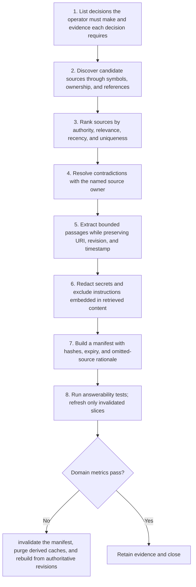

# Context: Workflow

> **Version:** 2.0 | **Updated:** 2026-07-16 | **Status:** Stable

## Purpose

Apply the domain workflow to construct a minimal, provenance-bearing information package that preserves decision quality.

## Procedure

1. **List decisions the.** List decisions the operator must make and evidence each decision requires.
2. **Discover candidate sources.** Discover candidate sources through symbols, ownership, and references.
3. **Rank sources by.** Rank sources by authority, relevance, recency, and uniqueness.
4. **Resolve contradictions with.** Resolve contradictions with the named source owner.
5. **Extract bounded passages.** Extract bounded passages while preserving URI, revision, and timestamp.
6. **Redact secrets and.** Redact secrets and exclude instructions embedded in retrieved content.
7. **Build a manifest.** Build a manifest with hashes, expiry, and omitted-source rationale.
8. **Run answerability tests;.** Run answerability tests; refresh only invalidated slices.

## Verification

- required-decision source recall = 100%
- irrelevant token ratio < 20%
- stale authoritative source rate < 2%
- every excerpt has provenance

## Tradeoffs

Context workflow deliberately spends additional review time to protect "required-decision source recall = 100%"; evidence weakness triggers "Invalidate the manifest, purge derived caches, and rebuild from authoritative revisions".

## Anti-patterns

Context workflow rejects shortcuts around "List decisions the operator must make and evidence each decision requires." because they sever the evidence chain required for "required-decision source recall = 100%".

## Enterprise considerations

Context workflow governance binds owner, policy revision, and retained proof to "required-decision source recall = 100%", with "Invalidate the manifest, purge derived caches, and rebuild from authoritative revisions" as the recorded recovery authority.

## Checklist

- [ ] List decisions the operator must make and evidence each decision requires
- [ ] Discover candidate sources through symbols, ownership, and references
- [ ] Rank sources by authority, relevance, recency, and uniqueness
- [ ] Resolve contradictions with the named source owner
- [ ] Extract bounded passages while preserving URI, revision, and timestamp
- [ ] Redact secrets and exclude instructions embedded in retrieved content
- [ ] Build a manifest with hashes, expiry, and omitted-source rationale
- [ ] Run answerability tests; refresh only invalidated slices

## Changelog

- 2026-07-16: Replaced generic scaffolding with domain-specific production guidance.
