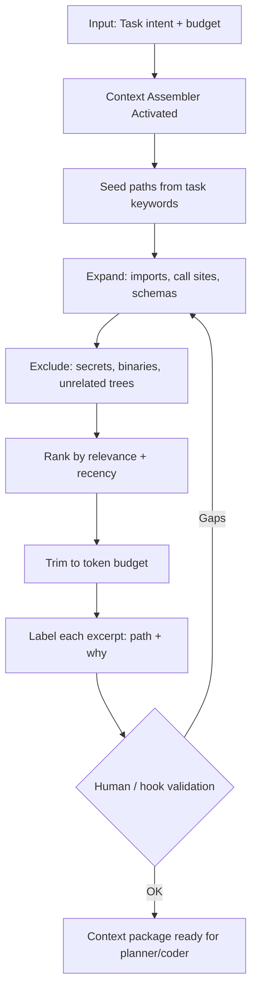

# Context Pattern — Workflow

> **Pattern:** Context  
> **Component:** workflow.md  
> **Version:** 1.1 | **Updated:** 2026-07-16

---

## End-to-end flow

## Step procedure

| Step | Actor | Action | Exit criteria |
|------|-------|--------|---------------|
| 1 | Human / harness | State intent + budget + exclusions | Inputs frozen |
| 2 | Path Seeder | Keyword/symbol → candidate paths | ≥1 seed path |
| 3 | Call-site Expander | Follow imports, routes, schema refs | Consumer + producer files listed |
| 4 | Assembler | Drop unrelated trees, generated noise | Exclusion log written |
| 5 | Secret Scrubber | Grep keys/tokens/PII patterns | Zero hits or redacted |
| 6 | Assembler | Rank and trim to budget | Size ≤ budget |
| 7 | Assembler | Label path + why per excerpt | Every block labeled |
| 8 | Hook / human | Validate structure | Package accepted |

## Deviation rule

If the consuming agent asks for a file that should have been included, **do not** silently paste ad hoc — update the package, re-run scrubber/budget hooks, then continue.

## Parallelism rule

Seeding multiple keyword clusters can run in parallel; scrubbing and final trim must be serial before handoff.
