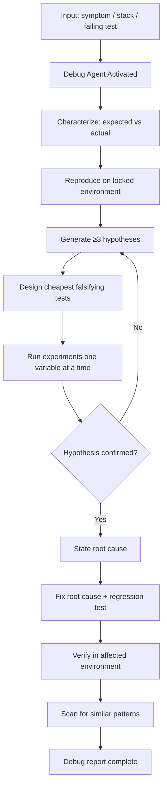

# Debug Pattern

> **Pattern:** Debug  
> **Category:** Defect Diagnosis  
> **Maturity:** Stable v1.1  
> **Updated:** 2026-07-16

---

## Overview

The Debug Pattern solves the most common failure when something breaks: **jumping to a fix before characterizing the bug or falsifying hypotheses**. Symptom-chasing creates regressions and leaves the real defect intact.

The Debug Pattern enforces reproduce → hypothesize → experiment → root cause → fix → verify — not “patch and pray.”

## When to Apply

Apply this pattern when:
- Actual behavior violates a specified or previously working expectation
- A stack trace, failing test, or error rate spike exists
- The failure is intermittent or environment-sensitive
- Multiple plausible causes remain
- A prior “quick fix” did not hold

Do NOT apply this pattern to:
- Feature requests mislabeled as bugs
- Obvious typos/syntax errors with a clear one-line fix
- Third-party outages where your only action is workaround + vendor ticket
- Active SEV1 firefighting that needs containment first (stabilize; then debug for RCA)

---

## Problem

```
debug-pattern/problem.md
```

**Statement:** Engineers and agents apply speculative fixes without reproduction or hypothesis tests, so the defect returns or a different layer breaks.

**Measurable symptom:** >40% of “fixed” bugs reopen within two weeks without a regression test.

**Root cause:** Optimization for “make the error go away” instead of isolating a causal factor under controlled experiments.

---

## Context Requirements

Before applying this pattern:
- [ ] Expected vs actual behavior stated
- [ ] Reproduction notes or “not yet reproducible” explicitly flagged
- [ ] Access to logs/traces/metrics for the failing environment
- [ ] Known-good baseline or last-green commit identified when possible

---

## Workflow



---

## Prompt

See [prompt.md](./prompt.md) — aligned with [`debug.skill.md`](../../03-skill-engineering/skills/debug.skill.md) and [`root-cause-analysis.prompt.md`](../../08-ai-sdlc/prompts/root-cause-analysis.prompt.md) for production incidents.

---

## Agent Definition

```yaml
name: Debug Agent
role: |
  You diagnose defects with hypothesis-driven experiments.
  You produce root cause, not just a patch. You add a regression test.
  You do not ship speculative multi-file rewrites as “debugging.”

tools:
  - read_file
  - search_files
  - run_tests
  - read_logs          # when harness provides
  # Denied: production data mutation without approval, secret dump

memory:
  - failure_taxonomy
  - recent_changes
  - similar_incidents

termination:
  success: Root cause stated; fix verified; regression test added; similars scanned
  failure: Cannot reproduce after agreed attempts — document residual risk
```

---

## Subagents

| Subagent | Role | When Invoked |
|----------|------|--------------|
| Repro Locker | Pins env, versions, seed data | Before experiments |
| Hypothesis Tester | Runs single-variable checks | During experiments |
| Similarity Scanner | Finds same anti-pattern elsewhere | After fix |

---

## Skills Required

- `debug.skill.md` — hypothesis procedure
- Root-cause / RCA prompt for production incidents
- Code search for similar risks

---

## Hooks

See [hooks.md](./hooks.md): require characterization file; require regression test mention after fix.

---

## Checklist

- [ ] Expected vs actual recorded
- [ ] Reproduced (or explicitly not)
- [ ] ≥3 hypotheses with tests
- [ ] Root cause one sentence
- [ ] Fix addresses root cause
- [ ] Regression test fails before / passes after
- [ ] Similar patterns scanned

---

## Examples

See [examples/example.md](./examples/example.md) for intermittent 500 from Redis cache race (hypothesis table + fix).

| Component | File |
|-----------|------|
| Problem | [problem.md](./problem.md) |
| Context | [context.md](./context.md) |
| Workflow | [workflow.md](./workflow.md) |
| Prompt | [prompt.md](./prompt.md) |
| Agent | [agent.md](./agent.md) |
| Subagents | [subagents.md](./subagents.md) |
| Skills | [skills.md](./skills.md) |
| Hooks | [hooks.md](./hooks.md) |
| Checklist | [checklist.md](./checklist.md) |
| Failures | [failures.md](./failures.md) |
| Enterprise | [enterprise-notes.md](./enterprise-notes.md) |

---

## Common Failures

### Failure 1: Symptom → fix
**Symptom:** Error message silenced; root race remains.  
**Cause:** No hypotheses.  
**Recovery:** Revert speculative patch; run full debug workflow.

### Failure 2: Multi-variable thrash
**Symptom:** Changed five things; “it works”; nobody knows why.  
**Cause:** Experiments not single-factor.  
**Recovery:** Bisect changes; re-confirm with one variable.

### Failure 3: No regression test
**Symptom:** Bug returns next month.  
**Cause:** Fix without failing-first test.  
**Recovery:** Add test that fails on old behavior; keep it.

---

## Enterprise Notes

- **Audit trail:** Keep debug report + regression test with the incident/PR.
- **SoD:** For prod data access, debugger ≠ unrestricted prod admin without approval.
- **Anti-claim:** A debug report is not a completed blameless postmortem unless RCA sections are filled.
