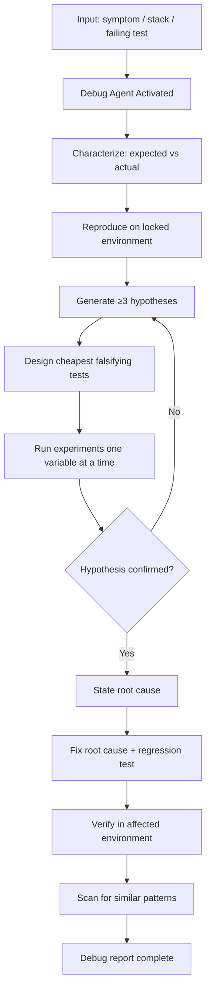

# Debug Pattern — Workflow

> **Pattern:** Debug  
> **Component:** workflow.md  
> **Version:** 1.1 | **Updated:** 2026-07-16

---

## End-to-end flow

## Step procedure

| Step | Actor | Action | Exit criteria |
|------|-------|--------|---------------|
| 1 | Human / alert | Capture symptom package | Expected/actual/env set |
| 2 | Repro Locker | Pin versions, flags, dataset | Repro rate known |
| 3 | Debug | Characterize bug (verbatim error) | Characterization section done |
| 4 | Debug | Write ≥3 ranked hypotheses | Hypothesis table exists |
| 5 | Hypothesis Tester | Cheapest falsifying experiment first | Confirm or rule out |
| 6 | Debug | Iterate until one hypothesis holds | Root cause sentence |
| 7 | Debug / coder | Fix cause; add regression test | Test fails on old, passes on new |
| 8 | Debug | Verify in target env; scan similars | Report complete |

## Deviation rule

If containment actions (feature flag off, rollback) are needed mid-debug, **do them**, then resume hypothesis work for the durable fix. Do not treat containment as root cause.

## Parallelism rule

Independent cheap experiments may run in parallel only if they do not mutate shared state. Never change code and infra “to see” in one step.
