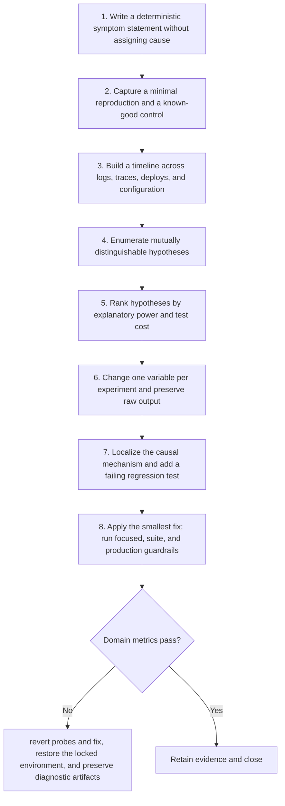

# Debug: Workflow

> **Version:** 2.0 | **Updated:** 2026-07-16 | **Status:** Stable

## Purpose

Apply the domain workflow to isolate a software defect through reproducible observations and falsifiable experiments.

## Procedure

1. **Write a deterministic.** Write a deterministic symptom statement without assigning cause.
2. **Capture a minimal.** Capture a minimal reproduction and a known-good control.
3. **Build a timeline.** Build a timeline across logs, traces, deploys, and configuration.
4. **Enumerate mutually distinguishable.** Enumerate mutually distinguishable hypotheses.
5. **Rank hypotheses by.** Rank hypotheses by explanatory power and test cost.
6. **Change one variable.** Change one variable per experiment and preserve raw output.
7. **Localize the causal.** Localize the causal mechanism and add a failing regression test.
8. **Apply the smallest.** Apply the smallest fix; run focused, suite, and production guardrails.

## Verification

- reproduction rate before fix is recorded
- regression test fails before and passes after
- no unrelated variable changes during causal experiment
- recurrence monitor remains clear for one release window. For the Debug workflow contract, gate 1 is evidenced by "reproduction rate before fix is recorded"; failure invokes this domain recovery: Revert probes and fix, restore the locked environment, and preserve diagnostic artifacts.

## Tradeoffs

Debug workflow deliberately spends additional review time to protect "reproduction rate before fix is recorded"; evidence weakness triggers "Revert probes and fix, restore the locked environment, and preserve diagnostic artifacts".

## Anti-patterns

Debug workflow rejects shortcuts around "Write a deterministic symptom statement without assigning cause." because they sever the evidence chain required for "reproduction rate before fix is recorded".

## Enterprise considerations

Debug workflow governance binds owner, policy revision, and retained proof to "reproduction rate before fix is recorded", with "Revert probes and fix, restore the locked environment, and preserve diagnostic artifacts" as the recorded recovery authority.

## Checklist

- [ ] Write a deterministic symptom statement without assigning cause
- [ ] Capture a minimal reproduction and a known-good control
- [ ] Build a timeline across logs, traces, deploys, and configuration
- [ ] Enumerate mutually distinguishable hypotheses
- [ ] Rank hypotheses by explanatory power and test cost
- [ ] Change one variable per experiment and preserve raw output
- [ ] Localize the causal mechanism and add a failing regression test
- [ ] Apply the smallest fix; run focused, suite, and production guardrails

## Changelog

- 2026-07-16: Replaced generic scaffolding with domain-specific production guidance.
