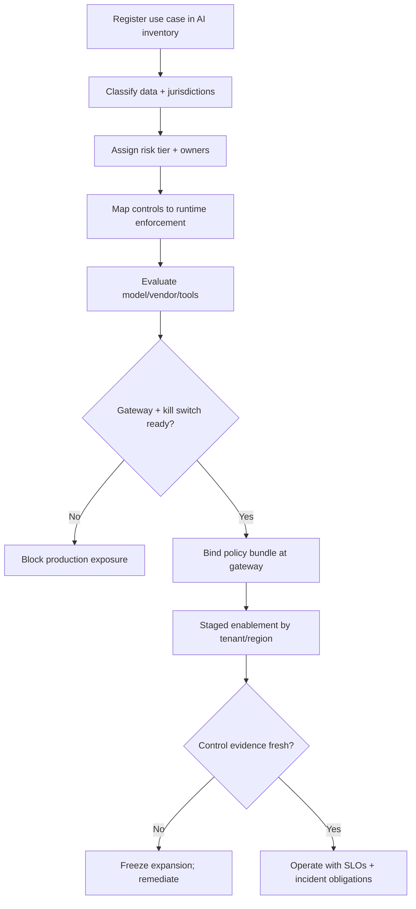

# Enterprise Pattern

> **Pattern:** Enterprise  
> **Category:** Governance & Multi-Tenant AI Ops  
> **Maturity:** Stable v1.1 | **Updated:** 2026-07-16

---

## Overview

The Enterprise Pattern prevents the failure mode where teams **deploy AI capabilities that work in a demo and cannot be governed in production**: no system inventory, unclear data classification, missing kill switches, and policy PDFs that never bind the runtime gateway.

This pattern enforces inventory → risk tier → control map → gateway enforcement → evidence → incident obligations — before material AI use crosses tenants or jurisdictions.

## When to Apply

Apply this pattern when:
- Personal data, regulated data, or cross-border processing is in scope
- AI output contributes to a material decision (credit, access, clinical, employment, safety)
- Shared AI platform serves multiple business units, brands, or regions
- Tools/MCP connectors can take external actions (email, tickets, cloud APIs)
- Leadership needs an enforceable go-live gate, not a slide deck

Do NOT apply this pattern to:
- Local prototyping on synthetic data with no production path
- Pure offline research notebooks with no user-facing or automated action
- Single-team internal copilots already covered by an existing approved use-case record (extend that record; do not invent a parallel governance stack)
- Active incident containment (use [hotfix-pattern](../hotfix-pattern/README.md); update controls after)

---

## Problem

```
enterprise-pattern/problem.md
```

**Statement:** AI features ship with policy documents and vendor assurances but without an inventory entry, risk tier, runtime policy gateway, or proven disable path — leaving the organization unable to answer “what models touch what data where?” during audits or incidents.

**Measurable symptom:** On-call cannot disable a use case in <15 minutes, or security cannot list all production prompts/models/tools for a business unit within one working day.

**Root cause:** Governance treated as documentation after build, instead of as runtime controls and evidence gates before exposure.

---

## Context Requirements

Before applying this pattern:
- [ ] AI system / use-case inventory exists (or this engagement creates the first entry)
- [ ] Data classification and residency constraints known
- [ ] Risk tier assigned with named owner
- [ ] Policy gateway (or equivalent enforcement point) can bind model/prompt/tool policy
- [ ] Kill switch / disable path rehearsed

---

## Workflow



---

## Prompt

See [prompt.md](./prompt.md) — full XML with bindable template variables for inventory, risk, controls, and go-live package.

---

## Agent Definition

```yaml
name: Enterprise AI Governance Agent
role: |
  You produce governable go-live packages: inventory fields, risk tier,
  control map, gateway bindings, and disable procedures. You do not waive
  high-risk controls. You do not claim external certification.
```

Full YAML: [agent.md](./agent.md)

---

## Subagents

| Subagent | Role | When Invoked |
|---------|------|-------------|
| Inventory Registrar | Creates/updates system record | Start |
| Data Flow Mapper | Classifies data + residency | After registration |
| Control Mapper | Maps tier → enforceable controls | After risk tier |
| Gateway Binder | Emits policy bundle + kill switch test | Before enablement |

---

## Skills Required

- Responsible AI / risk assessment skill  
- Security least-privilege / MCP OAuth skill  
- Prompt-injection defense skill  
- Audit logging / evidence skill  

---

## Hooks

Executable checks in [hooks.md](./hooks.md): inventory ID, risk tier, kill-switch test evidence, no “certificate replaces control” language.

---

## Checklist

See [checklist.md](./checklist.md). Gate: no production traffic until gateway binding and disable drill pass.

---

## Examples

See [examples/example.md](./examples/example.md) — multi-region support copilot with tool actions, inline inventory + control map + disable drill.

| Component | File |
|-----------|------|
| Problem | [problem.md](./problem.md) |
| Context | [context.md](./context.md) |
| Workflow | [workflow.md](./workflow.md) |
| Prompt | [prompt.md](./prompt.md) |
| Agent | [agent.md](./agent.md) |
| Subagents | [subagents.md](./subagents.md) |
| Skills | [skills.md](./skills.md) |
| Hooks | [hooks.md](./hooks.md) |
| Checklist | [checklist.md](./checklist.md) |
| Failures | [failures.md](./failures.md) |
| Enterprise | [enterprise-notes.md](./enterprise-notes.md) |

---

## Common Failures

### Failure 1: Policy PDF as control
**Symptom:** Audit asks for enforcement evidence; team produces a Confluence page.  
**Cause:** Controls never bound at the gateway.  
**Recovery:** Freeze use case; bind deny-by-default policy; re-drill kill switch.

### Failure 2: Shadow tools
**Symptom:** Agent calls an unsanctioned MCP/server in prod.  
**Cause:** Tool allowlist absent or bypassed in “debug” mode.  
**Recovery:** Revoke credentials; enforce allowlist; add detection for unknown tool names.

### Failure 3: Inventory drift
**Symptom:** Incident responders discover a second model endpoint.  
**Cause:** Inventory updated at launch then abandoned.  
**Recovery:** Reconcile from gateway logs; make inventory a release gate.

---

## Enterprise Notes

- Map to existing risk, privacy, and change boards — do not invent a parallel “AI-only” bureaucracy that nobody uses.
- This pattern produces **internal operating evidence**, not ISO/NIST/EU Act certification claims.
- Cross-border: residency and subprocessors are runtime routing constraints, not footnotes.
