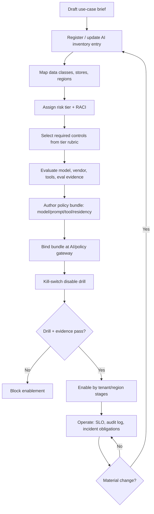

# Enterprise Pattern — Workflow

> **Pattern:** Enterprise  
> **Component:** workflow.md  
> **Version:** 1.1 | **Updated:** 2026-07-16

---

## End-to-end flow

## Step procedure

| Step | Actor | Action | Exit criteria |
|------|-------|--------|---------------|
| 1 | Business + tech owners | Write use-case brief (users, actions, data) | Brief reviewable |
| 2 | Inventory Registrar | Create/update inventory ID | Stable `AI-SYS-####` |
| 3 | Data Flow Mapper | Classify data; list processors/regions | Data-flow table complete |
| 4 | Risk owner | Assign tier; list mandatory controls | Tier + RACI signed |
| 5 | Control Mapper | Map each control to **runtime** evidence | No “PDF-only” controls for musts |
| 6 | Platform | Evaluate model/tools; record versions | Eval artifact linked |
| 7 | Gateway Binder | Bind policy bundle; version hash | Gateway shows active version |
| 8 | On-call + platform | Disable drill (<15m for high tier) | Drill log with timestamps |
| 9 | Owners | Staged enablement (pilot tenants → regions) | Expansion criteria met |
| 10 | Ops | Monitor quality/safety/cost SLOs | Alert routes tested |

## Material change rule

Any of these forces a return to inventory update and re-bind: new data class, new region, new tool with side effects, model/provider swap, prompt change that alters decision authority, or new automated action.

## Parallelism rule

Do not enable a second high-risk use case on the same gateway path until the first has a green disable drill and inventory entry. Shared misconfiguration multiplies blast radius.
