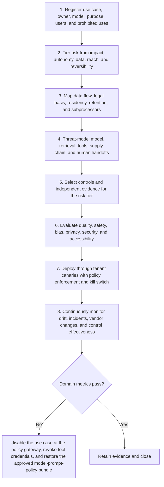

# Enterprise: Workflow

> **Version:** 2.0 | **Updated:** 2026-07-16 | **Status:** Stable

## Purpose

Apply the domain workflow to operate AI capabilities with enforceable governance across tenants, jurisdictions, and risk tiers.

## Procedure

1. **Register use case,.** Register use case, owner, model, purpose, users, and prohibited uses.
2. **Tier risk from.** Tier risk from impact, autonomy, data, reach, and reversibility.
3. **Map data flow,.** Map data flow, legal basis, residency, retention, and subprocessors.
4. **Threat-model model, retrieval,.** Threat-model model, retrieval, tools, supply chain, and human handoffs.
5. **Select controls and.** Select controls and independent evidence for the risk tier.
6. **Evaluate quality, safety,.** Evaluate quality, safety, bias, privacy, security, and accessibility.
7. **Deploy through tenant.** Deploy through tenant canaries with policy enforcement and kill switch.
8. **Continuously monitor drift,.** Continuously monitor drift, incidents, vendor changes, and control effectiveness.

## Verification

- inventory completeness = 100%
- high-risk controls have independent evidence
- policy decisions are attributable and retrievable < 1 business day. For the Enterprise workflow contract, gate 1 is evidenced by "inventory completeness = 100%"; failure invokes this domain recovery: Disable the use case at the policy gateway, revoke tool credentials, and restore the approved model-prompt-policy bundle.
- risk-tier SLO and harm indicators stay within threshold. For the Enterprise workflow contract, gate 2 is evidenced by "inventory completeness = 100%"; failure invokes this domain recovery: Disable the use case at the policy gateway, revoke tool credentials, and restore the approved model-prompt-policy bundle.

## Tradeoffs

Enterprise workflow deliberately spends additional review time to protect "inventory completeness = 100%"; evidence weakness triggers "Disable the use case at the policy gateway, revoke tool credentials, and restore the approved model-prompt-policy bundle".

## Anti-patterns

Enterprise workflow rejects shortcuts around "Register use case, owner, model, purpose, users, and prohibited uses." because they sever the evidence chain required for "inventory completeness = 100%".

## Enterprise considerations

Enterprise workflow governance binds owner, policy revision, and retained proof to "inventory completeness = 100%", with "Disable the use case at the policy gateway, revoke tool credentials, and restore the approved model-prompt-policy bundle" as the recorded recovery authority.

## Checklist

- [ ] Register use case, owner, model, purpose, users, and prohibited uses
- [ ] Tier risk from impact, autonomy, data, reach, and reversibility
- [ ] Map data flow, legal basis, residency, retention, and subprocessors
- [ ] Threat-model model, retrieval, tools, supply chain, and human handoffs
- [ ] Select controls and independent evidence for the risk tier
- [ ] Evaluate quality, safety, bias, privacy, security, and accessibility
- [ ] Deploy through tenant canaries with policy enforcement and kill switch
- [ ] Continuously monitor drift, incidents, vendor changes, and control effectiveness

## Changelog

- 2026-07-16: Replaced generic scaffolding with domain-specific production guidance.
