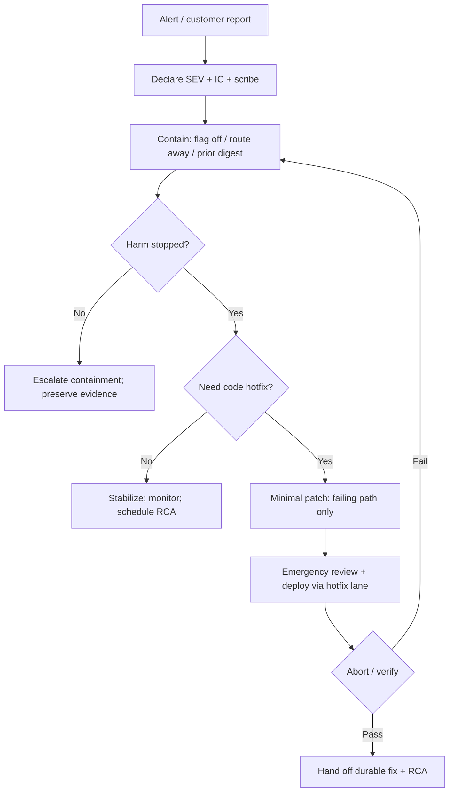

# Hotfix Pattern

> **Pattern:** Hotfix  
> **Category:** Incident Containment & Emergency Change  
> **Maturity:** Stable v1.1 | **Updated:** 2026-07-16

---

## Overview

The Hotfix Pattern prevents the failure mode where teams **debug and refactor under customer harm** instead of containing first. Without an incident commander, a last-known-good artifact, and a minimal reversible change, “hotfixes” become unscoped weekends that widen the outage.

This pattern enforces: declare command → contain → minimal patch or rollback → verify → hand off to durable fix + RCA.

## When to Apply

Apply this pattern when:
- Customer harm is active or imminent (errors, wrong data, safety, security exposure)
- Normal [release-pattern](../release-pattern/README.md) lead time exceeds incident tolerance
- Incident commander authorizes the emergency path
- A last-known-good artifact or feature-flag disable can restore service

Do NOT apply this pattern to:
- Non-incident debt, refactors, dependency upgrades, or “while we’re here” cleanup
- Speculative performance work ([optimization-pattern](../optimization-pattern/README.md))
- Planned releases with full gates available (use release-pattern)
- Blameless RCA facilitation itself ([root-cause-pattern](../root-cause-pattern/README.md) after containment)

---

## Problem

```
hotfix-pattern/problem.md
```

**Statement:** Under pressure, teams ship large, unreviewed changes or keep debugging while impact grows — extending time-to-containment and creating secondary incidents.

**Measurable symptom:** Time-to-containment misses severity target, or hotfix PR touches files unrelated to the failing path.

**Root cause:** Incident response optimizes for “finding the bug” instead of “stopping the bleeding” with a rehearsed, minimal, reversible action.

---

## Context Requirements

Before applying this pattern:
- [ ] Severity declared; incident commander and scribe named
- [ ] Impact scope known (users, regions, %, revenue if applicable)
- [ ] Last-known-good digest or disable flag identified
- [ ] Communication channel and cadence set
- [ ] Rollback/disable command tested or recently drilled

---

## Workflow



---

## Prompt

See [prompt.md](./prompt.md) — aligns with [`../../08-ai-sdlc/prompts/incident.prompt.md`](../../08-ai-sdlc/prompts/incident.prompt.md).

---

## Agent Definition

```yaml
name: Hotfix / Incident Support Agent
role: |
  You support the incident commander with containment options, minimal patch
  scope, and verification. You do not take IC authority. You do not expand
  scope into refactors.
```

Full YAML: [agent.md](./agent.md)

---

## Subagents

| Subagent | Role | When Invoked |
|---------|------|-------------|
| Impact Assessor | Quantifies blast radius | After declare |
| Containment Advisor | Flag / rollback / route options | Immediately |
| Minimal Diff Scout | Limits patch to failing path | If code needed |
| Verification Runner | Probes + metric checks | After action |

---

## Skills Required

- Incident command skill  
- Feature-flag / kill-switch skill  
- Rollback skill  
- Evidence preservation skill  

---

## Hooks

Executable checks in [hooks.md](./hooks.md): IC named, severity set, scope limited, no drive-by files.

---

## Checklist

See [checklist.md](./checklist.md).

---

## Examples

See [examples/example.md](./examples/example.md) — SEV1 checkout: flag disable then one-line null guard hotfix.

| Component | File |
|-----------|------|
| Problem | [problem.md](./problem.md) |
| Context | [context.md](./context.md) |
| Workflow | [workflow.md](./workflow.md) |
| Prompt | [prompt.md](./prompt.md) |
| Agent | [agent.md](./agent.md) |
| Subagents | [subagents.md](./subagents.md) |
| Skills | [skills.md](./skills.md) |
| Hooks | [hooks.md](./hooks.md) |
| Checklist | [checklist.md](./checklist.md) |
| Failures | [failures.md](./failures.md) |
| Enterprise | [enterprise-notes.md](./enterprise-notes.md) |

---

## Common Failures

### Failure 1: Debug past containment
**Symptom:** 45 minutes of live debugging while error rate stays high.  
**Cause:** No IC insistence on contain-first.  
**Recovery:** IC mandates flag/rollback now; debug on contained system.

### Failure 2: Hotfix as refactor
**Symptom:** Emergency PR reformats modules and upgrades libraries.  
**Cause:** Scope discipline collapsed.  
**Recovery:** Revert; ship minimal path-only patch; defer cleanup.

### Failure 3: No IC
**Symptom:** Multiple people deploy conflicting fixes.  
**Cause:** Role never declared.  
**Recovery:** Stop; declare IC; single-threaded changes.

---

## Enterprise Notes

- Privacy/legal join based on data exposure — IC escalates, agent does not freelance comms.
- Emergency path still records digests and decisions for audit; speed ≠ no evidence.
- Not a certification or regulatory “safe harbor.”
