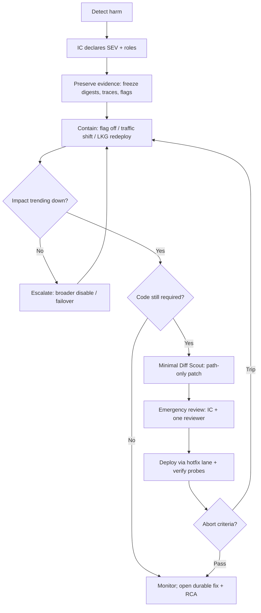

# Hotfix Pattern — Workflow

> **Pattern:** Hotfix  
> **Component:** workflow.md  
> **Version:** 1.1 | **Updated:** 2026-07-16

---

## End-to-end flow

## Step procedure

| Step | Actor | Action | Exit criteria |
|------|-------|--------|---------------|
| 1 | On-call | Page / open channel | Channel live |
| 2 | IC | Declare SEV, scribe, comms cadence | Roles in topic header |
| 3 | Scribe | Timeline starts | Timestamps flowing |
| 4 | Containment Advisor | Pick fastest reversible action | Harm reduced or next escalate |
| 5 | Ops | Execute contain; preserve evidence | Metrics show improvement |
| 6 | Minimal Diff Scout | If needed, smallest patch | Diff limited to failing path |
| 7 | Reviewer + IC | Approve emergency change | Named ack |
| 8 | Verification Runner | Probes + abort watch | Pass or abort to contain |
| 9 | IC | Mitigated; schedule RCA + durable fix | Incident severity can step down |

## Containment preference order

1. Feature flag / config kill switch  
2. Traffic shift away from bad cohort / region  
3. Redeploy last-known-good digest  
4. Minimal code hotfix  
5. Broader shutdown / maintenance mode (last resort)

## Abort criteria for the hotfix deploy itself

Abort and return to containment if:

- Error rate or probe does not improve within the SEV-specific window  
- New error class appears  
- Diff was expanded mid-review beyond agreed paths  

## Parallelism rule

One change thread under IC. Parallel “helpful” deploys are forbidden unless IC assigns a second thread with explicit non-overlapping scope.
