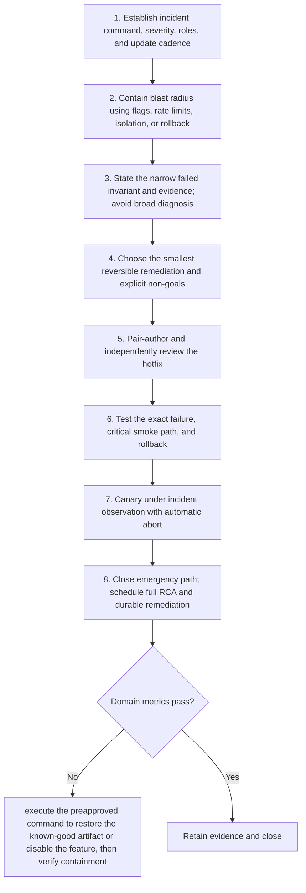

# Hotfix: Workflow

> **Version:** 2.0 | **Updated:** 2026-07-16 | **Status:** Stable

## Purpose

Apply the domain workflow to contain an active production defect with the smallest reversible intervention.

## Procedure

1. **Establish incident command,.** Establish incident command, severity, roles, and update cadence.
2. **Contain blast radius.** Contain blast radius using flags, rate limits, isolation, or rollback.
3. **State the narrow.** State the narrow failed invariant and evidence; avoid broad diagnosis.
4. **Choose the smallest.** Choose the smallest reversible remediation and explicit non-goals.
5. **Pair-author and independently.** Pair-author and independently review the hotfix.
6. **Test the exact.** Test the exact failure, critical smoke path, and rollback.
7. **Canary under incident.** Canary under incident observation with automatic abort.
8. **Close emergency path;.** Close emergency path; schedule full RCA and durable remediation.

## Verification

- time to containment meets severity target
- affected requests/users trend down after action
- hotfix changes only authorized scope
- rollback remains within incident RTO

## Tradeoffs

Hotfix workflow deliberately spends additional review time to protect "time to containment meets severity target"; evidence weakness triggers "Execute the preapproved command to restore the known-good artifact or disable the feature, then verify containment".

## Anti-patterns

Hotfix workflow rejects shortcuts around "Establish incident command, severity, roles, and update cadence." because they sever the evidence chain required for "time to containment meets severity target".

## Enterprise considerations

Hotfix workflow governance binds owner, policy revision, and retained proof to "time to containment meets severity target", with "Execute the preapproved command to restore the known-good artifact or disable the feature, then verify containment" as the recorded recovery authority.

## Checklist

- [ ] Establish incident command, severity, roles, and update cadence
- [ ] Contain blast radius using flags, rate limits, isolation, or rollback
- [ ] State the narrow failed invariant and evidence; avoid broad diagnosis
- [ ] Choose the smallest reversible remediation and explicit non-goals
- [ ] Pair-author and independently review the hotfix
- [ ] Test the exact failure, critical smoke path, and rollback
- [ ] Canary under incident observation with automatic abort
- [ ] Close emergency path; schedule full RCA and durable remediation

## Changelog

- 2026-07-16: Replaced generic scaffolding with domain-specific production guidance.
