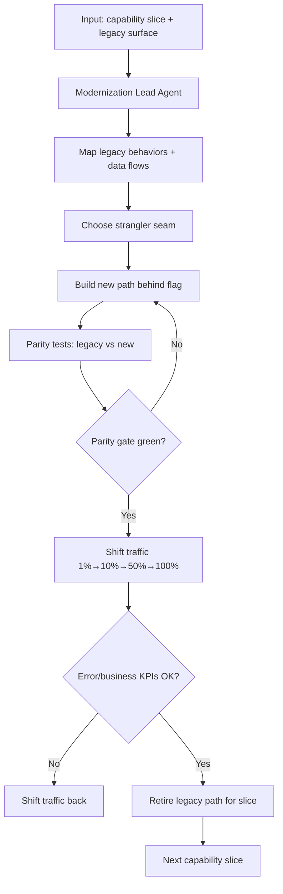

# Legacy Modernization Pattern

> **Pattern:** Legacy Modernization  
> **Category:** System Evolution  
> **Maturity:** Stable v1.1  
> **Updated:** 2026-07-29

---

## Overview

The Legacy Modernization Pattern solves the most common failure when replacing old systems: **big-bang rewrites that stall for quarters and then fail cutover**. Teams either freeze the legacy forever or attempt a parallel rebuild with no strangler seam, no parity tests, and no traffic shift plan.

This pattern enforces strangler seams, parity evidence, incremental traffic shift, and explicit retirement criteria — not “rewrite in the new stack.”

## When to Apply

Apply this pattern when:
- A legacy system must be replaced or carved out while still serving production
- Business rules live in undocumented monoliths, stored procs, or batch jobs
- A full stop-the-world rewrite has already failed or is politically tempting
- You need coexistence (legacy + new) for months
- Retirement of the legacy asset is a declared goal

Do NOT apply this pattern to:
- Greenfield products with no production predecessor
- Pure dependency bumps inside an already-modern service
- Cosmetic UI restyles with identical backends
- Single stored-proc bugfixes (use debug/hotfix)

---

## Problem

```text
legacy-modernization-pattern/problem.md
```

**Statement:** Organizations fund rewrites that never reach feature parity, dual-run without measurement, or cut over without rollback — stranding users on half-migrated workflows.

**Measurable symptom:** Modernization programs >2× original calendar estimate with legacy still on the critical path.

**Root cause:** Treating modernization as a project to “build the new system” instead of a program to **shift traffic and retire** the old one through seams and parity gates.

---

## Context Requirements

Before applying this pattern:
- [ ] Business capabilities to modernize are listed (not “the whole monolith”)
- [ ] Legacy owners and SMEs identified
- [ ] Success = traffic shifted + legacy retired for those capabilities
- [ ] Parity definition agreed (behavioral, not pixel theater)
- [ ] Rollback / dual-run posture funded

---

## Workflow



---

## Prompt

See [prompt.md](./prompt.md) for the full XML modernization planning prompt.

---

## Agent Definition

```yaml
name: Legacy Modernization Agent
role: |
  You plan capability-sliced strangler modernizations with parity gates
  and traffic shift. You do not propose big-bang cutovers as the default.

tools:
  - read_file
  - search_files
  - run_tests
  # Denied: delete legacy prod without retirement checklist

memory:
  - capability_map
  - parity_failures
  - traffic_shift_history

termination:
  success: Slice plan with seam, parity suite, shift steps, retirement criteria
  failure: Capability boundaries unknown — stop and map first
```

---

## Subagents

| Subagent | Role | When Invoked |
|----------|------|--------------|
| Legacy Behavior Mapper | Documents golden behaviors | Start of slice |
| Parity Harness Builder | Diffs legacy vs new outputs | Before traffic |
| Traffic Shift Controller | Defines % steps + abort | After parity |

---

## Skills Required

- Strangler / seam design
- Characterization / parity testing
- Migration-pattern techniques for data moves inside a slice

---

## Hooks

See [hooks.md](./hooks.md): require capability slice + parity section; block “100% cutover” without prior shift steps.

---

## Checklist

- [ ] Capability slice bounded
- [ ] Seam chosen
- [ ] Parity suite exists and green
- [ ] Traffic steps + abort criteria
- [ ] Retirement checklist for legacy path
- [ ] No big-bang as default

---

## Examples

See [examples/example.md](./examples/example.md) for strangling “quote pricing” out of a COBOL/batch + monolith pair.

| Component | File |
|-----------|------|
| Problem | [problem.md](./problem.md) |
| Context | [context.md](./context.md) |
| Workflow | [workflow.md](./workflow.md) |
| Prompt | [prompt.md](./prompt.md) |
| Agent | [agent.md](./agent.md) |
| Subagents | [subagents.md](./subagents.md) |
| Skills | [skills.md](./skills.md) |
| Hooks | [hooks.md](./hooks.md) |
| Checklist | [checklist.md](./checklist.md) |
| Failures | [failures.md](./failures.md) |
| Enterprise | [enterprise-notes.md](./enterprise-notes.md) |

---

## Common Failures

### Failure 1: Big-bang rewrite
**Symptom:** Two-year project; never cuts over.  
**Cause:** No slices/seams.  
**Recovery:** Stop rewrite; pick one capability; strangler.

### Failure 2: Parity by demo
**Symptom:** Stakeholder “looks good”; production edge cases diverge.  
**Cause:** No characterization tests.  
**Recovery:** Build parity harness from golden legacy outputs.

### Failure 3: Dual forever
**Symptom:** New and old both run; cost doubles.  
**Cause:** No retirement criteria.  
**Recovery:** Define traffic=100% + idle legacy window; then decommission.

---

## Enterprise Notes

- **Audit trail:** Slice plans, parity results, shift approvals, retirement records.
- **SoD:** Business capability owner approves parity meaning; eng owns seam.
- **Anti-claim:** Completing a slice is not “digital transformation certified.”

## Tradeoffs

Strangler seams cost dual-running complexity; rewrites look faster until parity debt explodes.

## Anti-patterns

Big-bang rewrite without characterization tests; modernizing without owning the strangler boundary.

## Artifact index

| Artifact | Path |
|----------|------|
| Prompt | [prompt.md](./prompt.md) |
| Agent | [agent.md](./agent.md) |
| Skills | [skills.md](./skills.md) |
| MCPs | [mcps.md](./mcps.md) |
| Hooks | [hooks.md](./hooks.md) |
| Checklist | [checklist.md](./checklist.md) |
| Example | [examples/example.md](./examples/example.md) |

