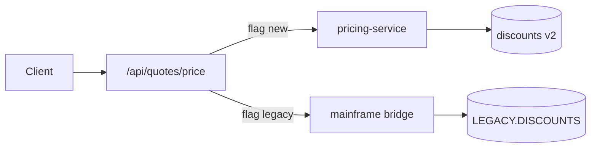

# Legacy Modernization Pattern — Example: Strangle quote pricing

> **Pattern:** Legacy Modernization  
> **Component:** examples/example.md  
> **Version:** 1.1 | **Updated:** 2026-07-16  
> **Capability slice:** Price customer quote

---

## Modernization slice plan (artifact)

### Boundary

- **In scope:** Synchronous quote price for product family A via API  
- **Out of scope:** Billing invoices, UI redesign, product families B/C

### Legacy map

| Entry / job / table | Behavior | Owner SME |
|---------------------|----------|-----------|
| `COBOL PRICEJOB` nightly + online CICS | Base + discount tiers | M. Singh |
| Monolith `PricingController` | Calls mainframe bridge | Platform |
| Table `LEGACY.DISCOUNTS` | Tier tables | Finance eng |

### Seam

Type: Edge proxy on `/api/quotes/price` → new `pricing-service`, fallback to legacy bridge.



### Parity suite

| Case | Legacy oracle | New assertion | Tolerance |
|------|---------------|---------------|-----------|
| Standard tier 2 | PRICEJOB fixture #1044 | equal money fields | $0.00 |
| Max discount cap | fixture #1090 | equal | $0.00 |
| Unknown SKU | legacy 404 body | same code | exact |

### Traffic shift

| Step | % | Duration | Abort if |
|------|---|----------|----------|
| Shadow | 0 (compare only) | 7d | mismatch > 0.1% |
| Canary | 1% | 3d | 5xx > 0.5% or mismatch |
| Ramp | 10% → 50% | 4d each | conversion −2pp |
| Full | 100% | 14d idle legacy | any SEV |

### Sample parity result (shadow week)

| Metric | Value |
|--------|-------|
| Compared quotes | 182_440 |
| Mismatch rate | 0.02% (investigated: leap-year promo — fixed) |
| After fix | 0.00% over 48h |

### Retirement checklist

- [x] 100% traffic on new for 14d  
- [x] Bridge flag removed for family A  
- [ ] `PRICEJOB` online path disabled for family A (scheduled)  
- [ ] Next slice: product family B

```text
Business parity signer: L. Cho  Eng lead: R. Gomez  Date: 2026-07-12
```

This example **is** the artifact — not a pointer elsewhere.
