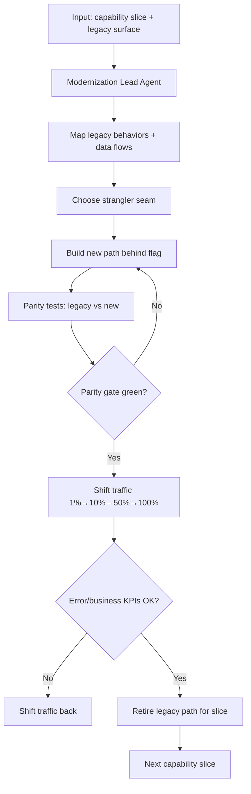

# Legacy Modernization Pattern — Workflow

> **Pattern:** Legacy Modernization  
> **Component:** workflow.md  
> **Version:** 1.1 | **Updated:** 2026-07-16

---

## End-to-end flow

## Step procedure

| Step | Actor | Action | Exit criteria |
|------|-------|--------|---------------|
| 1 | Human | Select capability slice | Bounded backlog item |
| 2 | Behavior Mapper | Document golden behaviors + edge cases | Characterization notes |
| 3 | Modernization Lead | Choose seam (facade, proxy, event, data) | Seam ADR |
| 4 | Coder | Implement new path behind flag | Feature-flagged |
| 5 | Parity Harness | Compare legacy vs new on fixtures + shadow | Gate green |
| 6 | Traffic Shift | Ramp % with abort KPIs | 100% or abort |
| 7 | Human + eng | Retire legacy path for slice | Retirement checklist done |
| 8 | Program | Pick next slice | Repeat |

## Deviation rule

If parity fails in production shadow, **do not** increase traffic. Fix or narrow the slice. Never skip to 100% to “make the demo.”

## Parallelism rule

Independent capability slices may proceed in parallel only if seams do not contend on the same legacy write path without a coordination plan.
