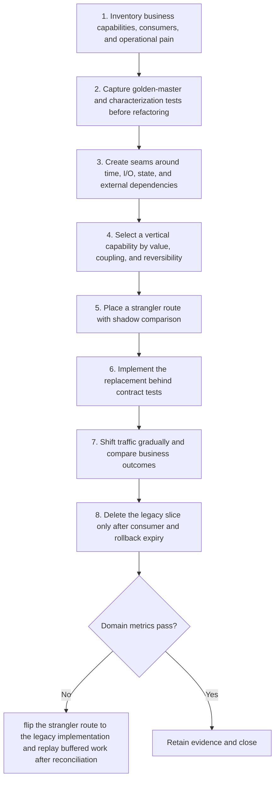

# Legacy Modernization: Workflow

> **Version:** 2.0 | **Updated:** 2026-07-16 | **Status:** Stable

## Purpose

Apply the domain workflow to replace obsolete internals incrementally while preserving observed business behavior.

## Procedure

1. **Inventory business capabilities,.** Inventory business capabilities, consumers, and operational pain.
2. **Capture golden-master and.** Capture golden-master and characterization tests before refactoring.
3. **Create seams around.** Create seams around time, I/O, state, and external dependencies.
4. **Select a vertical.** Select a vertical capability by value, coupling, and reversibility.
5. **Place a strangler.** Place a strangler route with shadow comparison.
6. **Implement the replacement.** Implement the replacement behind contract tests.
7. **Shift traffic gradually.** Shift traffic gradually and compare business outcomes.
8. **Delete the legacy.** Delete the legacy slice only after consumer and rollback expiry.

## Verification

- characterized critical behavior = 100%
- contract mismatch rate = 0
- change lead time improves by target
- legacy attack surface decreases each tranche

## Tradeoffs

Legacy Modernization workflow deliberately spends additional review time to protect "characterized critical behavior = 100%"; evidence weakness triggers "Flip the strangler route to the legacy implementation and replay buffered work after reconciliation".

## Anti-patterns

Legacy Modernization workflow rejects shortcuts around "Inventory business capabilities, consumers, and operational pain." because they sever the evidence chain required for "characterized critical behavior = 100%".

## Enterprise considerations

Legacy Modernization workflow governance binds owner, policy revision, and retained proof to "characterized critical behavior = 100%", with "Flip the strangler route to the legacy implementation and replay buffered work after reconciliation" as the recorded recovery authority.

## Checklist

- [ ] Inventory business capabilities, consumers, and operational pain
- [ ] Capture golden-master and characterization tests before refactoring
- [ ] Create seams around time, I/O, state, and external dependencies
- [ ] Select a vertical capability by value, coupling, and reversibility
- [ ] Place a strangler route with shadow comparison
- [ ] Implement the replacement behind contract tests
- [ ] Shift traffic gradually and compare business outcomes
- [ ] Delete the legacy slice only after consumer and rollback expiry

## Changelog

- 2026-07-16: Replaced generic scaffolding with domain-specific production guidance.
