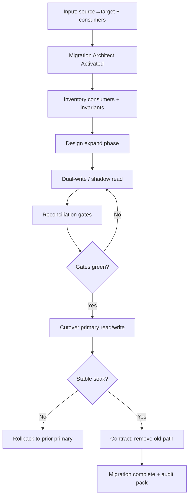

# Migration Pattern

> **Pattern:** Migration  
> **Category:** Data & Compatibility Change  
> **Maturity:** Stable v1.1  
> **Updated:** 2026-07-16

---

## Overview

The Migration Pattern solves the most common failure in schema, API, and data moves: **big-bang cutovers without expand/contract, reconciliation, or rollback**. Migrations fail quietly (wrong data) or loudly (downtime) when compatibility windows are skipped.

The Migration Pattern enforces phased expand → dual/shadow → reconcile → cutover → contract with quantitative gates.

## When to Apply

Apply this pattern when:
- Database schema or data shape changes under live traffic
- API versions change with existing consumers
- Storage, queue, or search index systems are swapped
- Dual-write / dual-read is required for safety
- Rollback after data rewrite would be hard without a plan

Do NOT apply this pattern to:
- Additive columns never read in production yet (simple expand may suffice alone)
- Pure code refactors with zero data/API contract change
- Ephemeral test DB resets in CI
- Emergency hotfix that only flips a flag (plan durable migration after)

---

## Problem

```
migration-pattern/problem.md
```

**Statement:** Teams drop old columns, flip primary reads, or rewrite data in one deploy, leaving no compatibility window, no reconciliation, and no safe rollback.

**Measurable symptom:** Migration-related incidents or data repair tickets after >10% of production schema/API cutovers.

**Root cause:** Treating migrations like ordinary code deploys instead of multi-phase compatibility projects with explicit points of no return.

---

## Context Requirements

Before applying this pattern:
- [ ] Source and target states defined
- [ ] Consumer inventory exists
- [ ] Data volume + SLO constraints known
- [ ] Backup / restore rehearsal possible
- [ ] Named owner for cutover approval

---

## Workflow



---

## Prompt

See [prompt.md](./prompt.md) — grounded in [`migration.prompt.md`](../../08-ai-sdlc/prompts/migration.prompt.md).

---

## Agent Definition

```yaml
name: Migration Architect Agent
role: |
  You design phased, reversible migrations with reconciliation and rollback.
  You do not perform irreversible contraction without named human approval.

tools:
  - read_file
  - search_files
  - run_tests
  # Denied: prod destructive DDL without approval, silent data deletes

memory:
  - consumer_inventory
  - prior_migration_incidents
  - slo_targets

termination:
  success: Phases + gates + reconciliation + rollback per phase approved
  failure: Consumers unknown or backup unproven — stop before cutover
```

---

## Subagents

| Subagent | Role | When Invoked |
|----------|------|--------------|
| Consumer Inventory | Finds readers/writers of the old surface | Start |
| Reconciler | Defines count/semantic comparison queries | Before cutover |
| Rollback Author | Writes per-phase rollback | Each phase design |

---

## Skills Required

- Migration / expand-contract methodology
- Data validation / reconciliation
- Observability for lag and error rates

---

## Hooks

See [hooks.md](./hooks.md): require consumer inventory + rollback sections; block contract phase without soak evidence.

---

## Checklist

- [ ] Consumers inventoried
- [ ] Expand before dual before cutover before contract
- [ ] Reconciliation queries defined and run
- [ ] Rollback per reversible phase
- [ ] Point of no return named
- [ ] Cutover approved by named human

---

## Examples

See [examples/example.md](./examples/example.md) for `users.email` → `users_contact.email` dual-write migration with gates.

| Component | File |
|-----------|------|
| Problem | [problem.md](./problem.md) |
| Context | [context.md](./context.md) |
| Workflow | [workflow.md](./workflow.md) |
| Prompt | [prompt.md](./prompt.md) |
| Agent | [agent.md](./agent.md) |
| Subagents | [subagents.md](./subagents.md) |
| Skills | [skills.md](./skills.md) |
| Hooks | [hooks.md](./hooks.md) |
| Checklist | [checklist.md](./checklist.md) |
| Failures | [failures.md](./failures.md) |
| Enterprise | [enterprise-notes.md](./enterprise-notes.md) |

---

## Common Failures

### Failure 1: Contract first
**Symptom:** Old column dropped; rollback impossible.  
**Cause:** Skipped expand/dual.  
**Recovery:** Restore from backup; restart with expand-first.

### Failure 2: No reconciliation
**Symptom:** Cutover “works”; silent row skew.  
**Cause:** No count/semantic checks.  
**Recovery:** Run recon; repair; delay contract.

### Failure 3: Dual-write forever
**Symptom:** Complexity never removed.  
**Cause:** No contract criteria.  
**Recovery:** Define soak metrics; schedule contract.

---

## Enterprise Notes

- **Audit trail:** Phase gates, recon results, approvers stored with change ticket.
- **SoD:** Migration author ≠ sole cutover approver for High-risk data.
- **Anti-claim:** A green recon query is not a full regulatory data-migration certification.
