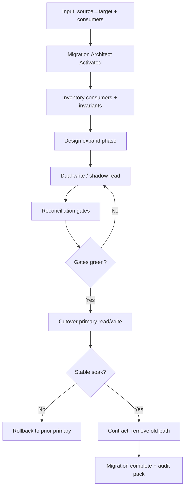

# Migration Pattern — Workflow

> **Pattern:** Migration  
> **Component:** workflow.md  
> **Version:** 1.1 | **Updated:** 2026-07-16

---

## End-to-end flow

## Step procedure

| Step | Actor | Action | Exit criteria |
|------|-------|--------|---------------|
| 1 | Human | Freeze source/target + SLOs | Spec reviewable |
| 2 | Consumer Inventory | List all readers/writers | Inventory table complete |
| 3 | Migration Architect | Expand: additive schema/API | Expand deployable alone |
| 4 | Migration Architect | Dual-write / shadow read | Both paths observed |
| 5 | Reconciler | Run count + semantic checks | Gate thresholds met |
| 6 | Human | Approve cutover | Named + dated |
| 7 | Ops / release | Flip primary; soak | Error/latency within SLO |
| 8 | Migration Architect | Contract old path | Old path removed safely |

## Deviation rule

If recon fails or soak burns SLO, **roll back primary** to the previous path. Do not contract. Do not “push through.”

## Parallelism rule

Consumer teams may migrate readers independently only after expand is live. Writers dual-write until the cutover gate passes.
