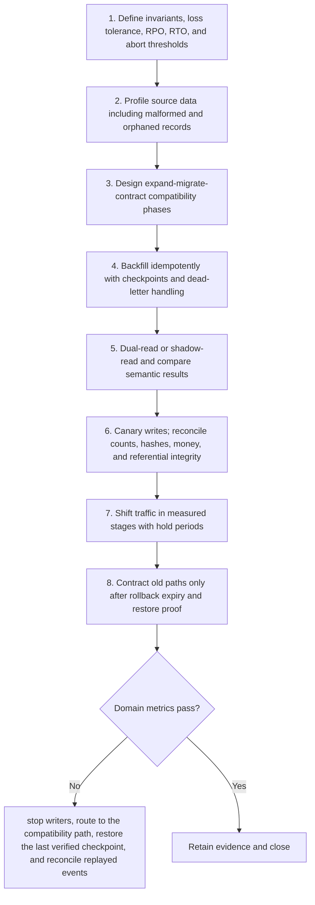

# Migration: Workflow

> **Version:** 2.0 | **Updated:** 2026-07-16 | **Status:** Stable

## Purpose

Apply the domain workflow to transition data or services while preserving invariants and a tested return path.

## Procedure

1. **Define invariants, loss.** Define invariants, loss tolerance, RPO, RTO, and abort thresholds.
2. **Profile source data.** Profile source data including malformed and orphaned records.
3. **Design expand-migrate-contract compatibility.** Design expand-migrate-contract compatibility phases.
4. **Backfill idempotently with.** Backfill idempotently with checkpoints and dead-letter handling.
5. **Dual-read or shadow-read.** Dual-read or shadow-read and compare semantic results.
6. **Canary writes; reconcile.** Canary writes; reconcile counts, hashes, money, and referential integrity.
7. **Shift traffic in.** Shift traffic in measured stages with hold periods.
8. **Contract old paths.** Contract old paths only after rollback expiry and restore proof.

## Verification

- record and monetary reconciliation = 100%
- unclassified mismatch count = 0
- error-budget burn stays below abort threshold
- restore completes within RTO

## Tradeoffs

Migration workflow deliberately spends additional review time to protect "record and monetary reconciliation = 100%"; evidence weakness triggers "Stop writers, route to the compatibility path, restore the last verified checkpoint, and reconcile replayed events".

## Anti-patterns

Migration workflow rejects shortcuts around "Define invariants, loss tolerance, RPO, RTO, and abort thresholds." because they sever the evidence chain required for "record and monetary reconciliation = 100%".

## Enterprise considerations

Migration workflow governance binds owner, policy revision, and retained proof to "record and monetary reconciliation = 100%", with "Stop writers, route to the compatibility path, restore the last verified checkpoint, and reconcile replayed events" as the recorded recovery authority.

## Checklist

- [ ] Define invariants, loss tolerance, RPO, RTO, and abort thresholds
- [ ] Profile source data including malformed and orphaned records
- [ ] Design expand-migrate-contract compatibility phases
- [ ] Backfill idempotently with checkpoints and dead-letter handling
- [ ] Dual-read or shadow-read and compare semantic results
- [ ] Canary writes; reconcile counts, hashes, money, and referential integrity
- [ ] Shift traffic in measured stages with hold periods
- [ ] Contract old paths only after rollback expiry and restore proof

## Changelog

- 2026-07-16: Replaced generic scaffolding with domain-specific production guidance.
