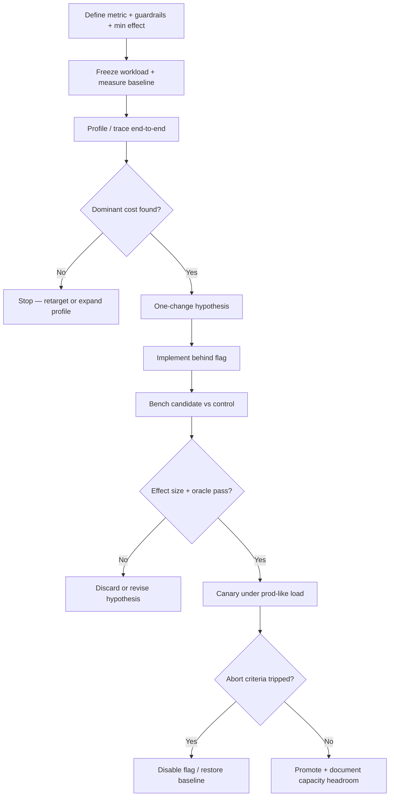

# Optimization Pattern

> **Pattern:** Optimization  
> **Category:** Performance & Cost  
> **Maturity:** Stable v1.1 | **Updated:** 2026-07-29

---

## Overview

The Optimization Pattern prevents the most expensive performance failure: **shipping “faster” code that never moved the user-facing metric**. Teams micro-optimize cold paths, skip baselines, ignore tail latency, and discover in production that p99 got worse while the mean looked fine.

This pattern enforces measure → attribute → change one thing → prove effect size → canary → keep or kill — with a correctness oracle and explicit guardrails.

## When to Apply

Apply this pattern when:
- An SLO is breached (latency, error budget burn, throughput) or unit cost exceeds budget
- Profiling or tracing shows a dominant cost (≥30% of the critical path or spend)
- Capacity headroom will exhaust within the planning horizon at current growth
- A hypothesized change can be A/B’d against a frozen baseline under the same workload

Do NOT apply this pattern to:
- Untargeted “make it faster” work with no metric or baseline
- Correctness bugs disguised as performance issues (fix first)
- Speculative rewrites of cold paths that cannot close the gap even at theoretical max
- Active SEV1/SEV2 containment (use [hotfix-pattern](../hotfix-pattern/README.md); optimize after)

---

## Problem

```
optimization-pattern/problem.md
```

**Statement:** Changes labeled “optimization” without a representative baseline, attributed bottleneck, and measured effect size burn engineering time and often regress tails or correctness.

**Measurable symptom:** >40% of performance PRs lack before/after percentiles under the same load profile, or ship without a kill-switch flag.

**Root cause:** Optimization work optimizes for local microbenchmarks and intuition rather than end-to-end user/cost metrics under production-like distributions.

---

## Context Requirements

Before applying this pattern:
- [ ] Target metric, minimum useful effect, and guardrails are written down
- [ ] Representative workload (traffic mix, concurrency, payload sizes) is defined
- [ ] Baseline measured with warm-up and variance (not a single run)
- [ ] Correctness oracle exists (golden tests, checksums, or business assertions)
- [ ] Feature flag or config kill-switch is available for the change

---

## Workflow



---

## Prompt

See [prompt.md](./prompt.md) — extends Level 8 [`performance-review.prompt.md`](../../08-ai-sdlc/prompts/performance-review.prompt.md) with optimization constraints and task-bound inputs defined in its context contract.

---

## Agent Definition

```yaml
name: Optimization Agent
role: |
  You are a performance engineer. You propose and evaluate ONE optimization
  at a time against a frozen baseline. You do not ship without effect size,
  confidence interval, correctness oracle, and abort criteria.
termination:
  success: Canary passed; flag promoted; capacity note recorded
  failure: >2 failed hypotheses without new attribution — escalate to human
```

Full YAML: [agent.md](./agent.md)

---

## Subagents

| Subagent | Role | When Invoked |
|---------|------|-------------|
| Workload Curator | Freezes traffic mix and fixtures | Before baseline |
| Profiler | Attributes CPU/IO/alloc/token cost | After baseline |
| Benchmark Runner | A/B with warm-up and CI | After candidate build |
| Canary Observer | Watches abort metrics during canary | During canary |

---

## Skills Required

- Performance / profiling skill — attribution and distributions
- Benchmarking skill — fair A/B, warm-up, confidence intervals
- Feature-flag skill — kill-switch and progressive exposure

---

## Hooks

Executable `pre-optimize` and `post-optimize` checks in [hooks.md](./hooks.md): baseline file present, min-effect declared, oracle section present, flag name recorded.

---

## Checklist

See [checklist.md](./checklist.md). Gate: no production promotion without baseline, effect size, oracle, and abort criteria.

---

## Examples

See [examples/example.md](./examples/example.md) — checkout p99 regression fixed by batching Redis GETs, with inline before/after numbers and canary abort thresholds.

Component specs:

| Component | File |
|-----------|------|
| Problem | [problem.md](./problem.md) |
| Context | [context.md](./context.md) |
| Workflow | [workflow.md](./workflow.md) |
| Prompt | [prompt.md](./prompt.md) |
| Agent | [agent.md](./agent.md) |
| Subagents | [subagents.md](./subagents.md) |
| Skills | [skills.md](./skills.md) |
| Hooks | [hooks.md](./hooks.md) |
| Checklist | [checklist.md](./checklist.md) |
| Failures | [failures.md](./failures.md) |
| Enterprise | [enterprise-notes.md](./enterprise-notes.md) |

---

## Common Failures

### Failure 1: Microbenchmark theater
**Symptom:** Local loop is 10× faster; production p99 unchanged.  
**Cause:** Optimized a cold path or non-representative fixture.  
**Recovery:** Re-attribute with production traces; discard the change.

### Failure 2: Mean improved, tail died
**Symptom:** Average latency down; p99 and error budget worse.  
**Cause:** Guardrails omitted tails and saturation.  
**Recovery:** Abort canary; restore baseline; redesign for tail.

### Failure 3: Correctness collateral
**Symptom:** Faster path returns stale or wrong results.  
**Cause:** No oracle in the benchmark gate.  
**Recovery:** Kill flag immediately; add oracle before next attempt.

---

## Enterprise Notes

- Capacity and reserved spend constrain what “win” means — invoice and quota evidence belong in the record.
- Tenant fairness: an optimization that starves noisy neighbors fails even if global mean improves.
- Passing an internal perf review is not a vendor SLA or external certification claim.

## Tradeoffs

Measure-first optimization is slower than intuition tweaks; intuition wins until you ship a silent correctness break.

## Anti-patterns

Optimize without baseline; change many variables; raise p99 without contractual review.

## Artifact index

| Artifact | Path |
|----------|------|
| Prompt | [prompt.md](./prompt.md) |
| Agent | [agent.md](./agent.md) |
| Skills | [skills.md](./skills.md) |
| MCPs | [mcps.md](./mcps.md) |
| Hooks | [hooks.md](./hooks.md) |
| Checklist | [checklist.md](./checklist.md) |
| Example | [examples/example.md](./examples/example.md) |

