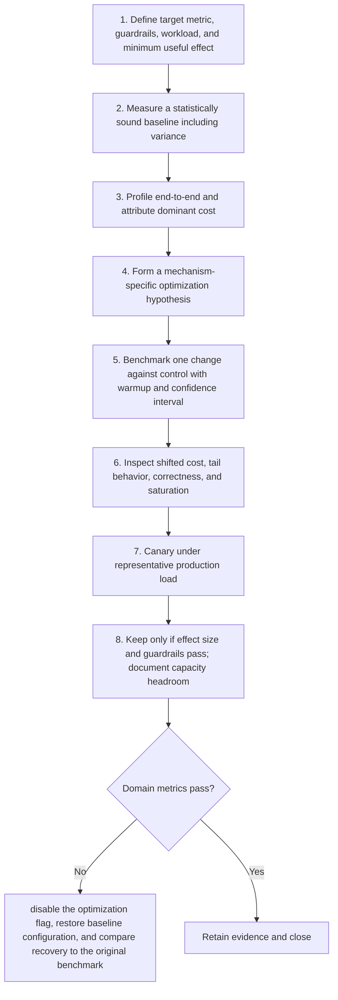

# Optimization: Workflow

> **Version:** 2.0 | **Updated:** 2026-07-16 | **Status:** Stable

## Purpose

Apply the domain workflow to improve a profiled bottleneck while protecting correctness and downstream guardrails.

## Procedure

1. **Define target metric,.** Define target metric, guardrails, workload, and minimum useful effect.
2. **Measure a statistically.** Measure a statistically sound baseline including variance.
3. **Profile end-to-end and.** Profile end-to-end and attribute dominant cost.
4. **Form a mechanism-specific.** Form a mechanism-specific optimization hypothesis.
5. **Benchmark one change.** Benchmark one change against control with warmup and confidence interval.
6. **Inspect shifted cost,.** Inspect shifted cost, tail behavior, correctness, and saturation.
7. **Canary under representative.** Canary under representative production load.
8. **Keep only if.** Keep only if effect size and guardrails pass; document capacity headroom.

## Verification

- approved effect size reached with confidence interval
- correctness oracle has zero regression
- p99 and saturation guardrails remain within SLO
- unit cost is measured end-to-end

## Tradeoffs

Optimization workflow deliberately spends additional review time to protect "approved effect size reached with confidence interval"; evidence weakness triggers "Disable the optimization flag, restore baseline configuration, and compare recovery to the original benchmark".

## Anti-patterns

Optimization workflow rejects shortcuts around "Define target metric, guardrails, workload, and minimum useful effect." because they sever the evidence chain required for "approved effect size reached with confidence interval".

## Enterprise considerations

Optimization workflow governance binds owner, policy revision, and retained proof to "approved effect size reached with confidence interval", with "Disable the optimization flag, restore baseline configuration, and compare recovery to the original benchmark" as the recorded recovery authority.

## Checklist

- [ ] Define target metric, guardrails, workload, and minimum useful effect
- [ ] Measure a statistically sound baseline including variance
- [ ] Profile end-to-end and attribute dominant cost
- [ ] Form a mechanism-specific optimization hypothesis
- [ ] Benchmark one change against control with warmup and confidence interval
- [ ] Inspect shifted cost, tail behavior, correctness, and saturation
- [ ] Canary under representative production load
- [ ] Keep only if effect size and guardrails pass; document capacity headroom

## Changelog

- 2026-07-16: Replaced generic scaffolding with domain-specific production guidance.
