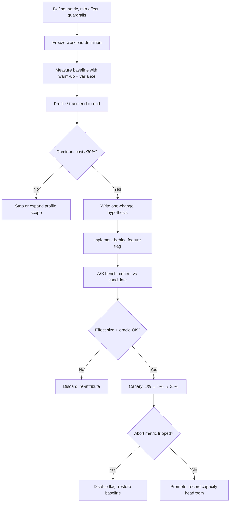

# Optimization Pattern — Workflow

> **Pattern:** Optimization  
> **Component:** workflow.md  
> **Version:** 1.1 | **Updated:** 2026-07-16

---

## End-to-end flow

## Step procedure

| Step | Actor | Action | Exit criteria |
|------|-------|--------|---------------|
| 1 | Human / Perf owner | Freeze metric, min effect, guardrails, abort thresholds | Written success/fail definition |
| 2 | Workload Curator | Check in load profile + fixtures | Versioned workload ID |
| 3 | Benchmark Runner | Baseline: warm-up, n samples, p50/p95/p99 + CI | Baseline artifact stored |
| 4 | Profiler | Attribute CPU/IO/alloc/lock/token cost on critical path | Dominant frame/span named |
| 5 | Optimization Agent | One hypothesis; reject multi-change bundles | Single mechanism stated |
| 6 | Coder | Implement behind flag only | Diff limited to hypothesis + tests |
| 7 | Benchmark Runner | Candidate vs control under identical load | Effect size ± CI; oracle green |
| 8 | Canary Observer | Progressive exposure; watch abort metrics | Hold times met or abort |
| 9 | Human | Promote or kill; document capacity note | Flag state + headroom recorded |

## Abort criteria (must be pre-declared)

Abort canary and disable flag if **any** hold for the configured window (e.g. 10 minutes):

- Target metric regresses vs baseline beyond noise band
- Guardrail: error rate > baseline + absolute delta (e.g. +0.1%)
- Guardrail: p99 > SLO or saturation (CPU/mem/queue) > soft limit
- Oracle failures in synthetic probes
- Neighbor-tenant latency unfairness alert fires

## Parallelism rule

Never run two optimization hypotheses on the same critical path concurrently. Confounded A/B results are not evidence. Serialize changes; keep one flag per hypothesis.

## Deviation rule

If implementation discovers the bottleneck moved or the change needs a second mechanism: **stop**, re-profile, open a new hypothesis. Do not silently widen scope behind the same flag.
