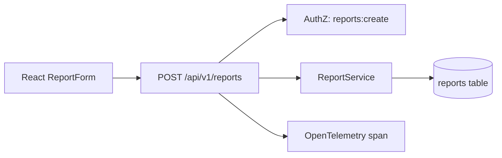

# Planner Pattern — Example: Feature Addition

> **Pattern:** Planner  
> **Component:** examples/example.md  
> **Version:** 1.1 | **Updated:** 2026-07-16  
> **Scenario:** Add `POST /api/v1/reports` with a new `reports` table and a React form

---

## Summary

Build an authenticated report-creation API and UI. Use expand/contract for the schema. Dual-write is not required; single new table with nullable future columns avoided.

## Architecture diagram



## Proposed changes

### Database

| Change | Type | Migration | Backward compatible |
|--------|------|-----------|---------------------|
| `reports` table | ADD | Yes — expand only | Yes (new table) |
| index `(org_id, created_at)` | ADD | Yes | Yes |

### Backend

| File | Change | Description |
|------|--------|-------------|
| `db/migrations/20260716_reports.sql` | CREATE | Table + index |
| `src/services/reportService.ts` | CREATE | Create/list with org scoping |
| `src/routes/reports.ts` | CREATE | POST handler + validation |
| `src/auth/permissions.ts` | MODIFY | Add `reports:create` |

### Frontend

| File | Change | Description |
|------|--------|-------------|
| `src/components/ReportForm.tsx` | CREATE | Accessible form, client validation |
| `src/api/reports.ts` | CREATE | Typed client for POST |

### API contract

| Endpoint | Change | Breaking |
|----------|--------|----------|
| `POST /api/v1/reports` | NEW | No |

## Implementation sequence

1. Migration (expand) — deployable alone  
2. `ReportService` + unit tests  
3. Route + auth permission + integration tests  
4. Frontend form + component tests  
5. Observability attributes on the handler  
6. Docs / OpenAPI update  

## Test plan

| Type | Coverage |
|------|----------|
| Unit | `ReportService` validation, org scoping |
| Integration | POST happy path, 401/403, validation 400 |
| E2E | Authenticated user submits form; row appears for their org only |

## Rollback plan

1. Feature-flag off the UI route  
2. Remove reverse proxy route to POST if needed  
3. Keep table (expand/contract) — drop only in a later contract migration after idle  

## Open questions (blocking)

- [x] Max attachment size? → 5 MB, enforced in API (resolved 2026-07-15)

## Human approval

```text
Approver: A. Chen  Date: 2026-07-15
Notes: Org scoping must be DB-enforced, not only UI-filtered.
```

This example is the artifact — not a claim that a separate file exists elsewhere.
