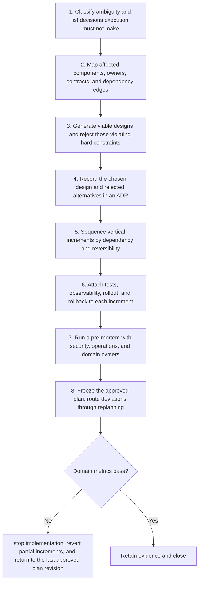

# Planner: Workflow

> **Version:** 2.0 | **Updated:** 2026-07-16 | **Status:** Stable

## Purpose

Apply the domain workflow to turn ambiguous engineering work into a decision-complete execution contract.

## Procedure

1. **Classify ambiguity and.** Classify ambiguity and list decisions execution must not make.
2. **Map affected components,.** Map affected components, owners, contracts, and dependency edges.
3. **Generate viable designs.** Generate viable designs and reject those violating hard constraints.
4. **Record the chosen.** Record the chosen design and rejected alternatives in an ADR.
5. **Sequence vertical increments.** Sequence vertical increments by dependency and reversibility.
6. **Attach tests, observability,.** Attach tests, observability, rollout, and rollback to each increment.
7. **Run a pre-mortem.** Run a pre-mortem with security, operations, and domain owners.
8. **Freeze the approved.** Freeze the approved plan; route deviations through replanning.

## Verification

- decision completeness = 100%
- unplanned file-change rate < 10%
- plan-driven rework < 10%
- all critical-path owners acknowledge

## Tradeoffs

Planner workflow deliberately spends additional review time to protect "decision completeness = 100%"; evidence weakness triggers "Stop implementation, revert partial increments, and return to the last approved plan revision".

## Anti-patterns

Planner workflow rejects shortcuts around "Classify ambiguity and list decisions execution must not make." because they sever the evidence chain required for "decision completeness = 100%".

## Enterprise considerations

Planner workflow governance binds owner, policy revision, and retained proof to "decision completeness = 100%", with "Stop implementation, revert partial increments, and return to the last approved plan revision" as the recorded recovery authority.

## Checklist

- [ ] Classify ambiguity and list decisions execution must not make
- [ ] Map affected components, owners, contracts, and dependency edges
- [ ] Generate viable designs and reject those violating hard constraints
- [ ] Record the chosen design and rejected alternatives in an ADR
- [ ] Sequence vertical increments by dependency and reversibility
- [ ] Attach tests, observability, rollout, and rollback to each increment
- [ ] Run a pre-mortem with security, operations, and domain owners
- [ ] Freeze the approved plan; route deviations through replanning

## Changelog

- 2026-07-16: Replaced generic scaffolding with domain-specific production guidance.
