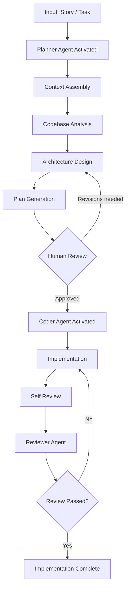

# Planner Pattern — Workflow

> **Pattern:** Planner  
> **Component:** workflow.md  
> **Version:** 1.1 | **Updated:** 2026-07-16

---

## End-to-end flow

## Step procedure

| Step | Actor | Action | Exit criteria |
|------|-------|--------|---------------|
| 1 | Human / Story prompt | Freeze acceptance criteria and out-of-scope | Story is reviewable |
| 2 | Context Assembler | Collect paths, schemas, ADRs, constraints | Context ≥ relevant files, not “whole repo” |
| 3 | Planner | Analyze dependencies and blast radius | Dependency list exists |
| 4 | Planner | Choose one design; reject alternatives with reason | ADR-quality decision recorded in plan |
| 5 | Planner | Emit plan: Mermaid diagram, file list, sequence, tests, rollback | All required sections present (hooks validate) |
| 6 | Human | Review for understanding; resolve blocking questions | Named approver + date |
| 7 | Coder | Implement **only** what the plan authorizes | Diff matches planned paths (or replans) |
| 8 | Reviewer | Check plan conformance + defect severity | Checklist green |

## Deviation rule

If implementation discovers a missing file, API break, or schema change not in the plan: **stop coding**, return to step 4, revise the plan, re-approve. Silent deviation voids the audit trail.

## Parallelism rule

Implementation sequence is ordered by dependency. Parallel work is allowed only for increments the plan marks independent. Do not “parallelize” a migration and its dual-write consumers without an explicit plan step.
