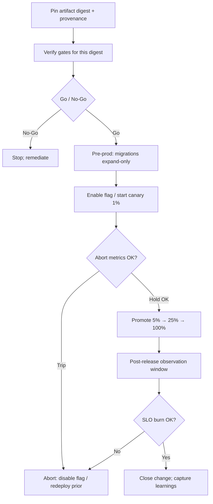

# Release Pattern

> **Pattern:** Release  
> **Category:** Progressive Delivery & Change Safety  
> **Maturity:** Stable v1.1 | **Updated:** 2026-07-29

---

## Overview

The Release Pattern prevents the failure mode where teams **treat “tests passed” as permission for 100% production traffic**. Unsigned or mutable artifacts, renegotiated abort thresholds mid-canary, and missing feature-flag kill switches turn every deploy into an uncontrolled experiment.

This pattern enforces evidence → go/no-go → progressive exposure → quantitative abort → promote or roll back — with a named release owner and rehearsed rollback.

## When to Apply

Apply this pattern when:
- A verified artifact is ready for production or production-like exposure
- Customer behavior, data, or model output can change as a result
- Rollback must meet an operational RTO
- Migrations, flags, or multi-service order matter
- Risk tier requires witnessed go/no-go (medium/high)

Do NOT apply this pattern to:
- Purely internal documentation with no runtime effect
- Flag-only config flips already covered by a lighter change process **and** instant kill switch (still record the flip)
- Active SEV hotfix under incident command (use [hotfix-pattern](../hotfix-pattern/README.md); fold back into normal release after)
- Deploying unreviewed local builds or mutable `:latest` tags

---

## Problem

```text
release-pattern/problem.md
```

**Statement:** Releases without digest-pinned artifacts, progressive exposure, and pre-declared abort criteria create outages that are slow to detect and slower to reverse.

**Measurable symptom:** Rollback exceeds RTO, or canary abort criteria are invented after error rates spike.

**Root cause:** Delivery optimizes for merge/deploy greenness rather than bounded exposure and reversible promotion.

---

## Context Requirements

Before applying this pattern:
- [ ] Artifact digest + provenance available
- [ ] Gate results (tests, security, SBOM policy) fresh for this digest
- [ ] Feature flag or traffic-split mechanism ready
- [ ] Abort criteria quantitative and pre-declared
- [ ] Rollback owner named; rollback command rehearsed
- [ ] Change record / release notes drafted

---

## Workflow



---

## Prompt

See [prompt.md](./prompt.md) — aligns with [`../../08-ai-sdlc/prompts/release.prompt.md`](../../08-ai-sdlc/prompts/release.prompt.md).

---

## Agent Definition

```yaml
name: Release Manager Agent
role: |
  You produce go/no-go packages: digest verification, sequence, canary plan,
  abort criteria, rollback owner. You do not waive failed gates without an
  expiring named exception. You do not execute irreversible prod actions.
```

Full YAML: [agent.md](./agent.md)

---

## Subagents

| Subagent | Role | When Invoked |
|---------|------|-------------|
| Artifact Verifier | Digest + provenance + SBOM | Pre go/no-go |
| Gate Aggregator | Collates CI/security results | Pre go/no-go |
| Canary Controller | Progressive traffic / flags | During release |
| Rollback Operator | Executes abort path | On abort or failed soak |

---

## Skills Required

- Progressive delivery / canary skill  
- Feature-flag skill  
- Migration expand/contract skill  
- Observability abort-signal skill  

---

## Hooks

Executable pre-release and post-canary checks in [hooks.md](./hooks.md).

---

## Checklist

See [checklist.md](./checklist.md).

---

## Examples

See [examples/example.md](./examples/example.md) — payments API canary with flag, abort thresholds, and abort that fired at 5%.

| Component | File |
|-----------|------|
| Problem | [problem.md](./problem.md) |
| Context | [context.md](./context.md) |
| Workflow | [workflow.md](./workflow.md) |
| Prompt | [prompt.md](./prompt.md) |
| Agent | [agent.md](./agent.md) |
| Subagents | [subagents.md](./subagents.md) |
| Skills | [skills.md](./skills.md) |
| Hooks | [hooks.md](./hooks.md) |
| Checklist | [checklist.md](./checklist.md) |
| Failures | [failures.md](./failures.md) |
| Enterprise | [enterprise-notes.md](./enterprise-notes.md) |

---

## Common Failures

### Failure 1: Mutable tag deploy
**Symptom:** Cannot prove what ran; rollback redeploys the wrong bits.  
**Cause:** `:latest` or moving tags.  
**Recovery:** Pin digests; rebuild release evidence; block pipeline.

### Failure 2: Abort criteria negotiated mid-fire
**Symptom:** Team raises thresholds while canary burns error budget.  
**Cause:** Criteria not pre-declared.  
**Recovery:** Abort immediately on original criteria; treat negotiation as process defect.

### Failure 3: Migration without expand/contract
**Symptom:** Rollback requires forward fix under pressure.  
**Cause:** Destructive schema in the same release as app cutover.  
**Recovery:** Separate expand → app → contract; abort app via flag; leave expand in place.

---

## Enterprise Notes

- Medium/high risk: go/no-go authority independent of the authoring agent.
- Provenance and SBOM policy are change evidence — not marketing badges.
- No certification claims from a green canary alone.

## Tradeoffs

Canaries and abort criteria slow promote; big-bang ships until rollback windows disappear.

## Anti-patterns

Promote without eval gate; no abort owner; digests unpinned.

## Artifact index

| Artifact | Path |
|----------|------|
| Prompt | [prompt.md](./prompt.md) |
| Agent | [agent.md](./agent.md) |
| Skills | [skills.md](./skills.md) |
| MCPs | [mcps.md](./mcps.md) |
| Hooks | [hooks.md](./hooks.md) |
| Checklist | [checklist.md](./checklist.md) |
| Example | [examples/example.md](./examples/example.md) |

