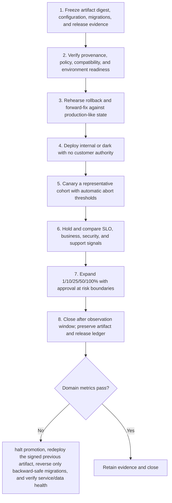

# Release: Workflow

> **Version:** 2.0 | **Updated:** 2026-07-16 | **Status:** Stable

## Purpose

Apply the domain workflow to promote a signed artifact through progressive exposure with objective abort criteria.

## Procedure

1. **Freeze artifact digest,.** Freeze artifact digest, configuration, migrations, and release evidence.
2. **Verify provenance, policy,.** Verify provenance, policy, compatibility, and environment readiness.
3. **Rehearse rollback and.** Rehearse rollback and forward-fix against production-like state.
4. **Deploy internal or.** Deploy internal or dark with no customer authority.
5. **Canary a representative.** Canary a representative cohort with automatic abort thresholds.
6. **Hold and compare.** Hold and compare SLO, business, security, and support signals.
7. **Expand 1/10/25/50/100% with.** Expand 1/10/25/50/100% with approval at risk boundaries.
8. **Close after observation.** Close after observation window; preserve artifact and release ledger.

## Verification

- artifact-to-runtime digest match = 100%
- deployment success > 99%
- rollback completes within RTO
- no accelerated SLO burn during holds

## Tradeoffs

Release workflow deliberately spends additional review time to protect "artifact-to-runtime digest match = 100%"; evidence weakness triggers "Halt promotion, redeploy the signed previous artifact, reverse only backward-safe migrations, and verify service/data health".

## Anti-patterns

Release workflow rejects shortcuts around "Freeze artifact digest, configuration, migrations, and release evidence." because they sever the evidence chain required for "artifact-to-runtime digest match = 100%".

## Enterprise considerations

Release workflow governance binds owner, policy revision, and retained proof to "artifact-to-runtime digest match = 100%", with "Halt promotion, redeploy the signed previous artifact, reverse only backward-safe migrations, and verify service/data health" as the recorded recovery authority.

## Checklist

- [ ] Freeze artifact digest, configuration, migrations, and release evidence
- [ ] Verify provenance, policy, compatibility, and environment readiness
- [ ] Rehearse rollback and forward-fix against production-like state
- [ ] Deploy internal or dark with no customer authority
- [ ] Canary a representative cohort with automatic abort thresholds
- [ ] Hold and compare SLO, business, security, and support signals
- [ ] Expand 1/10/25/50/100% with approval at risk boundaries
- [ ] Close after observation window; preserve artifact and release ledger

## Changelog

- 2026-07-16: Replaced generic scaffolding with domain-specific production guidance.
