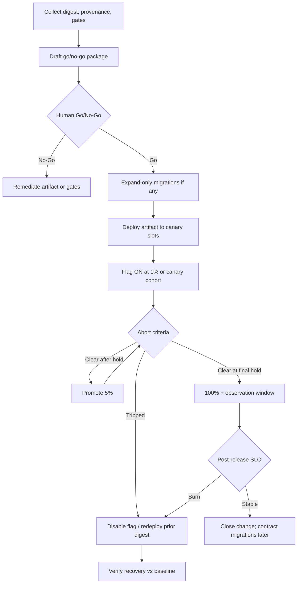

# Release Pattern — Workflow

> **Pattern:** Release  
> **Component:** workflow.md  
> **Version:** 1.1 | **Updated:** 2026-07-16

---

## End-to-end flow

## Step procedure

| Step | Actor | Action | Exit criteria |
|------|-------|--------|---------------|
| 1 | Artifact Verifier | Confirm digest + provenance + SBOM policy | Matches release record |
| 2 | Gate Aggregator | Attach test/security results for digest | All required gates green or exception filed |
| 3 | Release Agent | Emit sequence, canary, abort, rollback | Package complete |
| 4 | Human | Go / No-Go | Named decision |
| 5 | Ops | Expand-only migration | Migration reversible or safe to leave |
| 6 | Canary Controller | 1% → 5% → 25% → 100% with holds | Each hold met |
| 7 | On-call | Watch abort metrics | Auto or manual abort if tripped |
| 8 | Rollback Operator | On abort: flag off + prior digest | RTO met; health restored |
| 9 | Owner | Observation window; close change | Notes + digest recorded |

## Abort criteria (example shape — declare concrete numbers per service)

Abort if **any** true for the hold window:

- Error rate > baseline + absolute delta  
- p99 latency > SLO or > baseline + %  
- Saturation (CPU/mem/queue) soft limit breached  
- Business KPI probe fails (checkout success, auth success)  
- Security/page-worthy alert on the canary cohort  

Do **not** raise these numbers during an active canary without a new Go decision.

## Parallelism rule

One progressive release per blast-radius unit (service or flag). Parallel unrelated releases need separate abort dashboards so signals are not confounded.
